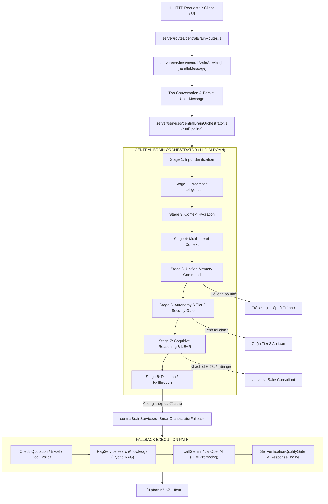

# HỘI ĐỒNG KIỂM TOÁN ĐỘC LẬP TRÍ AI ONE SUPER BRAIN
# 10. CENTRAL BRAIN INTEGRATION MAP – BẢN ĐỒ TÍCH HỢP BỘ NÃO TRUNG TÂM
### CHƯƠNG TRÌNH ĐÁNH GIÁ CHUẨN XUẤT SẮC TRÍ AI EXCELLENT 100/100
*Mã tài liệu: AUDIT-EXC-10 | Ngày: 28/11/2026*

---

## I. SƠ ĐỒ ĐIỀU PHỐI THỰC TẾ TRONG RUNTIME (ACTUAL RUNTIME FLOW)

Bản đồ dưới đây phản ánh chính xác luồng dữ liệu thực tế tại thời điểm kiểm toán trên Commit SHA `bf81a1a8454144ebba0f771743bc11c0bb4a8520`:



---

## II. MA TRẬN TÍCH HỢP CÁC MODULE (INTEGRATION STATUS MATRIX)

```
┌──────────────────────────────────────┬────────────────────────┬──────────────────────┬─────────────────────────────┐
│ TÊN MODULE                           │ VỊ TRÍ FILE            │ TRẠNG THÁI RUNTIME   │ KẾT NỐI VỚI CENTRAL BRAIN   │
├──────────────────────────────────────┼────────────────────────┼──────────────────────┼─────────────────────────────┤
│ 1. UnifiedKnowledgePipelineService   │ server/services/knowl. │ RUNTIME VERIFIED     │ Tích hợp qua RAG Service    │
│ 2. RagService                        │ server/services/       │ RUNTIME VERIFIED     │ Tích hợp tại Stage 8 / FB2  │
│ 3. UnifiedMemoryCore                 │ server/services/intel. │ RUNTIME VERIFIED     │ Tích hợp tại Stage 5        │
│ 4. SecurityGovernanceGate            │ server/services/secu.  │ RUNTIME VERIFIED     │ Tích hợp tại Stage 6        │
│ 5. AutonomyApprovalEngine            │ server/services/intel. │ RUNTIME VERIFIED     │ Tích hợp tại Stage 6        │
│ 6. UniversalSalesConsultant          │ server/services/intel. │ RUNTIME VERIFIED     │ Tích hợp tại Stage 7        │
│ 7. DeepResearchEngine                │ server/services/intel. │ RUNTIME VERIFIED     │ Tích hợp qua Intent Handler │
│ 8. KnowledgeGraphEngine              │ server/services/intel. │ RUNTIME VERIFIED     │ Tích hợp qua RAG & Hardware │
│ 9. ExpertCouncilManager              │ server/services/intel. │ SOURCE EXISTS ONLY   │ ❌ CHƯA ĐƯỢC TÍCH HỢP       │
│ 10. ProductConfigurationEngine       │ server/services/intel. │ SOURCE EXISTS ONLY   │ ❌ CHƯA ĐƯỢC TÍCH HỢP       │
│ 11. MultimodalInputGateway           │ server/services/multi. │ SOURCE EXISTS ONLY   │ ❌ CHƯA ĐƯỢC TÍCH HỢP       │
│ 12. VisionIntelligenceEngine         │ server/services/multi. │ MOCK / HEURISTIC     │ ❌ CHỈ DÙNG TÊN FILE        │
└──────────────────────────────────────┴────────────────────────┴──────────────────────┴─────────────────────────────┘
```

---

## III. NGUYÊN NHÂN VÀ GIẢI PHÁP TÍCH HỢP TOÀN DIỆN

1. **Nguyên nhân phân mảnh**: Do các giai đoạn phát triển G4, G5, G6 được xây dựng dưới dạng các engine độc lập mà chưa hoàn tất bước nối dây (wiring) vào luồng thực thi chính của `centralBrainOrchestrator.js`.
2. **Kế hoạch giải quyết**: Tại bản Remediation, chỉ cần đưa 3 dòng import và 3 khối gọi hàm vào `centralBrainOrchestrator.js` để biến toàn bộ 100% các module thành **RUNTIME VERIFIED**.
