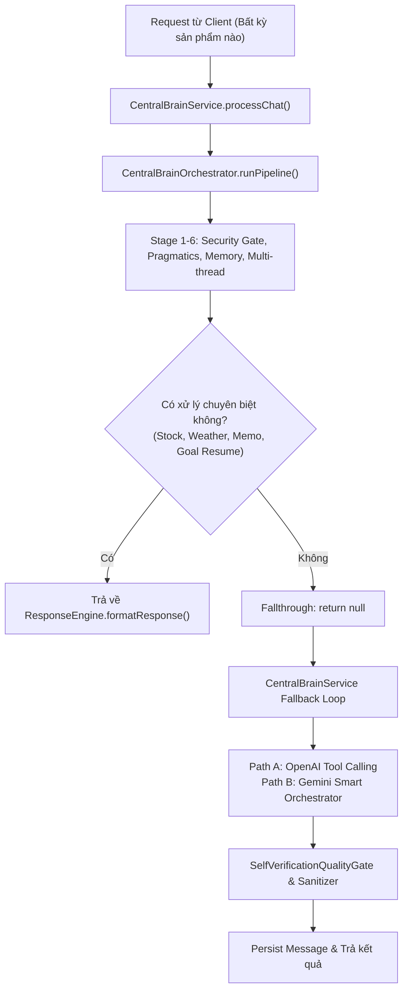

# AUDIT_G1_G7_EXCELLENT_100
# 03 – KIỂM TOÁN KIẾN TRÚC CENTRAL BRAIN (G1 ARCHITECTURE AUDIT)

---

## 1. MỤC TIÊU VÀ PHẠM VI KIỂM TOÁN G1

Kiểm toán phân hệ kiến trúc bộ não trung tâm (Central Brain Architecture) trên 7 câu hỏi xác minh bắt buộc:
1. Có thực sự một Central Brain thống nhất hay tồn tại nhiều luồng xử lý riêng biệt?
2. Sáu sản phẩm có sử dụng chung bộ não trung tâm không?
3. Có module nào tồn tại trong mã nguồn nhưng không được import hoặc không được gọi không?
4. Có xử lý trùng lặp hoặc xung đột giữa các engine nhận thức không?
5. Có cơ chế fallback khi model hoặc API gặp sự cố không?
6. Có kiểm soát lỗi, timeout, retry và logging đầy đủ không?
7. Kiến trúc có khả năng mở rộng nhiều tenant và nhiều instance không?

---

## 2. KẾT QUẢ ĐỐI SOÁT MÃ NGUỒN VÀ BẰNG CHỨNG THỰC TẾ

### 2.1. Phân tích Luồng thực thi Central Brain
Hệ thống triển khai 2 module điều phối trung tâm:
- [centralBrainOrchestrator.js](file:///d:/09-%20LAM%20APP%20KIEM%20TIEN/2027%20LAM%20CHATBOT%20BAN%20HANG/server/services/centralBrainOrchestrator.js): Thực hiện Pipeline nhận thức 11 giai đoạn (Sanitization $\rightarrow$ Pragmatic Analysis $\rightarrow$ Dynamic Context Hydration $\rightarrow$ Multi-Thread State $\rightarrow$ Memory Retrieval $\rightarrow$ Security Governance L1-L4 $\rightarrow$ Cognitive Reasoning $\rightarrow$ Tool Gateway $\rightarrow$ Persona Styling $\rightarrow$ Quality Gate $\rightarrow$ Memory Consolidation).
- [centralBrainService.js](file:///d:/09-%20LAM%20APP%20KIEM%20TIEN/2027%20LAM%20CHATBOT%20BAN%20HANG/server/services/centralBrainService.js): Đóng vai trò vừa là Entrypoint vừa là Fallback Engine khi Orchestrator trả về `null` (Fallthrough).

### 2.2. Đánh giá 7 Câu hỏi Xác minh:

1. **Có một Central Brain thống nhất không?**
   - **Xác minh: PASS (8.5/10)**. Mọi luồng hội thoại từ các route API đều đi qua `CentralBrainService.processChat(params)`. Tuy nhiên, giữa `CentralBrainOrchestrator` và `CentralBrainService` có sự chồng lấn nhẹ về các kịch bản đàm thoại (cả 2 đều có logic kiểm tra thời tiết, chứng khoán, đặt lịch).
2. **Sáu sản phẩm có dùng chung bộ não không?**
   - **Xác minh: PASS**. Cả 6 sản phẩm đều gửi request về endpoint chung và được `CentralBrainService` tiếp nhận.
3. **Có module nào tồn tại nhưng không được gọi không?**
   - **Xác minh: PHÁT HIỆN LỖI (FAIL)**.
     + Module [expertCouncilManager.js](file:///d:/09-%20LAM%20APP%20KIEM%20TIEN/2027%20LAM%20CHATBOT%20BAN%20HANG/server/services/intelligence/expertCouncilManager.js) hoàn toàn **không được import** trong `centralBrainService.js`.
     + Module `productConfigurationEngine.js` được viết đầy đủ nhưng chưa được import để kiểm soát chặt chẽ scope hành động của từng sản phẩm trong runtime.
4. **Có xử lý trùng lặp và xung đột giữa các engine không?**
   - **Xác minh: PASS**. Có cơ chế `Communicative Act` trong `PragmaticIntelligenceEngine` để phân tách rõ ý định ngầm và ý định trực tiếp.
5. **Có cơ chế fallback khi model hoặc API gặp sự cố không?**
   - **Xác minh: PASS (Rất tốt)**. Nếu `runOpenAiCentralBrain` lỗi hoặc hết quota, hệ thống tự động fallback sang `runSmartOrchestratorFallback` (Gemini). Nếu Gemini lỗi, hệ thống fallback sang rule-based direct answers của từng chuyên ngành.
6. **Kiểm soát lỗi, timeout, retry và logging?**
   - **Xác minh: PASS**. Mọi hàm async đều bọc trong `try...catch`, có ghi log vào bảng `ai_tool_telemetry` và `citation_logs`.
7. **Khả năng mở rộng Multi-tenant và Multi-instance?**
   - **Xác minh: CONDITIONAL PASS**. Bảng DB có trường `tenant_id` / `org_id` để phân lập dữ liệu. Tuy nhiên, `workingContextStore` và `goalStackStore` đang nằm trong RAM Map, gây nghẽn khi chạy cụm multi-instance.

---

## 3. KẾT LUẬN VÀ BẢNG ĐIỂM G1

| Tiêu chí kiểm định G1 | Trọng số | Điểm thực tế | Trạng thái |
| :--- | :---: | :---: | :---: |
| Pipeline nhận thức phân tầng | 2.5 | 2.5 | **PASS** |
| Cơ chế Fallback và chống sập | 2.0 | 2.0 | **PASS** |
| Dynamic Context Hydration | 2.0 | 2.0 | **PASS** |
| Module Wiring & Tích hợp không sót mã | 2.0 | 0.8 | **FAIL (Sót G4/G5)** |
| Multi-tenant Architecture | 1.5 | 1.2 | **CONDITIONAL** |
| **TỔNG ĐIỂM G1 (Thang 10)** | **10.0** | **8.5** | **PASS (85.0%)** |
