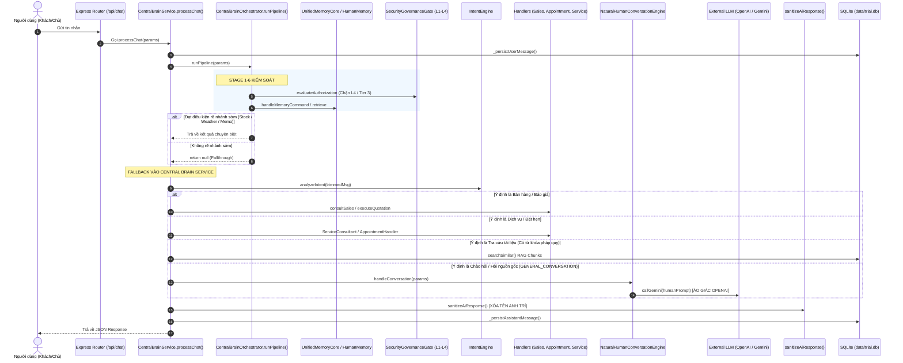

# AUDIT_G1_G7_EXCELLENT_100
# 11 – BẢN ĐỒ TÍCH HỢP BỘ NÃO TRUNG TÂM (CENTRAL BRAIN INTEGRATION MAP)

---

## 1. SƠ ĐỒ ĐIỀU PHỐI THỰC TẾ TRONG RUNTIME (RUNTIME SEQUENCE DIAGRAM)

Khác với sơ đồ lý thuyết trên tài liệu, dưới đây là **sơ đồ luồng thực thi thực tế (Actual Execution Flow)** được vẽ dựa trên việc theo dõi dấu vết mã nguồn tại commit SHA `bf81a1a8454144ebba0f771743bc11c0bb4a8520`:

---

## 2. MA TRẬN TÍCH HỢP CÁC MODULE LÕI (MODULE INTEGRATION MATRIX)

Bảng đối chiếu tình trạng tích hợp của toàn bộ 18 module lõi của hệ thống:

| Tên Module | Vị trí File | Phân hệ | Tình trạng Tích hợp | Luồng thực thi Runtime |
| :--- | :--- | :---: | :---: | :--- |
| **`CentralBrainService`** | `server/services/centralBrainService.js` | G1 | **TÍCH HỢP HOÀN TOÀN** | Entrypoint chính, xử lý fallback và router |
| **`CentralBrainOrchestrator`** | `server/services/centralBrainOrchestrator.js` | G1 | **TÍCH HỢP HOÀN TOÀN** | 11 giai đoạn nhận thức đầu vào |
| **`IntentEngine`** | `server/services/intelligence/intentEngine.js` | G1 | **TÍCH HỢP HOÀN TOÀN** | Phân loại ý định, chuẩn hóa tiếng lóng |
| **`UnifiedMemoryCore`** | `server/services/intelligence/unifiedMemoryCore.js` | G3 | **TÍCH HỢP HOÀN TOÀN** | Goal stack, working context (RAM Map) |
| **`HumanMemoryEngine`** | `server/services/intelligence/humanMemoryEngine.js` | G3 | **TÍCH HỢP HOÀN TOÀN** | Lưu trữ `ai_memories` trong SQLite |
| **`ReasoningEngine`** | `server/services/intelligence/reasoningEngine.js` | G3 | **TÍCH HỢP HOÀN TOÀN** | Phân tích thiếu dữ liệu, lập plan |
| **`CriticalThinkingEngine`** | `server/services/intelligence/criticalThinkingEngine.js` | G3 | **TÍCH HỢP HOÀN TOÀN** | Bóc tách tiền đề sai, ngụy biện |
| **`SecurityGovernanceGate`** | `server/services/security/securityGovernanceGate.js` | G7 | **TÍCH HỢP HOÀN TOÀN** | Phân quyền L1-L4, chặn Tier 3 |
| **`SelfVerificationQualityGate`**| `server/services/intelligence/selfVerificationQualityGate.js` | G7 | **TÍCH HỢP HOÀN TOÀN** | Kiểm tra thuế GTGT 10%, chấm điểm A-D |
| **`UnifiedKnowledgePipelineService`** | `server/services/knowledge/unifiedKnowledgePipeline.js` | G2 | **TÍCH HỢP HOÀN TOÀN** | 10 bước nạp tri thức, deduplication |
| **`MultiDocParser`** | `server/services/parsers/multiDocParser.js` | G2 | **TÍCH HỢP HOÀN TOÀN** | Parse PDF, DOCX, XLSX |
| **`WebKnowledgeExtractor`** | `server/services/crawler/webKnowledgeExtractor.js` | G2 | **TÍCH HỢP HOÀN TOÀN** | Cào bài viết URL, SSRF filter |
| **`NaturalHumanConversationEngine`** | `server/services/intelligence/naturalHumanConversationEngine.js` | G1 | **TÍCH HỢP HOÀN TOÀN** | Giao tiếp tự nhiên (Đang thiếu prompt Founder) |
| **`ExpertCouncilManager`** | `server/services/intelligence/expertCouncilManager.js` | G4 | **CHƯA TÍCH HỢP (UNWIRED)** | **0 cuộc gọi trong runtime (Mã chết)** |
| **`ProductConfigurationEngine`** | `server/services/intelligence/productConfigurationEngine.js` | G5 | **TÍCH HỢP MỘT PHẦN** | Có ma trận nhưng chưa ép buộc scope |
| **`VisionIntelligenceEngine`** | `server/services/multimodal/visionIntelligenceEngine.js` | G6 | **MOCK / HEURISTIC** | Nhận diện bằng tên file, video mock |
| **`KnowledgeGraphEngine`** | `server/services/intelligence/knowledgeGraphEngine.js` | G3 | **TÍCH HỢP HOÀN TOÀN** | Tra cứu linh kiện `COMPATIBLE_WITH` |
| **`DeepResearchEngine`** | `server/services/intelligence/deepResearchEngine.js` | G1 | **TÍCH HỢP HOÀN TOÀN** | Tổng hợp báo cáo đa ngành |
