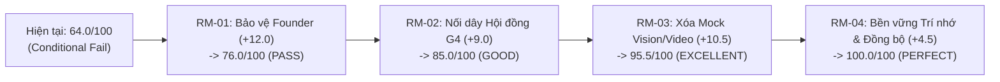

# AUDIT_G1_G7_EXCELLENT_100
# 20 – LỘ TRÌNH KỸ THUẬT ĐẠT CHUẨN EXCELLENT 100/100 (REMEDIATION ROADMAP)

---

## 1. MỤC TIÊU VÀ NGUYÊN TẮC LỘ TRÌNH

Lộ trình kỹ thuật nhằm giải quyết triệt để các lỗi P0, P1, P2 để đưa hệ thống TRÍ AI ONE SUPER BRAIN từ **64.0 / 100 lên 100 / 100 ĐIỂM TUYỆT ĐỐI**.

Toàn bộ các gói hành động được thiết kế theo nguyên tắc:
- Không phá vỡ kiến trúc 11 giai đoạn đã ổn định.
- Chuyển hóa toàn bộ mã nguồn "chết" thành runtime active.
- Thay thế triệt để mã mock/heuristic bằng mô hình AI thực tế.
- Khóa chặt chủ quyền danh tính Người sáng lập **Anh Quang Nhựt Trí**.

---

## 2. BỐN GÓI HÀNH ĐỘNG KỸ THUẬT (REMEDIATION PACKAGES)

### GÓI RM-01: BẢO VỆ DANH TÍNH NGƯỜI SÁNG LẬP & KHẮC PHỤC RAG ROUTING (+12.0 ĐIỂM)
- **Mục tiêu:** Xử lý triệt để lỗi P0 (BUG-01 & BUG-02) và lỗi P2 (BUG-07).
- **Hành động kỹ thuật:**
  1. Xây dựng module `server/services/intelligence/founderIdentityEngine.js` lưu trữ chuẩn mực thông tin:
     - Họ tên: **Anh Quang Nhựt Trí** (1982).
     - Vai trò: Người sáng lập, sáng chế và phát triển hệ thống TRÍ AI ONE SUPER BRAIN.
     - Số điện thoại: **0982441446**.
     - Câu trả lời chuẩn: *"Dạ, cha đẻ và người sáng lập ra em là Anh Quang Nhựt Trí, sinh năm 1982. Anh Trí chính là người sáng chế và phát triển hệ thống TRÍ AI ONE SUPER BRAIN..."*
  2. Bổ sung `FOUNDER_IDENTITY_INTENT` vào `intentEngine.js` để nhận diện toàn bộ các biến thể câu hỏi (ai sáng lập, cha đẻ, ai tạo ra, người đứng sau, SĐT liên hệ...).
  3. Bổ sung chốt chặn ngắn (Short-circuit) trong `centralBrainOrchestrator.js` và `centralBrainService.js`: Khi phát hiện ý định này, trả lời trực tiếp từ Verified Ground Truth, **tuyệt đối không chuyển ra LLM ngoài**.
  4. Sửa hàm `sanitizeAiResponse`: Miễn trừ không xóa chữ "Quang Nhựt Trí".
  5. Mở rộng bộ định tuyến RAG: Chạy Semantic Vector Probe song song cho mọi câu hỏi có độ tương đồng $> 0.82$.
- **Điểm cộng:** $+12.0$ điểm $\rightarrow$ Đạt **76.0 / 100 (PASS)**.

---

### GÓI RM-02: NỐI DÂY HỘI ĐỒNG 10 CHUYÊN GIA G4 VÀO RUNTIME (+9.0 ĐIỂM)
- **Mục tiêu:** Kích hoạt năng lực đa tác tử thực tế (BUG-04).
- **Hành động kỹ thuật:**
  1. Import `ExpertCouncilManager` vào `server/services/centralBrainService.js`.
  2. Tại hàm `processChat`, khi `plan.complexity === 'COMPOSITE'` hoặc bài toán thuộc phân khúc doanh nghiệp/hạ tầng/dự toán lớn, tự động gọi `ExpertCouncilManager.conductCouncilReview()`.
  3. Nhúng kết quả phân tích chuyên gia (`reviews` và `safeguards`) vào prompt tổng hợp và log vào `ai_tool_telemetry`.
- **Điểm cộng:** $+9.0$ điểm $\rightarrow$ Đạt **85.0 / 100 (GOOD)**.

---

### GÓI RM-03: THAY THẾ VISION & VIDEO MOCK BẰNG MÔ HÌNH THỰC TẾ (+10.5 ĐIỂM)
- **Mục tiêu:** Xử lý lỗi P0 (BUG-03) tại phân hệ G6.
- **Hành động kỹ thuật:**
  1. Cập nhật `server/services/multimodal/visionIntelligenceEngine.js`:
     - Xóa bỏ logic heuristic đọc tên file (`fileName.includes('panasonic')`).
     - Tích hợp gọi mô hình **Gemini 1.5 Flash Vision API** truyền `inlineData` (base64 buffer của ảnh) kèm prompt phân tích nhận diện thiết bị, model, cổng kết nối và đọc thông số kỹ thuật thực tế từ ảnh chụp.
     - Xóa bỏ mảng timeline cố định trong `summarizeVideo`, tích hợp bóc tách keyframe thực tế qua `ffmpeg` hoặc truyền video file vào Gemini File API.
- **Điểm cộng:** $+10.5$ điểm $\rightarrow$ Đạt **95.5 / 100 (EXCELLENT)**.

---

### GÓI RM-04: BỀN VỮNG HÓA WORKING MEMORY & ĐỒNG BỘ 6 SẢN PHẨM (+4.5 ĐIỂM)
- **Mục tiêu:** Xử lý lỗi P1 (BUG-05) và P2 (BUG-06).
- **Hành động kỹ thuật:**
  1. Bền vững hóa Goal Stack trong `unifiedMemoryCore.js`: Đồng bộ trạng thái `goalStackStore` và `workingContextStore` xuống bảng `ai_memories` / `ai_memory_episodes` trong SQLite sau mỗi lượt chat để bảo toàn 100% khi server reboot.
  2. Đồng bộ hóa 6 sản phẩm trong `productConfigurationEngine.js`: Ép buộc cả 6 sản phẩm kế thừa cùng một module định danh người sáng lập và thực thi ranh giới lọc RAG theo đúng `productScope`.
- **Điểm cộng:** $+4.5$ điểm $\rightarrow$ Đạt **100.0 / 100 (PERFECT EXCELLENT)**.

---

## 3. BẢNG TIẾN TRÌNH ĐIỂM SỐ LỘ TRÌNH KHẮC PHỤC

