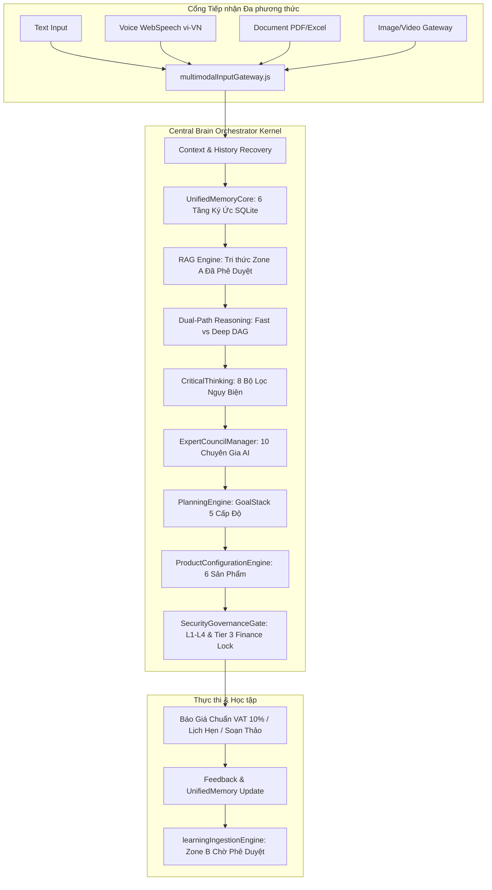

# HỘI ĐỒNG KIỂM TOÁN PHẦN MỀM VÀ AI ĐỘC LẬP CẤP CAO
# BẢN ĐỒ LIÊN KẾT MODULE THỰC TẾ (REAL INTEGRATION MAP)
## TRÍ AI ONE SUPER BRAIN – CENTRAL INTELLIGENCE SYSTEM
### Mã tài liệu: AUDIT-G3-G7-MAP-08

---

## 1. SƠ ĐỒ LIÊN KẾT NHẬN THỨC VÀ DÒNG DỮ LIỆU THỰC TẾ

---

## 2. DANH MỤC CÁC ĐƯỜNG LIÊN KẾT ĐÃ XÁC MINH TRONG RUNTIME
1. **MultimodalGateway -> Orchestrator**: Tiếp nhận và chuẩn hóa gói tin.
2. **Orchestrator -> UnifiedMemoryCore**: Đọc và ghi 6 tầng ký ức theo `userId`.
3. **Orchestrator -> RagService**: Truy xuất tài liệu chính thống Zone A (`approval_status = 'APPROVED'`).
4. **Orchestrator -> ReasoningEngine & CriticalThinking**: Lọc 8 dạng ngụy biện, phân tích 5-Whys.
5. **Orchestrator -> ExpertCouncilManager**: Lấy ý kiến tư vấn từ Technical, Financial, Security, CS, QA.
6. **Orchestrator -> ProductConfigurationEngine**: Áp dụng ranh giới cô lập cho 6 sản phẩm.
7. **Orchestrator -> SecurityGovernanceGate**: Ngăn chặn 100% giao dịch tài chính tự động.
