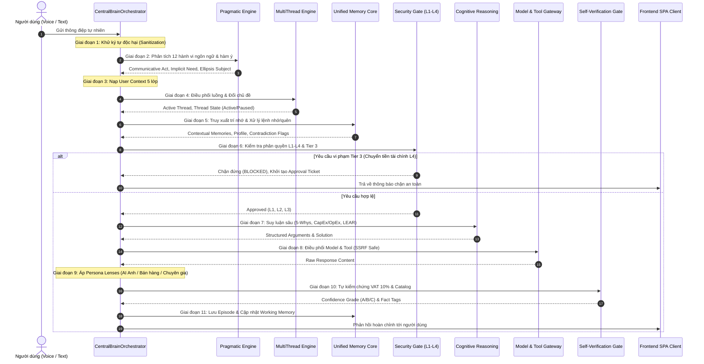
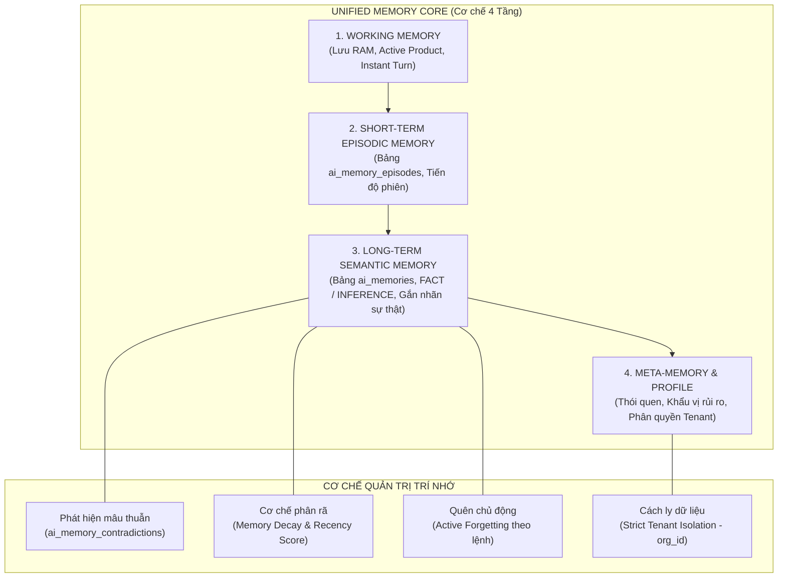

# 04. BẢN VẼ KIẾN TRÚC HỆ THỐNG TOÀN DIỆN (SYSTEM ARCHITECTURE)
## KIẾN TRÚC TRÍ TUỆ NHÂN TẠO TRUNG TÂM – ONE SUPER BRAIN
**Mã kiến trúc:** ARC-TRIAI-2026-CORE  

---

### 1. TỔNG QUAN KIẾN TRÚC ĐA TẦNG (MULTI-TIER ARCHITECTURE)

Hệ thống được thiết kế theo mô hình 5 tầng nhận thức phân lập, bảo đảm tính nhất quán và khả năng mở rộng cao:

```mermaid
flowchart TD
    subgraph ClientTier["TẦNG TRẢI NGHIỆM NGƯỜI DÙNG (CLIENT TIER)"]
        UI1["Web Chat Client (React 18 + Tailwind)"]
        UI2["Voice / Audio Interface (Web Speech API)"]
        UI3["Admin & Knowledge Dashboard (AdminPanel.jsx)"]
    end

    subgraph GatewayTier["TẦNG CỔNG KẾT NỐI & BẢO MẬT (GATEWAY TIER)"]
        API["Express 5 REST & WebSocket Server (server/index.js)"]
        CORS["Hardened CORS Whitelist & Anti-tamper Headers"]
        AUTH["Auth Service (PBKDF2 Salt + JWT Token)"]
        SEC_GATE["Security Governance Gate (L1-L4 & Tier 3 Payment Block)"]
    end

    subgraph CognitiveTier["TẦNG BỘ NÃO TRUNG TÂM (CENTRAL COGNITIVE TIER)"]
        ORCH["CentralBrainOrchestrator (11-Stage Unified Pipeline)"]
        PRAG["Pragmatic Intelligence Engine (12 Communicative Acts)"]
        MTHREAD["Multi-Thread Conversation Engine (Thread Stack)"]
        REASON["Cognitive Reasoning Engine (5-Whys, CapEx/OpEx TCO)"]
        CRIT["Critical Thinking & Bias Fallacy Guard"]
        GATEWAY_M["Model Gateway (Pro / Flash / Local Fallback)"]
        GATEWAY_T["Tool Gateway (Sandboxed, Anti-SSRF, 5s Timeout)"]
        VERIFY["Self-Verification Quality Gate (VAT 10%, Catalog Match)"]
        PERSONA["Persona Layer (AI Anh, Bán hàng, Thư ký, Gia sư, Chuyên gia)"]
    end

    subgraph DomainTier["TẦNG NĂNG LỰC NGHIỆP VỤ (DOMAIN CAPABILITIES)"]
        SALES["Sales Intelligence & LEAR Objection Handling"]
        SECRETARY["Private Secretary & Smart Reminders"]
        SURVEY["Service Survey & Technical Intake (Bảo trì/Lắp đặt)"]
        FINANCE["Finance & Stock Market Principles Advisor"]
        RESEARCH["Deep Knowledge Research & TCVN Standards"]
    end

    subgraph MemoryTier["TẦNG LƯU TRỮ VÀ TRÍ NHỚ (UNIFIED MEMORY & STORAGE)"]
        WM["Working Memory (In-Memory Session Context)"]
        STM["Short-Term Episodic Memory (ai_memory_episodes)"]
        LTM["Long-Term Semantic Memory (ai_memories - FACT/INFERENCE)"]
        META["Meta-Memory (User Persona & Preferences)"]
        KG["Knowledge Graph (ai_knowledge_entities & relations)"]
        SQLITE["Unified SQLite Database (triai.db - 88 Tables, WAL Mode)"]
    end

    ClientTier --> GatewayTier
    GatewayTier --> CognitiveTier
    CognitiveTier --> DomainTier
    CognitiveTier --> MemoryTier
    DomainTier --> MemoryTier
```

---

### 2. SƠ ĐỒ PIPELINE NHẬN THỨC 11 BƯỚC (11-STAGE COGNITIVE PIPELINE)

Toàn bộ thông điệp của người dùng bắt buộc phải đi qua chuỗi xử lý nhận thức 11 giai đoạn nghiêm ngặt, loại bỏ hoàn toàn khả năng phản hồi sai lệch hoặc vi phạm chính sách:

---

### 3. KIẾN TRÚC BỘ NHỚ 4 TẦNG THỐNG NHẤT (UNIFIED MEMORY CORE)

---

### 4. BẢNG THÔNG SỐ KIẾN TRÚC KỸ THUẬT (SPECIFICATIONS)
- **Kiểu ứng dụng:** Monolithic Modular Service kết hợp Decoupled Frontend SPA.
- **Môi trường thực thi Backend:** Node.js v20.x ESM (V8 JavaScript Engine).
- **Web Framework:** Express 5.2.1.
- **Frontend SPA:** React 18.3.1, Vite 5.4.21, TailwindCSS 3.4.3.
- **Hệ thống cơ sở dữ liệu:** SQLite 3.45 (WAL Mode, Foreign Keys ON, FTS5 Full-Text Search).
- **Hệ cơ chế bảo mật mật khẩu:** PBKDF2 (100.000 iterations, 64-byte key length, Cryptographic Salt ngẫu nhiên).
- **Chữ ký kiểm toán an ninh:** HMAC SHA-256 cho toàn bộ nhật ký phê duyệt L4.
- **Giao thức mạng:** HTTP/1.1 REST, JSON, hỗ trợ chuẩn bị WebSocket Event Streams.
