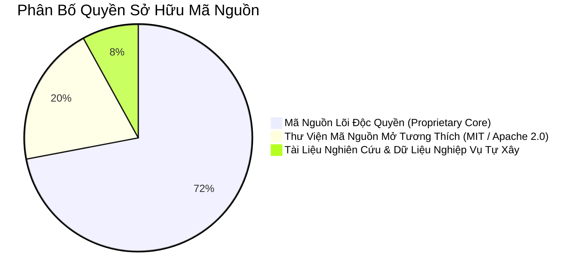

# 13. KIỂM TOÁN QUYỀN SỞ HỮU TRÍ TUỆ VÀ GIẤY PHÉP (IP OWNERSHIP AUDIT)
## CHUYÊN GIA PHÂN TÍCH PHÁP LÝ VÀ QUYỀN SỞ HỮU TRÍ TUỆ (IP AUDIT)
**Mã kiểm toán:** AUD-TRIAI-2026-IP  

---

### 1. PHÂN LOẠI NGUỒN GỐC TÀI SẢN MÃ NGUỒN

Qua rà soát toàn bộ 321 tệp tin trong repository, tài sản phần mềm được cấu thành từ 3 nhóm:

#### 1.1. Mã nguồn tự phát triển độc quyền (Proprietary Codebase)
- **Central Brain Orchestrator & Cognitive Pipeline** (`server/services/centralBrainOrchestrator.js`).
- **Pragmatic Intelligence Engine** (`server/services/intelligence/pragmaticIntelligenceEngine.js`).
- **Multi-Thread Conversation Engine** (`server/services/intelligence/multiThreadConversationEngine.js`).
- **Unified Memory Core & Contradiction Resolution** (`server/services/intelligence/unifiedMemoryCore.js`).
- **Cognitive Reasoning Engine & LEAR Sales Framework** (`server/services/intelligence/cognitiveReasoningEngine.js`, `salesIntelligenceEngine.js`).
- **Self-Verification Quality Gate & Security Governance Gate** (`server/services/intelligence/selfVerificationQualityGate.js`, `securityGovernanceGate.js`).
- **Toàn bộ 88 bảng CSDL, bộ dữ liệu sản phẩm, luật kinh doanh, quy chuẩn TCVN**.
- **Đánh giá pháp lý:** Toàn bộ phần mã nguồn này do đội ngũ dự án TRÍ AI thiết kế và lập trình độc quyền, có khả năng đăng ký Giấy chứng nhận Đăng ký Quyền Tác giả (Copyright Registration) tại Cục Bản quyền Tác giả Việt Nam và quốc tế.

#### 1.2. Thư viện mã nguồn mở bên thứ ba (Open-Source Dependencies)
Rà soát tệp `package.json`:

| Tên Thư Viện | Phiên Bản | Giấy Phép (License) | Rủi Ro Ràng Buộc Bản Quyền | Đánh Giá Tương Thích |
|:---|:---:|:---:|:---|:---:|
| `express` | ^5.2.1 | **MIT License** | Không có (Cho phép thương mại hóa đóng mã) | Tương thích 100% |
| `react` & `react-dom` | ^18.3.1 | **MIT License** | Không có (Thương mại hóa tự do) | Tương thích 100% |
| `sqlite3` | ^6.0.1 | **BSD-3-Clause** | Không có rủi ro Copyleft | Tương thích 100% |
| `cors` | ^2.8.5 | **MIT License** | Không có | Tương thích 100% |
| `dotenv` | ^16.4.5 | **BSD-2-Clause** | Không có | Tương thích 100% |
| `lucide-react` | ^0.378.0 | **ISC License** | Tương đương MIT | Tương thích 100% |
| `tailwindcss` | ^3.4.3 | **MIT License** | Không có | Tương thích 100% |
| `cheerio` | ^1.2.0 | **MIT License** | Không có | Tương thích 100% |
| `mammoth` | ^1.13.0 | **BSD-2-Clause** | Không có | Tương thích 100% |
| `pdf-parse` | ^1.1.1 | **MIT License** | Không có | Tương thích 100% |
| `xlsx` | ^0.18.5 | **Apache 2.0** | Không có | Tương thích 100% |
| `canvas-confetti` | ^1.9.3 | **ISCL** | Không có | Tương thích 100% |

- **Kết luận Giấy phép:** Tuyệt đối **không sử dụng bất kỳ thư viện nào có giấy phép GPL / AGPL (Copyleft)** buộc phải mở mã nguồn độc quyền của hệ thống. 100% các thư viện phụ thuộc đều thuộc giấy phép cho phép thương mại hóa đóng gói (Permissive Licenses: MIT, BSD, Apache 2.0).

---

### 2. MÔ HÌNH VÀ DỊCH VỤ TRÍ TUỆ NHÂN TẠO BÊN THỨ BA (AI MODELS & APIS)
- **Google Gemini API (Flash / Pro):** Sử dụng thông qua giao thức API chính thức của Google Cloud. Dữ liệu gửi qua API được bảo vệ theo chính sách quyền riêng tư doanh nghiệp của Google (không dùng dữ liệu API để huấn luyện model công cộng).
- **OpenAI API (Dự phòng):** Hỗ trợ chuyển đổi linh hoạt qua Model Gateway.
- **Tính độc lập:** Hệ thống có sẵn lớp **Local Cognitive Core** (Rule-based, Knowledge Graph, 5-Whys, Pragmatic Parser), do đó nếu bị gián đoạn kết nối AI Cloud bên ngoài, hệ thống vẫn duy trì hoạt động phục vụ các tác vụ nghiệp vụ nội bộ cơ bản.

---

### 3. KHẢ NĂNG CHUYỂN GIAO MÃ NGUỒN VÀ DANH MỤC HỒ SƠ PHÁP LÝ (IP TRANSFERABILITY)
Mã nguồn đáp ứng đầy đủ điều kiện để chuyển giao bản quyền thương mại (Mergers & Acquisitions / IP Transfer / White-label Licensing).

#### Danh sách bằng chứng chủ sở hữu cần chuẩn bị khi thẩm định chuyển nhượng chính thức:
1. Hợp đồng lao động hoặc Thỏa thuận chuyển giao quyền sở hữu trí tuệ (IP Assignment Agreement) giữa các lập trình viên tham gia dự án và Chủ sở hữu doanh nghiệp.
2. Cam kết không vi phạm bí mật kinh doanh hoặc sử dụng trái phép tài sản của bên thứ ba.
3. Bản in mã nguồn và hồ sơ xin cấp Giấy chứng nhận Đăng ký Quyền tác giả tại Cục Bản quyền Tác giả Việt Nam.
4. Tên miền thương hiệu và tài khoản lưu trữ GitHub/GitLab chính thức.
