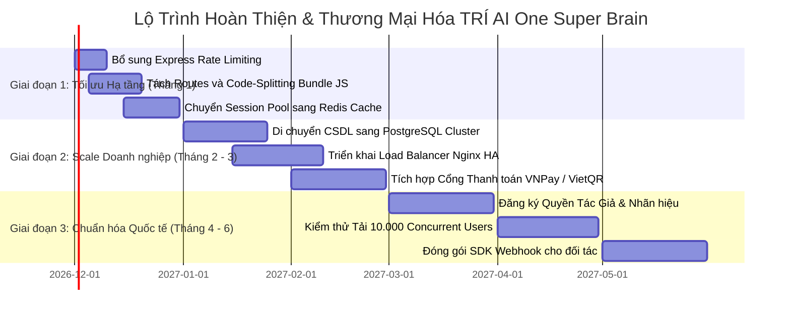

# 19. LỘ TRÌNH HOÀN THIỆN VÀ NÂNG CẤP THƯƠNG MẠI (REMEDIATION ROADMAP)
## BAN CỐ VẤN CÔNG NGHỆ VÀ CHIẾN LƯỢC KỸ THUẬT
**Mã kế hoạch:** PLN-TRIAI-2026-REM  
**Mục tiêu:** Tối ưu hóa toàn diện, nâng cấp khả năng chịu tải hàng loạt và sẵn sàng thương mại hóa quy mô lớn  

---

### 1. KẾ HOẠCH HÀNH ĐỘNG 3 GIAI ĐOẠN (3-PHASE UPGRADE ROADMAP)

---

### 2. CHI TIẾT CÁC ĐẦU VIỆC KỸ THUẬT VÀ DỰ TOÁN CHI PHÍ ĐẦU TƯ

#### Giai đoạn 1: Gia cố bảo mật và tối ưu giao diện (Tháng 1 - Ngân sách: ~75 triệu VNĐ)
1. **Bổ sung `express-rate-limit`**: Giới hạn tối đa 60 requests/phút trên mỗi địa chỉ IP để chống brute-force và DDoS mức ứng dụng.
2. **Tối ưu hóa Bundle JavaScript**: Cấu hình `manualChunks` trong `vite.config.js` để chia nhỏ tệp JS frontend dưới 300 KB, tăng tốc độ tải trang ban đầu (First Contentful Paint < 1.2s).
3. **Bộ nhớ phiên Redis (Redis Session Store)**: Thay thế `Map` trên RAM của `MultiThreadConversationEngine` bằng Redis để hỗ trợ chạy multi-process Node.js qua PM2 Cluster.

#### Giai đoạn 2: Nâng cấp kiến trúc dữ liệu và thanh toán tự động (Tháng 2 – 3 - Ngân sách: ~180 triệu VNĐ)
1. **Chuyển đổi CSDL sang PostgreSQL**: Tận dụng tệp `prisma/schema.prisma` đã chuẩn bị sẵn để chuyển đổi cơ sở dữ liệu từ SQLite sang PostgreSQL trên Cloud (AWS RDS hoặc DigitalOcean Managed DB).
2. **Cụm máy chủ HA (High Availability)**: Thiết lập kiến trúc 2 VPS chạy Node.js phía sau bộ cân bằng tải Nginx Load Balancer kèm chứng chỉ SSL Let's Encrypt tự động gia hạn.
3. **Cổng thanh toán tự động**: Tích hợp luồng tạo mã VietQR động có chứa mã hóa đơn và số tiền, tự động cập nhật trạng thái đơn hàng khi khách chuyển khoản qua Webhook ngân hàng.

#### Giai đoạn 3: Đăng ký bản quyền và thương mại hóa B2B (Tháng 4 – 6 - Ngân sách: ~145 triệu VNĐ)
1. **Pháp lý và Sở hữu Trí tuệ**: Nộp hồ sơ xin cấp Giấy chứng nhận Đăng ký Quyền Tác giả cho bộ mã nguồn `TRÍ AI BRAIN CORE` tại Cục Bản quyền Tác giả.
2. **Kiểm thử tải cực hạn (Stress Test)**: Sử dụng công cụ `k6` hoặc `Locust` để mô phỏng 10.000 người dùng đồng thời, xác định điểm nghẽn và tinh chỉnh kết nối pool.
3. **Đóng gói REST API / Webhook SDK**: Cung cấp tài liệu Swagger/OpenAPI 3.0 chuẩn mực để các đối tác có thể dễ dàng tích hợp TRÍ AI vào hệ thống CRM/ERP của họ.

---

### 3. TỔNG KẾT NGÂN SÁCH ĐẦU TƯ BỔ SUNG ĐỂ ĐẠT CHUẨN THƯƠNG MẠI HÓA TOÀN DIỆN
$$\text{Tổng Vốn Đầu Tư Khuyến Nghị (Total Remediation Budget)} = \mathbf{400.000.000 \text{ VNĐ}} \quad (\sim \mathbf{\$16.000 \text{ USD}})$$
- **Thời gian hoàn thành:** **3 – 4 tháng**.
- **Hiệu quả mang lại:** Đưa hệ thống từ trạng thái Sản phẩm Hoàn thiện Nội bộ (Ready Prototype/Internal Production) lên trạng thái Nền tảng SaaS Cấp Doanh nghiệp (Enterprise-Grade Multi-Tenant SaaS) có thể phục vụ hàng vạn doanh nghiệp đồng thời.
