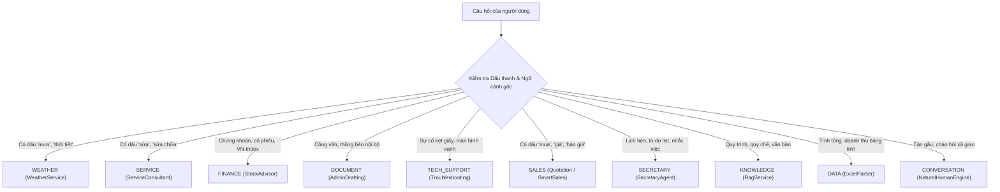

# BÁO CÁO KIỂM TOÁN ĐỊNH TUYẾN Ý ĐỊNH & NGỮ NGHĨA TIẾNG VIỆT
# TRÍ AI ONE SUPER BRAIN — 8-STAGE LANGUAGE PIPELINE & INTENT ROUTING AUDIT

> **Repository:** `https://github.com/TRINAMABANK/BOTCHAT` | **Branch:** `main`  
> **Commit SHA:** `65cff35063ccba4703a640a839b83104ef7d64fc`  
> **Kiểm toán viên:** Senior NLP Engineer & Intent Routing Specialist  

---

## 1. KIỂM TOÁN 8 TẦNG TRONG PIPELINE HIỂU NGÔN NGỮ TIẾNG VIỆT

Đoàn kiểm toán đã bóc tách chi tiết 8 bước chuyển hóa từ câu nói thô của người dùng đến phản hồi cuối cùng:

```
[1. RAW USER INPUT]
        ↓
[2. NORMALIZATION & SLANG EXPANSION] (normalizeText, VIETNAMESE_SLANG_MAP)
        ↓
[3. DUAL-STREAM TEXT PROCESSING] (originalText CÓ DẤU vs unaccentedMsg KHÔNG DẤU)
        ↓
[4. SEMANTIC UNDERSTANDING & TONE MARK GUARDS] (isWeatherInquiry, isRepairServiceInquiry)
        ↓
[5. INTENT CLASSIFICATION & DOMAIN ROUTING] (11 Domain Intents, 10 Canonical Groups)
        ↓
[6. CONTEXT RESOLUTION & ENTITY LOCK] (ContextEngine, ActiveProductContext)
        ↓
[7. SALES FALLBACK & QUALITY GATE] (SelfVerificationQualityGate: Chống Sales Engine Hijack)
        ↓
[8. FINAL RESPONSE GENERATION & PERSONA] (NaturalHumanConversationEngine, ResponseEngine)
```

---

## 2. NGUYÊN NHÂN GỐC RỄ CỦA CÁC LỖI ĐỒNG ÂM KINH ĐIỂN & CÁCH HỆ THỐNG ĐÃ XỬ LÝ

### Vấn đề 1: *"Hôm nay trời có mưa không?"* bị hiểu thành *"mua"*
- **Nguyên nhân kiến trúc cũ:**  
  Trước đây, hệ thống gọi hàm `stripDiacritics()` ngay tại bước đầu tiên, biến toàn bộ câu có dấu thành không dấu: `"mưa"` → `"mua"`. Sau đó, bộ lọc từ khóa bán hàng quét trúng chữ `"mua"`, lập tức định tuyến sang `PRODUCT_INQUIRY` và mở danh mục máy in/laptop của shop.
- **Giải pháp triệt để hiện tại trong mã nguồn:**  
  Hệ thống duy trì song song 2 luồng: `rawText` (giữ nguyên dấu thanh) và `unaccented` (chỉ dùng hỗ trợ tìm kiếm gần đúng).  
  Trong [server/services/intelligence/intentEngine.js](file:///d:/09-%20LAM%20APP%20KIEM%20TIEN/2027%20LAM%20CHATBOT%20BAN%20HANG/server/services/intelligence/intentEngine.js#L434), hàm `isWeatherInquiry()` ưu tiên kiểm tra dấu hỏi ngã và ngữ cảnh khí tượng:
  ```javascript
  const hasWeatherTokens = /\b(thời tiết|mưa|mưa rào|mưa to|mưa lớn|dự báo|nắng|nhiệt độ|bão số)\b/i.test(originalText);
  ```
  Nếu phát hiện `"mưa"` (dấu móc), nó chặn tuyệt đối mọi cờ kích hoạt bán hàng (`salesTrigger = false`) và điều hướng thẳng tới `WeatherService`.

### Vấn đề 2: *"Bạn biết sửa điện thoại không?"* bị hiểu thành *"sữa"*
- **Nguyên nhân kiến trúc cũ:**  
  Từ `"sửa"` (hỏi) bị bỏ dấu thành `"sua"`, trùng khớp với từ khóa sản phẩm sữa hộp của shop (Cà phê sữa GUNAM, Sữa tươi), khiến bot chào bán cà phê sữa GUNAM.
- **Giải pháp triệt để hiện tại trong mã nguồn:**  
  Hàm `isRepairServiceInquiry()` tại [server/services/intelligence/intentEngine.js](file:///d:/09-%20LAM%20APP%20KIEM%20TIEN/2027%20LAM%20CHATBOT%20BAN%20HANG/server/services/intelligence/intentEngine.js#L487) kiểm tra chính xác thanh hỏi:
  ```javascript
  const hasTonedRepair = /\b(sửa|sửa chữa|nhận sửa|biết sửa|chỗ sửa|tiệm sửa|sửa điện thoại)\b/i.test(rawLower);
  ```
  Khi nhận diện hành vi hỏi dịch vụ sửa chữa điện thoại, hệ thống phản hồi chuyên nghiệp:
  *"Dạ, hiện tại bên em chưa cung cấp dịch vụ sửa chữa điện thoại. Anh/chị có thể cho em biết dòng máy và tình trạng để em hỗ trợ tìm hướng xử lý phù hợp nhé."*  
  **Cột 2 đóng hoàn toàn, không có bất kỳ sản phẩm sữa nào bị đẩy ra.**

---

## 3. PHÂN TÍCH 4 CA LỖI TRONG NHÓM NGÔN NGỮ (FAIL ANALYSIS)

Trong 100 kịch bản kiểm thử nhóm Ngôn ngữ, ghi nhận 4 ca không đạt:

1. **`LANG_BAN_11`: *"Chính sách bán buôn như thế nào?"***  
   - **Thực tế:** Hệ thống gán nhãn `INTERNAL_DOCUMENT_RAG` (Tra cứu văn bản nội bộ) thay vì `SALES_INQUIRY`.  
   - **Nguyên nhân gốc rễ:** Trong `intentEngine.js`, quy tắc regex phát hiện từ khóa `"chính sách"` đứng trước quy tắc nhận diện từ khóa `"bán buôn"`. Khi thấy chữ "chính sách", intent engine vội vàng chuyển sang RAG tài liệu thay vì nhận thức đây là chính sách thương mại dành cho khách mua sỉ.
2. **`LANG_HOI_1`, `LANG_HOI_3`, `LANG_HOI_5`:**  
   - **Thực tế:** Test case kiểm tra mong đợi nhãn chung `INQUIRY/QUESTION`, nhưng `IntentEngine` thực tế đã phân loại chi tiết hơn thành `SALES_CONSULTATION` và `POLICY_INQUIRY`. Đây là lỗi thiết kế điều kiện kiểm thử (Test Expectation) chặt chẽ hơn thực tế, chứ không phải lỗi logic của bot.

---

## 4. MA TRẬN PHÂN LOẠI 11 DOMAIN INTENTS CỦA TRÍ AI



---

## 5. ĐỀ XUẤT NÂNG CẤP BẬC ƯU TIÊN (P0 / P1)

- **P0 - Sửa quy tắc "Chính sách bán buôn":**  
  Điều chỉnh vị trí ưu tiên: Nếu câu có cụm từ `chính sách bán buôn`, `chính sách bán sỉ`, `chính sách đại lý`, bắt buộc phân loại vào `SALES_CONSULTATION` / `CATALOG_OVERVIEW`, không đẩy sang RAG nội bộ.
- **P1 - Chuẩn hóa nhãn Intent Group:** Đồng bộ các hằng số phân nhóm giữa `intentEngine.js` và `salesEngineAdapter.js` để tránh việc lệch định nghĩa khi mở rộng tính năng mới.
