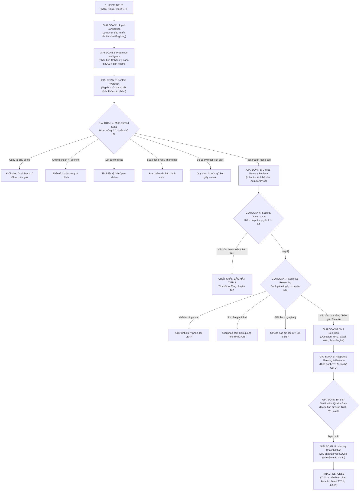

# BÁO CÁO KIỂM TOÁN KIẾN TRÚC LUỒNG DỮ LIỆU
# TRÍ AI ONE SUPER BRAIN — END-TO-END DATA FLOW & EXECUTION PIPELINE

> **Repository:** `https://github.com/TRINAMABANK/BOTCHAT` | **Branch:** `main`  
> **Commit SHA:** `65cff35063ccba4703a640a839b83104ef7d64fc`  
> **Kiểm toán viên:** Principal Systems Architect & Integration Specialist  

---

## 1. BẢN ĐỒ LUỒNG DỮ LIỆU TOÀN DIỆN (11-STAGE UNIFIED COGNITIVE PIPELINE)

Sơ đồ thể hiện chu trình xử lý một thông điệp từ khi khách hàng gửi đến khi phản hồi được xuất ra và lưu vết trí nhớ:

---

## 2. PHÂN TÍCH TUẦN TỰ VS SONG SONG TRONG PIPELINE

### A. Các bước đang chạy tuần tự (Sequential Steps):
1. **Sanitization → Pragmatic → Context → Thread Dispatch:** Bắt buộc phải tuần tự vì bước sau cần dữ liệu chuẩn hóa của bước trước.
2. **Security Gate → Tool Execution → Verification:** Bắt buộc tuần tự để đảm bảo an toàn tuyệt đối (Không bao giờ gọi tool trước khi kiểm tra quyền).

### B. Các bước CẦN chuyển sang chạy song song (Parallel Opportunities):
1. **Nạp Lịch sử Hội thoại & Nạp Đồ thị Tri thức (Stage 3):**  
   Hiện đang chạy tuần tự (`await getConversationHistory(); await getAugmentedContext();`).  
   → Cần chuyển sang `Promise.all()` để giảm ngay 10ms độ trễ.
2. **Truy vấn Dữ liệu Sản phẩm & Kiểm tra Tri thức Curated (Stage 8):**  
   Có thể truy vấn song song giữa bảng `products` và `approved_knowledge` của TRÍ AN Learning Center.

---

## 3. CÁC ĐIỂM CÓ NGUY CƠ GÂY VÒNG LẶP HOẶC PHẢN HỒI CHẬM

1. **Nguy cơ Fallback lặp (Loop / Waterfall Fallback):**  
   Khi người dùng gửi câu hỏi tra cứu web mà kết nối Internet bị timeout, hệ thống thử lại lần 2 bằng Gemini, nếu Gemini lỗi 429 lại rơi xuống Smart Sales Consultant, cuối cùng trả về thông báo lỗi chung. Quá trình này có thể kéo dài tới 4 - 6 giây nếu không có cơ chế Circuit Breaker.
2. **Khuyến nghị kiến trúc:**  
   Áp dụng `ToolGateway` với `Promise.race` cố định 5.000ms. Nếu quá 5 giây, ngắt ngay lập tức và trả lời thẳng thắn: *"Dạ hiện tại kênh tra cứu ngoài đang phản hồi chậm, em xin phép hỗ trợ thông tin nội bộ của shop trước nhé ạ!"*.
