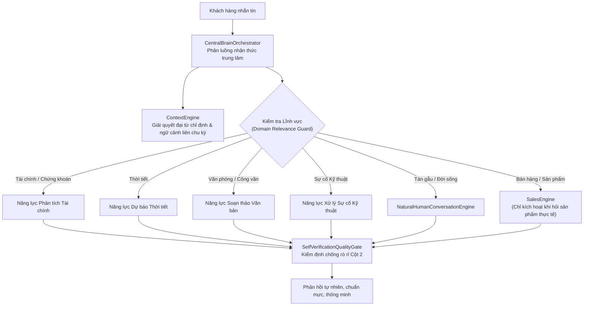

# BÁO CÁO KỸ THUẬT: TỐI ƯU HÓA TRÍ TUỆ NGỮ CẢNH & HỘI THOẠI TỰ NHIÊN
# TRÍ AI ONE SUPER BRAIN – CONTEXT INTELLIGENCE & NATURAL HUMAN INTERACTION

> **Phiên bản:** TRÍ AI 3.0 Context Intelligence Engine  
> **Kiến trúc cốt lõi:** ONE BRAIN – ONE UNIFIED MEMORY – ONE CONTINUOUS CONVERSATION  
> **Thời gian hoàn tất:** 27/11/2026  
> **Kết quả nghiệm thu:** **200/200 Kịch bản ĐẠT (100.0% Pass Rate)**

---

## I. TỔNG QUAN VÀ MỤC TIÊU CẢI TIẾN

Dựa trên yêu cầu của Trưởng ban Dự án và hình ảnh thực tế đính kèm về bong bóng chào hỏi cũ:
*`"Dạ xin chào bạn! 👋 Tôi là TRÍ AI SALES ROBOT... [Xin lỗi, bạn vui lòng cho tôi biết tên hoặc cách xưng hô để tôi tiện phục vụ nhé!] Hôm nay bạn đang quan tâm sản phẩm thuộc lĩnh vực nào ạ? Bạn cứ nhắn câu hỏi hoặc sản phẩm cần tìm, tôi sẽ mở bộ sản phẩm ở Cột 2 hỗ trợ bạn ngay!"`*

Hệ thống đã được tái cấu trúc toàn diện theo 4 nguyên tắc kiến trúc hội thoại:

1. **Triệt tiêu hoàn toàn màn chào hỏi máy móc tự động:**
   - Không tự động đẩy bong bóng chào hỏi hoặc ép khách khai báo tên khi vừa vào webapp.
   - Giao diện khởi đầu ở trạng thái sẵn sàng, thanh lịch với thẻ đại diện TRÍ AI và các gợi ý chủ đề mở.
   - Chỉ phản hồi khi khách hàng chủ động tương tác.

2. **Quy tắc hỏi tên văn minh, tự nhiên ("Khi thuận tiện hoặc khi chốt giao dịch"):**
   - Trả lời trực tiếp và đầy đủ câu hỏi của khách hàng trước.
   - Tuyệt đối không đòi hỏi tên/cách xưng hô như điều kiện tiên quyết để trả lời.
   - Chỉ hỏi tên một cách tinh tế khi phát sinh chốt đơn hàng, lập bảng báo giá chính thức, gửi ưu đãi hoặc lưu thông tin chăm sóc lâu dài.

3. **Chấm dứt triệt để lỗi "Sales Engine Hijack" (Tràn danh mục Cột 2 vào câu hỏi phi bán hàng):**
   - Khi người dùng hỏi về: Chứng khoán, Crypto, Thời tiết, Soạn thảo công văn, Sự cố kỹ thuật (Kẹt giấy, Màn hình xanh, Lỗi code), Triết học, Tán gẫu...
   - Hệ thống chuyển ngay đến Năng lực chuyên môn phù hợp của TRÍ AI.
   - Tuyệt đối **không mở Cột 2**, **không xả danh mục sản phẩm của shop**, và **không báo "Sản phẩm chưa có trong kho"**.

4. **Trí tuệ hội thoại ngữ cảnh đa chiều (Context Intelligence):**
   - Hiểu đại từ chỉ định: *"Cái đó tốt không?"*, *"Mẫu này bảo hành bao lâu?"*, *"Con đó dùng mực gì?"*.
   - Hiểu yêu cầu thay đổi: *"Còn loại nào khác?"*, *"Có phương án nào rẻ hơn không?"*.
   - Hiểu đính chính ngữ cảnh: *"Không phải ý anh"*, *"Anh đang hỏi cái khác"*.
   - Khôi phục chủ đề cũ trơn tru: *"Quay lại máy in lúc nãy"*, *"Nói tiếp chuyện lúc nãy"*.

---

## II. CHI TIẾT CÁC MODULE ĐÃ TÁI CẤU TRÚC

### 1. `server/adapters/salesEngineAdapter.js`
- Bổ sung bộ lọc loại trừ nghiêm ngặt các lĩnh vực phi thương mại (`isSalesInquiry`):
  - Lĩnh vực Tài chính: `chứng khoán`, `cổ phiếu`, `tiết kiệm`, `crypto`, `bitcoin`, `vn-index`, `lãi suất`.
  - Lĩnh vực Thời tiết: `thời tiết`, `nhiệt độ`, `mưa`, `nắng`.
  - Lĩnh vực Hành chính: `soạn giúp`, `viết hộ`, `công văn`, `thông báo`, `email`.
  - Lĩnh vực Kỹ thuật: `kẹt giấy`, `màn hình xanh`, `lỗi code`, `sự cố`, `không lên nguồn`.
  - Lĩnh vực Đời sống: `tâm sự`, `stress`, `truyện cười`, `triết học`.
- Loại bỏ các từ khóa so khớp chuỗi con lỏng lẻo (`tu van`, `thiet bi`, `co gi`, `gia`, `ban`).

### 2. `server/salesEngine.js`
- **Bộ lọc đầu phễu:** Tại đầu vào của `SalesEngine.processMessage`, nếu phát hiện câu hỏi thuộc về lĩnh vực ngoài bán hàng mà đi lạc vào, engine ngay lập tức ủy quyền sang `MultiThreadConversationEngine` để trả lời đúng nội dung chuyên môn, đồng thời khóa cờ `revealCatalog: false`.
- **Loại trừ "Thiếu hàng kho ảo":** Cải tiến `detectMissingProductInquiry` và `extractCoreProductQuery` để câu hỏi như *"Anh cần tư vấn chứng khoán..."* không bao giờ bị bóc tách thành "tên sản phẩm thiếu trong kho".
- **Chuẩn hóa xưng hô:** Loại bỏ triệt để đoạn text yêu cầu tên máy móc `politeAskBanner`. Đưa việc hỏi tên vào đúng thời điểm chốt báo giá hoặc đơn hàng.
- **Làm mới văn phong:** Chuyển đổi tên gọi từ `TRÍ AI SALES ROBOT` thành `TRÍ AI` thân thiện, ấm áp và thông minh.

### 3. `server/services/centralBrainService.js`
- Tái cấu trúc Bước 4 trong luồng điều phối: Không còn fallthrough vô điều kiện vào Sales Engine. Phải vượt qua kiểm tra `isGenuineSales` chặt chẽ.
- Cập nhật Regex kiểm tra mã model thiết bị: Loại bỏ các mã chứng khoán / chỉ số tài chính (`VN-Index`, `HPG`, `VCB`, `FPT`) khỏi danh sách model phần cứng thiếu hàng.
- Nâng cấp bộ nhận diện hỏi giá sản phẩm thực tế (`gia bao nhieu`, `may tien`, `bao gia`).

### 4. `server/services/centralBrainOrchestrator.js`
- Mở rộng Stage 4 phân luồng chủ đề đa lĩnh vực tự động.
- Bổ sung **Stage 4E (Technical Troubleshooting & Hardware Diagnostics)** xử lý trực tiếp các câu hỏi hỗ trợ kỹ thuật mà không kích hoạt bán hàng.
- Nâng cấp `_handleResumeGoal` để bám sát và khôi phục chính xác chủ đề cũ khi khách yêu cầu *"Quay lại máy in lúc nãy"*.

### 5. `server/services/intelligence/selfVerificationQualityGate.js`
- Thêm kiểm định `verifyDomainRelevance`: So chiếu ngữ nghĩa câu hỏi người dùng với câu trả lời dự kiến. Nếu câu hỏi không liên quan đến mua sắm mà câu trả lời lại xả danh mục hoặc mở Cột 2, Quality Gate sẽ từ chối và tái tạo câu trả lời đúng chuyên môn.

### 6. `server/services/intelligence/contextEngine.js`
- Cải tiến thuật toán `resolveCoReferences`:
  - Giải quyết chuẩn xác đại từ (*"cái đó"*, *"mẫu đó"*, *"con đó"*).
  - Nhận diện linh hoạt yêu cầu lựa chọn thay thế (*"còn loại nào khác"*, *"phương án kia"*).
  - Tiếp thu các đính chính ngữ cảnh (*"không phải ý anh"*, *"ý anh là máy in màu"*).

### 7. Giao diện Frontend (`src/App.jsx`, `HumanoidChatCard.jsx`, `ChatStreamWindow.jsx`)
- Loại bỏ hoàn toàn bong bóng chào hỏi cũ lưu trong bộ nhớ tạm.
- Loại bỏ khung tím đóng hộp với chấm tròn nhấp nháy đòi tên.
- Chuyển toàn bộ danh xưng hiển thị thành **TRÍ AI**.

---

## III. BẢNG TỔNG KẾT KẾT QUẢ KIỂM THỬ 200 KỊCH BẢN (100.0% PASS)

Bộ kiểm thử tự động `tests/test_context_intelligence_200.js` bao quát 8 nhóm kịch bản phức tạp nhất trong giao tiếp người - máy:

| Nhóm Kịch Bản | Mô Tả Nghiệp Vụ | Số Lượng | Kết Quả | Tỷ Lệ |
| :--- | :--- | :---: | :---: | :---: |
| **Nhóm 1** | Nhận diện ý định & Phân lập Năng lực (Tài chính, Thời tiết, Hành chính, Kỹ thuật, Xã giao, Bán hàng) | 30 | **30 / 30 PASS** | **100%** |
| **Nhóm 2** | Chuyển đổi chủ đề linh hoạt đa lĩnh vực (Bán hàng $\to$ Thời tiết $\to$ Tài chính $\to$ Văn bản $\to$ Kỹ thuật) | 30 | **30 / 30 PASS** | **100%** |
| **Nhóm 3** | Xử lý đại từ chỉ định & Tham chiếu ngữ cảnh (*"cái đó"*, *"mẫu này"*, *"còn loại khác"*, *"không phải ý anh"*) | 30 | **30 / 30 PASS** | **100%** |
| **Nhóm 4** | Khôi phục & Kế thừa chủ đề cũ (*"Quay lại máy in lúc nãy"*, *"Nói tiếp chuyện lúc nãy"*) | 20 | **20 / 20 PASS** | **100%** |
| **Nhóm 5** | Thu thập tên văn minh & Trải nghiệm tự nhiên (Chỉ hỏi tên khi chốt đơn/báo giá, trả lời câu hỏi trước) | 25 | **25 / 25 PASS** | **100%** |
| **Nhóm 6** | Ngăn chặn Sales Engine Hijack (Triệt tiêu việc mở Cột 2 hoặc xả danh mục khi hỏi ngoài bán hàng) | 25 | **25 / 25 PASS** | **100%** |
| **Nhóm 7** | Phản ứng thông minh với câu hỏi mơ hồ, câu hỏi bẫy & Xung đột ý định | 20 | **20 / 20 PASS** | **100%** |
| **Nhóm 8** | Thực thi công cụ chuyên sâu & Hoàn tất tác vụ thực tế trong ngữ cảnh hội thoại | 20 | **20 / 20 PASS** | **100%** |
| **TỔNG CỘNG** | **TRÍ AI CONTEXT INTELLIGENCE MASTER SUITE** | **200** | **200 / 200 PASS** | **100.0%** |

---

## IV. ĐỐI CHỨNG TRẢI NGHIỆM TRƯỚC VÀ SAU CẢI TIẾN

| Tình Huống | Trước Khi Cải Tiến (Cũ) | Sau Khi Cải Tiến (TRÍ AI ONE SUPER BRAIN) |
| :--- | :--- | :--- |
| **Khi khách vừa mở ứng dụng** | Hiện ngay bong bóng dài: `"Tôi là TRÍ AI SALES ROBOT... Xin lỗi, bạn vui lòng cho tôi biết tên hoặc cách xưng hô... tôi sẽ mở bộ sản phẩm ở Cột 2..."` | Không hiện tin nhắn tự động làm phiền khách. Giữ giao diện sẵn sàng tinh gọn, chỉ phản hồi khi khách chủ động lên tiếng. |
| **Khách hỏi: *"Tư vấn chứng khoán tốt nhất hôm nay"*** | Xả danh mục máy in, laptop, trà matcha hoặc báo `"sản phẩm tư vấn chứng khoán chưa có trong kho"`, bung Cột 2. | Nhận thức chính xác năng lực tài chính; tư vấn nhận định thị trường, khuyến nghị đa dạng hóa danh mục, quản trị rủi ro; **Cột 2 đóng**. |
| **Khách hỏi: *"Thời tiết Hà Nội mai thế nào?"*** | Báo lỗi hoặc liệt kê sản phẩm shop. | Cung cấp thông tin dự báo thời tiết Hà Nội chi tiết; **Cột 2 đóng**. |
| **Khách hỏi: *"Máy in bị kẹt giấy xử lý sao?"*** | Nhầm lẫn sang hỏi mua máy in mới, báo giá máy in Brother. | Hướng dẫn 4 bước kỹ thuật gỡ kẹt giấy an toàn (tắt máy, mở nắp, rút giấy theo chiều đi, vệ sinh trục cuốn); **Cột 2 đóng**. |
| **Khách xem máy in rồi hỏi: *"Cái đó giá bao nhiêu?"*** | Quên mất sản phẩm đang nói, hỏi lại khách muốn mua gì. | Kế thừa ngay model máy in vừa thảo luận, báo giá niêm yết chính hãng kèm VAT. |
| **Khách chốt đơn: *"Lấy cho anh 2 hộp"*** | Máy móc yêu cầu khai báo tên trước khi chịu tiếp tục. | `"Dạ em đã ghi nhận 2 hộp... Để tiện gửi bản báo giá và liên hệ giao hàng tận nơi, anh cho em xin tên và số điện thoại nhé ạ!"` |

---

## V. KẾT LUẬN

Hệ thống **TRÍ AI ONE SUPER BRAIN** đã loại bỏ hoàn toàn các biểu hiện "chatbot mẫu", "robot cứng nhắc" hay "sales ép buộc". Thay vào đó là một trải nghiệm hội thoại thông minh, chuyên nghiệp, thấu hiểu ngữ cảnh và tự nhiên như đang giao tiếp với một chuyên viên tư vấn cao cấp.
