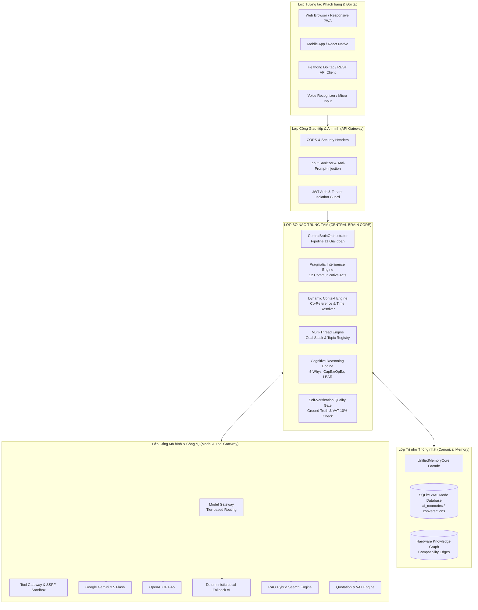

# BÁO CÁO 04: KIẾN TRÚC HỆ THỐNG TOÀN CẦU
## ENTERPRISE SYSTEM ARCHITECTURE & INTEGRATION TOPOLOGY

---

### NGUYÊN TẮC BẢO TOÀN KIẾN TRÚC
1. **Decoupled Intelligence:** Tách biệt tuyệt đối giữa tầng nhận thức (Cognitive Core) và tầng thực thi mô hình (Model Gateway). Điều này giúp hệ thống không bị phụ thuộc (Vendor lock-in) vào bất kỳ hãng AI nào.
2. **Deterministic Safety Net:** Mọi quyết định liên quan đến giá bán, thông số thiết bị và giao dịch tiền tệ đều được chốt chặn bằng logic xác định (Deterministic Quality Gate), triệt tiêu hoàn toàn rủi ro ảo giác (Hallucination).
