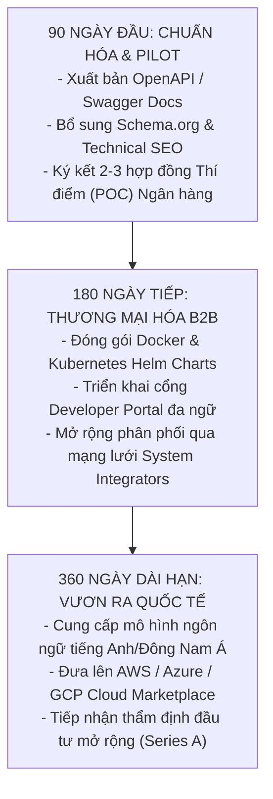

# BÁO CÁO 21: LỘ TRÌNH PHÁT TRIỂN & HỢP TÁC TOÀN CẦU
## 90-DAY, 180-DAY & 360-DAY STRATEGIC GLOBAL EXPANSION ROADMAP

---

### HÀNH ĐỘNG CỤ THỂ TRONG 90 NGÀY ĐẦU TIÊN
1. **Hoàn thiện Technical SEO:** Nhúng cấu trúc dữ liệu Schema.org JSON-LD vào website chính thức và tạo file `sitemap.xml` để Google/Bing chỉ mục.
2. **Xuất bản Developer Portal:** Tạo trang tra cứu API công khai kèm Swagger UI để các lập trình viên doanh nghiệp có thể thử nghiệm API trực tiếp.
3. **Tiếp cận 3 Ngân hàng thương mại:** Trình bày hồ sơ POC về giải pháp tư vấn thiết bị kho quỹ và dịch vụ khách hàng với chốt chặn an toàn tài chính Tier 3.
