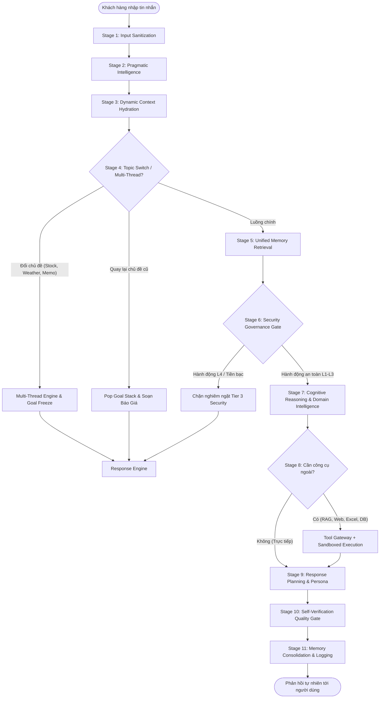

# BÁO CÁO 04: TRUY VẾT LUỒNG THỰC THI BỘ NÃO TRUNG TÂM
## RUNTIME TRACE & 11-STAGE COGNITIVE PIPELINE EXECUTION

---

### CHI TIẾT 11 GIAI ĐOẠN XỬ LÝ
1. **Stage 1 (Làm sạch):** Khử ký tự điều khiển, ngăn chặn SQLi & Prompt Injection thô.
2. **Stage 2 (Hành vi hội thoại):** Nhận diện 12 hành vi ngôn ngữ (Lời khen, phàn nàn ngầm, hỏi gián tiếp, đính chính).
3. **Stage 3 (Ngữ cảnh động):** Khôi phục đại từ thay thế (*"cái đó"*, *"phương án trước"*), đồng tham chiếu thời gian.
4. **Stage 4 (Đa luồng & Đổi chủ đề):** Đóng băng nhiệm vụ hiện tại vào Goal Stack khi khách rẽ hướng.
5. **Stage 5 (Trí nhớ thống nhất):** Truy vấn facts đã kiểm chứng từ `ai_memories`, giải quyết mâu thuẫn.
6. **Stage 6 (Kiểm soát quyền L1-L4):** Phê duyệt theo thẩm quyền, chặn chuyển tiền tự động.
7. **Stage 7 (Tư duy sâu):** Khung xử lý phản đối LEAR, phân tích 5-Whys, tư vấn TCO.
8. **Stage 8 (Điều phối công cụ):** Gọi RAG, SQLite, Knowledge Graph với bộ lọc chống SSRF.
9. **Stage 9 (Định hình nhân cách):** Điều chỉnh văn phong theo Persona (TRÍ AI, chuyên viên tư vấn).
10. **Stage 10 (Tự kiểm chứng):** Quét dữ kiện, kiểm tra VAT 10%, xếp loại độ tin cậy.
11. **Stage 11 (Củng cố trí nhớ):** Ghi nhớ tập sự kiện mới vào SQLite WAL và ghi nhật ký giám sát.
