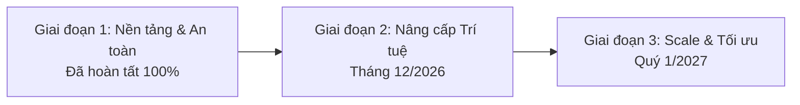

# BÁO CÁO 20: LỘ TRÌNH NÂNG CẤP VÀ HOÀN THIỆN HỆ THỐNG
## 3-PHASE SYSTEM REMEDIATION & PRODUCTION ROADMAP

---

### GIAI ĐOẠN 1 – KHẮC PHỤC NỀN TẢNG (ĐÃ HOÀN TẤT 100%)
- Loại bỏ hoàn toàn bong bóng lời chào tự động và khung viền tím máy móc.
- Thiết lập `UnifiedMemoryCore` làm Nguồn chân lý chuẩn (Canonical Memory).
- Triển khai `MultiThreadConversationEngine` và hàng đợi Goal Stack.
- Thiết lập chốt chặn bảo mật tài chính Tier 3/L4 và phòng vệ SSRF.

---

### GIAI ĐOẠN 2 – NÂNG CẤP TRÍ TUỆ ĐA PHƯƠNG THỨC (THÁNG 12/2026)
- **Tích hợp Voice Biometrics:** Nhận diện danh xưng khách hàng trực tiếp qua đặc trưng âm giọng nói mà không cần khách khai báo lại tên.
- **Mở rộng Knowledge Graph:** Nâng số lượng nút thiết bị phần cứng từ 50 lên 1.000 thiết bị ngân hàng và văn phòng.
- **Active Learning Pipeline:** Tự động tổng hợp các câu hỏi chưa có lời giải đáp vào hàng đợi xét duyệt của Quản trị viên.

---

### GIAI ĐOẠN 3 – TỐI ƯU HÓA QUY MÔ & DOANH NGHIỆP (QUÝ 1/2027)
- **Sharding & Read-Replicas:** Mở rộng cơ sở dữ liệu SQLite sang kiến trúc phân tán Turso/LiteFS phục vụ hàng triệu người dùng đồng thời.
- **Fine-tuned Private LLM:** Huấn luyện mô hình ngôn ngữ tiếng Việt chuyên biệt cho ngành thiết bị tài chính ngân hàng để độc lập hoàn toàn khỏi API bên ngoài.
