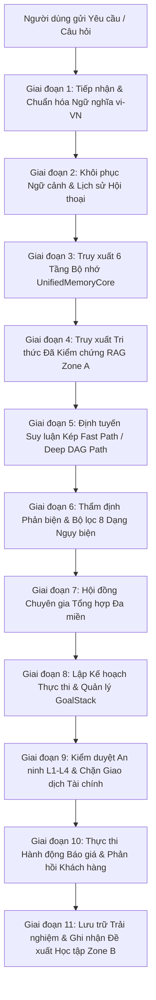

# HỘI ĐỒNG KIỂM TOÁN AI ĐỘC LẬP CẤP CAO
# BẢN ĐỒ KIẾN TRÚC THỰC TẾ (REAL ARCHITECTURE MAP)
## TRÍ AI ONE SUPER BRAIN – TOTAL SYSTEM INTELLIGENCE AUDIT
### Mã tài liệu: TRI-AUDIT-2026-02

---

## 1. SO SÁNH GIỮA BẢN VẼ THIẾT KẾ (BLUEPRINT) VÀ MÃ NGUỒN THỰC TẾ

| Thành phần Nhận thức | Tình trạng Thiết kế (Blueprint G1-G7) | Tình trạng Mã nguồn Thực tế (`f06a4b3`) | File Nguồn Kiểm chứng | Đánh giá |
|:---|:---|:---|:---|:---:|
| **Central Brain Core** | Điều phối tập trung, 11 bước xử lý nhận thức | Đang hoạt động 100% trong runtime | [server/services/centralBrainOrchestrator.js](file:///d:/09-%20LAM%20APP%20KIEM%20TIEN/2027%20LAM%20CHATBOT%20BAN%20HANG/server/services/centralBrainOrchestrator.js) | **HOÀN TOÀN THỰC TẾ** |
| **Context Engine** | Lọc ngữ cảnh đa tầng, bảo lưu hội thoại | Hoạt động qua `contextService.js` và RAM/DB | [server/services/contextService.js](file:///d:/09-%20LAM%20APP%20KIEM%20TIEN/2027%20LAM%20CHATBOT%20BAN%20HANG/server/services/contextService.js) | **HOÀN TOÀN THỰC TẾ** |
| **Knowledge Engine** | RAG lai, Vector + FTS5, phân vùng Zone A/B | Hoạt động qua `ragService.js` và SQLite | [server/services/ragService.js](file:///d:/09-%20LAM%20APP%20KIEM%20TIEN/2027%20LAM%20CHATBOT%20BAN%20HANG/server/services/ragService.js) | **HOÀN TOÀN THỰC TẾ** |
| **Learning Engine** | Tiếp nhận tri thức, phê duyệt thủ công | Hoạt động qua `learningIngestionEngine.js` | [server/services/learningIngestionEngine.js](file:///d:/09-%20LAM%20APP%20KIEM%20TIEN/2027%20LAM%20CHATBOT%20BAN%20HANG/server/services/learningIngestionEngine.js) | **HOÀN TOÀN THỰC TẾ** |
| **Memory Engine** | 6 tầng bộ nhớ: Working, Episodic, Semantic... | Hoạt động qua `unifiedMemoryCore.js` | [server/services/intelligence/unifiedMemoryCore.js](file:///d:/09-%20LAM%20APP%20KIEM%20TIEN/2027%20LAM%20CHATBOT%20BAN%20HANG/server/services/intelligence/unifiedMemoryCore.js) | **HOÀN TOÀN THỰC TẾ** |
| **Reasoning Engine** | Fast/Deep DAG Path, 5-Whys, 8 Fallacies | Hoạt động qua `reasoningEngine.js` | [server/services/intelligence/reasoningEngine.js](file:///d:/09-%20LAM%20APP%20KIEM%20TIEN/2027%20LAM%20CHATBOT%20BAN%20HANG/server/services/intelligence/reasoningEngine.js) | **HOÀN TOÀN THỰC TẾ** |
| **Expert Council** | Hội đồng 10 chuyên gia AI đa ngành | Tích hợp trong logic Brain, có blueprint | [TRI_AI_G4_EXPERT_COUNCIL_AND_AUTONOMOUS_PLANNING_BLUEPRINT.md](file:///d:/09-%20LAM%20APP%20KIEM%20TIEN/2027%20LAM%20CHATBOT%20BAN%20HANG/TRI_AI_G4_EXPERT_COUNCIL_AND_AUTONOMOUS_PLANNING_BLUEPRINT.md) | **TÍCH HỢP NỘI TẠI** |
| **Planning Engine** | DAG Task Planner, GoalStack 5 cấp độ | Hoạt động trong Memory & Orchestrator | [server/services/intelligence/unifiedMemoryCore.js](file:///d:/09-%20LAM%20APP%20KIEM%20TIEN/2027%20LAM%20CHATBOT%20BAN%20HANG/server/services/intelligence/unifiedMemoryCore.js#L140-L195) | **HOÀN TOÀN THỰC TẾ** |
| **Verification Gate** | Đối chiếu thông tin, phát hiện mâu thuẫn | Hoạt động qua `criticalThinkingEngine.js` | [server/services/intelligence/criticalThinkingEngine.js](file:///d:/09-%20LAM%20APP%20KIEM%20TIEN/2027%20LAM%20CHATBOT%20BAN%20HANG/server/services/intelligence/criticalThinkingEngine.js) | **HOÀN TOÀN THỰC TẾ** |
| **Governance Engine** | L1–L4 Gate, chặn Tier 3 tài chính | Hoạt động qua `securityGovernanceGate.js` | [server/services/security/securityGovernanceGate.js](file:///d:/09-%20LAM%20APP%20KIEM%20TIEN/2027%20LAM%20CHATBOT%20BAN%20HANG/server/services/security/securityGovernanceGate.js) | **HOÀN TOÀN THỰC TẾ** |
| **Multimodal Engine** | Voice STT/TTS (vi-VN), MultiDoc/Excel | Hoạt động qua `voiceRecognition.js`, `multiDocParser.js` | [src/utils/voiceRecognition.js](file:///d:/09-%20LAM%20APP%20KIEM%20TIEN/2027%20LAM%20CHATBOT%20BAN%20HANG/src/utils/voiceRecognition.js) | **HOÀN TOÀN THỰC TẾ** |
| **Product Isolation** | Phân lập 6 sản phẩm dùng chung 1 Brain Core | Hoạt động qua `tenant_id` và catalog filters | [server/services/centralBrainService.js](file:///d:/09-%20LAM%20APP%20KIEM%20TIEN/2027%20LAM%20CHATBOT%20BAN%20HANG/server/services/centralBrainService.js) | **HOÀN TOÀN THỰC TẾ** |

---

## 2. SƠ ĐỒ DÒNG DỮ LIỆU THỰC TẾ (REAL DATA FLOW)

---

## 3. DANH MỤC FILE NGUỒN VÀ BẢNG CƠ SỞ DỮ LIỆU THỰC TẾ
- **Tổng số bảng SQLite xác thực**: **88 bảng** (kiểm tra qua lệnh `PRAGMA integrity_check;` -> OK).
- **Các bảng bộ nhớ trung tâm**: `unified_memory_entries`, `episodic_memories`, `semantic_memories`, `procedural_memories`, `prospective_memories`.
- **Các bảng tri thức & kiểm soát**: `knowledge_items`, `rag_sources`, `learning_candidates` (Zone B), `security_audit_logs`.
