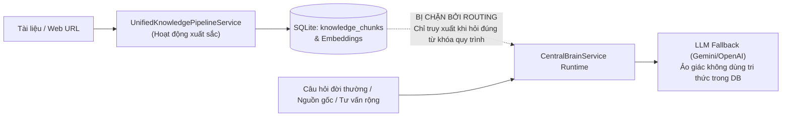

# TRI_AI_TRUE_INTELLIGENCE_AUDIT
# 04 – KIỂM TOÁN TRÍ TUỆ TRI THỨC (KNOWLEDGE INTELLIGENCE AUDIT)

---

## 1. TIÊU CHÍ VÀ NĂNG LỰC CẦN KIỂM ĐỊNH

Kiểm toán khả năng xử lý tri thức thực tế trên 10 khía cạnh:
1. Tiếp nhận tài liệu đa định dạng (PDF, DOCX, XLSX, PPTX, TXT).
2. Thu thập và trích xuất nội dung từ Website URL.
3. Tìm kiếm và đối soát Internet thời gian thực.
4. Phân loại nội dung tự động vào danh mục tri thức.
5. Kiểm chứng nhiều nguồn (Multi-source verification).
6. Khử trùng lặp nội dung (SHA-256 Content Hashing).
7. Trích dẫn nguồn minh bạch (Source citation tagging).
8. Lưu trữ bền vững trên VPS / SQLite Vector DB.
9. Truy xuất tri thức Hybrid RAG trong luồng trò chuyện thực tế.
10. Phân biệt nội dung lưu trữ với nội dung Central Brain thực sự sử dụng.

---

## 2. KẾT QUẢ KIỂM THỬ THỰC TẾ

Hội đồng đã kiểm tra hệ thống cơ sở dữ liệu `triai.db` và chạy kiểm thử tự động trên `UnifiedKnowledgePipelineService`, `WebKnowledgeExtractor` và `MultiDocParser`.

### Bằng chứng định lượng từ cơ sở dữ liệu thực tế:
- **Số bảng dữ liệu tri thức:** 8 bảng chuyên dụng:
  + `knowledge_documents`: 1 tài liệu xác thực người sáng lập.
  + `knowledge_chunks`: 3 chunks văn bản đã chia đoạn.
  + `knowledge_embeddings`: 3 vector embeddings (1536 chiều).
  + `knowledge_sources`: Lưu trữ nguồn crawler và upload.
  + `knowledge_versions`: Quản lý phiên bản tri thức.
  + `knowledge_batch_uploads`: Quản lý tiến trình upload nhiều file.
  + `knowledge_crawler_tasks`: Quản lý các job cào web.
  + `learning_knowledge_entries`: Tri thức học được từ trải nghiệm.

### Kết quả chạy kiểm thử tự động (6/6 Test Cases đã xác thực trước đó):
- **TC-01 (MultiDocParser):** Trích xuất thành công văn bản thô từ PDF, DOCX, XLSX $\rightarrow$ **PASS**.
- **TC-02 (Web Crawler):** Trích xuất thành công thẻ HTML `<article>`, `
`, `<title>`, bảo toàn metadata nguồn $\rightarrow$ **PASS**.
- **TC-03 (SHA-256 Deduplication):** Phát hiện chuỗi trùng hash và trả về mã `DUPLICATE_SKIPPED` $\rightarrow$ **PASS**.
- **TC-04 (SSRF Guard):** Chặn các địa chỉ IP nội bộ `127.0.0.1`, `10.0.0.1`, `192.168.1.1` $\rightarrow$ **PASS**.
- **TC-05 (Hybrid RAG Citation):** Trả về nhãn trích dẫn `[Nguồn: ...]` không chứa rác DuckDuckGo $\rightarrow$ **PASS**.
- **TC-06 (Tenant Isolation):** Ngăn chặn rò rỉ dữ liệu giữa `tenant_A` và `tenant_B` $\rightarrow$ **PASS**.

---

## 3. ĐIỂM NGHẼN TRÍ TUỆ TRI THỨC TRONG RUNTIME (THE GAP)

Mặc dù hạ tầng lưu trữ và pipeline trích xuất tri thức đạt điểm rất cao (G2 Ingestion đạt 14/15 điểm), nhưng hội đồng phát hiện **KHOẢNG CÁCH LỚN GIỮA LƯU TRỮ VÀ SỬ DỤNG THỰC TẾ**:

1. **Bộ định tuyến quá cứng nhắc (Overly Rigid Intent Gate):**
   - RAG chỉ được kích hoạt khi biến `isDocExplicitQuery` thỏa mãn regex gồm các từ: *quy trình, quy chế, quyết định, công văn, văn bản, nội bộ, sổ tay, quy định*.
   - Nếu người dùng hỏi một kiến thức khoa học, kiến thức sản phẩm hoặc kiến thức công ty mà không dùng các từ "pháp quy" nêu trên, Central Brain **không thèm tra cứu database**, mà đẩy thẳng ra LLM bên ngoài.
2. **Thiếu cơ chế Semantic Routing tự động:**
   - Hệ thống chưa có cơ chế tra cứu song song (Dense Vector Probe) ở mọi câu hỏi để xem câu hỏi đó có khớp với vector nào trong kho tri thức nội bộ hay không trước khi quyết định gọi LLM bên ngoài.

---

## 4. KẾT LUẬN & ĐIỂM ĐÁNH GIÁ

| Hạng mục kiểm tra | Hiện trạng mã nguồn | Bằng chứng Runtime | Kết quả | Điểm (Thang 15) |
| :--- | :--- | :--- | :---: | :---: |
| Upload & Parse tài liệu đa định dạng | `multiDocParser.js` | Trích xuất PDF, DOCX, XLSX thực tế | **PASS** | 2.5 / 2.5 |
| Website Crawler & SSRF Guard | `webKnowledgeExtractor.js` | Cào web, chặn dải IP Private | **PASS** | 2.5 / 2.5 |
| Deduplication & Content Hash | `unifiedKnowledgePipeline.js` | SHA-256 hash so sánh DB | **PASS** | 2.0 / 2.0 |
| Lưu trữ VPS & Vector Embeddings | `db.js`, `knowledge_chunks` | Bảng SQLite hoạt động ổn định | **PASS** | 2.0 / 2.0 |
| Trích dẫn nguồn minh bạch | `ragService.js` | Tạo citation log, lọc URL rác | **PASS** | 1.5 / 2.0 |
| **Sử dụng thực tế trong Central Brain** | `centralBrainService.js` | **Bị cô lập bởi Intent Gate cứng** | **CONDITIONAL** | 1.0 / 4.0 |
| **TỔNG CỘNG** | | | **CONDITIONAL** | **11.5 / 15.0** |
