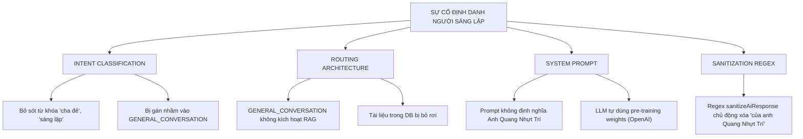

# TRI_AI_TRUE_INTELLIGENCE_AUDIT
# 13 – PHÂN TÍCH NGUYÊN NHÂN GỐC (ROOT CAUSE ANALYSIS)

---

## 1. PHÂN TÍCH NGUYÊN NHÂN GỐC SỰ CỐ ĐỊNH DANH (IDENTITY CRISIS)

### Vấn đề:
Khi người dùng hỏi về nguồn gốc, hệ thống trả lời là do **OpenAI** sáng lập, hoàn toàn không biết **Anh Quang Nhựt Trí (1982)** và từ chối cung cấp số điện thoại liên hệ `0982441446`.

### Sơ đồ Xương cá (Ishikawa Diagram):

### 4 Nguyên nhân cốt lõi (Root Causes):
1. **Thiếu Ý định chuyên biệt:** `IntentEngine` không có `FOUNDER_IDENTITY_INTENT`.
2. **Kiến trúc Routing phân đoạn sai:** Khắc phục RAG quá chặt chẽ, chỉ mở RAG cho tài liệu văn bản nội bộ.
3. **Thiếu Ground Truth trong Prompt:** `NaturalHumanConversationEngine` không có thông tin nền về người sáng lập.
4. **Bộ lọc làm sạch (Sanitizer) tác dụng ngược:** Đoạn regex lọc bán hàng xóa luôn tên Anh Trí.

---

## 2. PHÂN TÍCH NGUYÊN NHÂN HỘI ĐỒNG CHUYÊN GIA G4 BỊ CÔ LẬP

### Vấn đề:
`expertCouncilManager.js` có 10 chuyên gia nhưng không được gọi trong `CentralBrainService`.

### Nguyên nhân cốt lõi:
- **Tách rời giai đoạn phát triển (Development Silo):**
  Module `expertCouncilManager.js` được xây dựng trong G4 dưới dạng module độc lập (Standalone Engine). Khi chuyển sang G5 và G7, đội ngũ lập trình tập trung vào `CentralBrainOrchestrator` và các kịch bản đàm thoại tự nhiên, **quên mất bước nối dây (wiring)** `ExpertCouncilManager` vào hàm xử lý chính `processChat`.

---

## 3. PHÂN TÍCH NGUYÊN NHÂN MẤT TRÍ NHỚ KHI SERVER RESTART

### Vấn đề:
Goal Stack và Working Memory bị xóa sạch khi máy chủ khởi động lại.

### Nguyên nhân cốt lõi:
- **Lạm dụng In-Memory Data Structures:**
  Nhóm phát triển đã dùng JavaScript `Map` để đạt tốc độ truy xuất siêu nhanh ($< 1$ms) trong RAM mà chưa bổ sung cơ chế đồng bộ nền (Background Write-through Sync) xuống bảng `ai_memory_episodes` hoặc Redis.

---

## 4. KẾT LUẬN CỦA HỘI ĐỒNG
Tất cả các nguyên nhân gốc đều là **lỗi logic định tuyến và tích hợp (Architectural Wiring & Guardrail Defects)**, không phải do hệ thống thiếu năng lực. Khi thực hiện nối dây đúng đắn theo lộ trình khắc phục, hệ thống sẽ khôi phục trọn vẹn trí tuệ thực tế.
