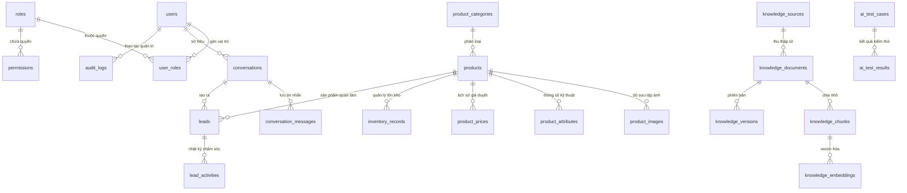

# SƠ ĐỒ THỰC THỂ LIÊN KẾT (ERD) & CẤU TRÚC CƠ SỞ DỮ LIỆU
## DỰ ÁN: TRÍ AI SALES ROBOT (31 BẢNG DOANH NGHIỆP & SAAS)

> **Tiêu chuẩn thiết kế**: Chuẩn hóa 3NF, hỗ trợ pgvector 1536 chiều, sẵn sàng mở rộng Multi-tenant SaaS, tương thích ngược 100% với SQLite hiện hữu.

---

## 1. SƠ ĐỒ QUAN HỆ TỔNG THỂ (MERMAID ERD)

---

## 2. DANH MỤC 31 BẢNG & MÔ TẢ CHI TIẾT

### Phân hệ 1: Xác thực, Phân quyền & Quản lý Danh tính (Identity & RBAC)
1. **`users`**: Tài khoản người dùng (khách hàng vãng lai, nhân viên kinh doanh, quản trị viên tối cao).
   - *Khóa chính*: `id (UUID / String)`
   - *Chỉ mục*: `idx_users_email` (UNIQUE), `idx_users_role`, `idx_users_active`
2. **`roles`**: Nhóm vai trò trong hệ thống (`role_admin`, `role_sales_manager`, `role_support`).
3. **`permissions`**: Quyền hạn chi tiết (`prod:read`, `prod:write`, `lead:manage`, `ai:configure`, `audit:read`).
4. **`user_roles`**: Bảng quan hệ nhiều - nhiều giữa người dùng và vai trò.

### Phân hệ 2: Danh tính Robot & Kịch bản AI
5. **`robot_profiles`**: Hồ sơ đại diện của Robot (Tên `TRÍ AI SALES ROBOT`, model 3D `cyber_valkyrie`, avatar, giọng điệu, system prompt).
6. **`faq_items`**: Danh mục câu hỏi thường gặp và câu trả lời đã được chủ nhân phê duyệt.
7. **`sales_scenarios`**: Kịch bản tư vấn, xử lý thắc mắc về giá, xử lý phản đối, và điều kiện chuyển hướng liên hệ chủ nhân.
8. **`ai_rules`**: Quy tắc bắt buộc của hệ thống (Không bịa giá, không tự chốt đơn ảo, không làm lộ prompt, bảo mật số điện thoại).

### Phân hệ 3: Quản lý Danh mục & Sản phẩm (Product Center)
9. **`product_categories`**: Cây danh mục lĩnh vực sản phẩm (`Máy đếm tiền`, `Thiết bị văn phòng`,...).
10. **`products`**: Thông tin sản phẩm cốt lõi (Xiudun XD-2166, XD-6688, XD-9999).
11. **`product_images`**: Hình ảnh sản phẩm chất lượng cao với cờ `is_primary` và thứ tự hiển thị `sort_order`.
12. **`product_attributes`**: Bảng thông số chi tiết (Tốc độ đếm, cảm biến IR/UV/MG, điện áp, trọng lượng).
13. **`product_prices`**: Nhật ký giá niêm yết đã được quản trị viên duyệt kèm ngày hiệu lực.
14. **`inventory_records`**: Số lượng tồn kho thực tế, vị trí kho hàng và thời điểm kiểm kê.

### Phân hệ 4: RAG Knowledge Base & Tìm kiếm Ngữ nghĩa (pgvector)
15. **`knowledge_sources`**: Danh sách nguồn tài liệu được phê duyệt tự động cập nhật.
16. **`knowledge_documents`**: Hồ sơ tài liệu tải lên (PDF, DOCX, XLSX, TXT).
17. **`knowledge_chunks`**: Đoạn văn bản sau khi bóc tách (Chunking ~500-1000 ký tự có độ gối overlap).
18. **`knowledge_embeddings`**: Vector đặc trưng 1536 chiều tạo bởi mô hình `text-embedding-3-small` / OpenAI Embeddings.
19. **`knowledge_versions`**: Quản lý lịch sử chỉnh sửa tài liệu và phê duyệt xuất bản.

### Phân hệ 5: Phiên Chat & CRM Khách Hàng Tiềm Năng (Chat & CRM)
20. **`conversations`**: Phiên hội thoại giữa khách và Robot.
21. **`conversation_messages`**: Toàn bộ tin nhắn trao đổi trong phiên, gắn kèm metadata và trạng thái Lead.
22. **`leads`**: Khách hàng tiềm năng thu thập từ phiên tư vấn (Tên, SĐT, Email, Nhu cầu, Sản phẩm quan tâm, Trạng thái `NEW – WAITING FOR OWNER CONTACT`).
23. **`lead_activities`**: Nhật ký chủ nhân liên hệ (Gọi điện, gửi Zalo, hẹn gặp, báo giá).
24. **`unanswered_questions`**: Bộ sưu tập các câu hỏi khách hỏi mà kho dữ liệu chưa có câu trả lời xác nhận để chủ nhân bổ sung.

### Phân hệ 6: Kiểm thử AI, Kiểm toán & Hệ thống (Testing & Audit)
25. **`ai_test_cases`**: Bộ kịch bản kiểm thử bảo mật & chất lượng AI (Prompt injection, hỏi giá khống, ép giảm giá).
26. **`ai_test_results`**: Báo cáo kết quả chạy kiểm thử tự động.
27. **`notifications`**: Thông báo tức thời trên giao diện Admin.
28. **`system_settings`**: Cấu hình bảo mật hệ thống (Hotline, Email nhận thông báo, Key dịch vụ).
29. **`audit_logs`**: Nhật ký kiểm toán mọi thao tác quản trị viên (Thêm/xóa sản phẩm, duyệt kiến thức).
30. **`email_logs`**: Lịch sử gửi email giao dịch cho chủ nhân.
31. **`agent_sessions`**: Phiên token hoạt động của AI Engine.

---

## 3. CHỈ MỤC (INDEXING STRATEGY)
- `idx_leads_phone`: Tìm kiếm nhanh thông tin khách hàng qua số điện thoại.
- `idx_leads_status`: Lọc danh sách Lead theo trạng thái trong CRM.
- `idx_products_field_group`: Tối ưu tốc độ tải danh mục Cột 2 trên màn hình khách hàng.
- `idx_messages_conv`: Truy xuất lịch sử hội thoại thời gian thực dưới 5ms.
- `idx_embeddings_hnsw`: Chỉ mục HNSW trên cột vector của PostgreSQL phục vụ tìm kiếm ngữ nghĩa siêu tốc.
