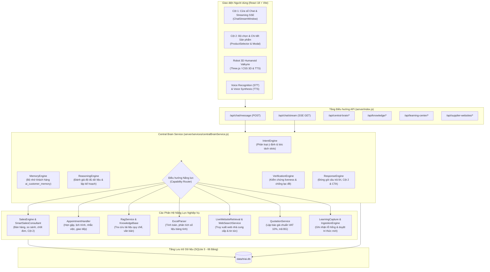
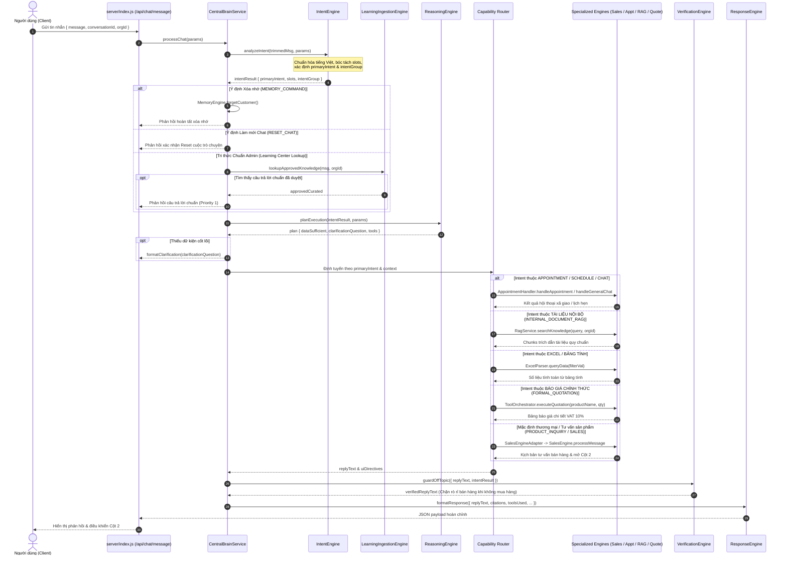

# KIẾN TRÚC HIỆN TẠI HỆ THỐNG BOTCHAT (AS-IS ARCHITECTURE)
## TÀI LIỆU 01 – BOTCHAT BRAIN 2.1 AUDIT & ARCHITECTURE DESIGN

> **Dự án:** BOTCHAT – AI Employee Đa Năng  
> **Repository:** TRINAMABANK/BOTCHAT  
> **Branch:** `main` (Phát triển: `feature/botchat-brain-2.1-intent`)  
> **Domain mục tiêu:** `quangnhuttri.com`  
> **Thời điểm kiểm định:** 24/11/2026  
> **Vai trò:** Principal AI Architect, Senior Backend Engineer & Conversational AI Specialist  

---

## 1. TỔNG QUAN HỆ THỐNG HIỆN HỮU

BOTCHAT là hệ thống Trợ lý AI tích hợp giao diện Humanoid 3D đa phương thức (Web 3D + Giọng nói STT/TTS + Hội thoại thời gian thực) phục vụ doanh nghiệp. Hệ thống được tổ chức theo mô hình Full-stack:
- **Frontend:** Single Page Application (SPA) xây dựng trên nền **React 18.3.1**, đóng gói bằng **Vite 5.2.0**, giao diện Responsive với TailwindCSS, Lucide Icons, Canvas Confetti.
- **Backend:** **Node.js Express 5.2.1** (ES Modules), phục vụ các API RESTful và Server-Sent Events (SSE) streaming.
- **Database:** **SQLite 3** (`data/triai.db` - 66 bảng) thông qua driver `sqlite3 6.0.1`. Đồng thời có sẵn file thiết kế cấu trúc SaaS đa người dùng **PostgreSQL + pgvector** tại `prisma/schema.prisma`.
- **AI Engine Orchestration:** Mô hình kép:
  - *Primary Engine:* `CentralBrainService` (Điều phối Intent, Memory, Reasoning, Verification, Response, Tool Orchestration).
  - *Secondary / Legacy Engine:* `SalesEngine` (Hơn 3.680 dòng code xử lý sâu kịch bản bán hàng, giỏ hàng, chốt sale, đặt hàng, đối chiếu sản phẩm 3 cấp độ).
  - *LLM Foundation Models:* Hỗ trợ đồng thời **Google Gemini** (`gemini-flash-lite-latest` qua Google AI REST API) và **OpenAI** (`gpt-4o-mini` qua Chat Completions Function Calling).

---

## 2. KIẾN TRÚC MẶT TRƯỚC (FRONTEND ARCHITECTURE)

### 2.1. Bố cục Hai Cột Đặc trưng (Two-Column Layout)
- **Cột 1 (Bên trái):** `ChatStreamWindow.jsx` hiển thị dòng tin nhắn người dùng và phản hồi của trợ lý ảo theo cơ chế Server-Sent Events (SSE) gõ chữ từng từ mượt mà. Tích hợp thanh nhập liệu text, nút ghi âm giọng nói STT, nút điều khiển robot 3D, và danh sách các nút hành động nhanh (Suggested Action Chips).
- **Cột 2 (Bên phải):** `ProductSelector.jsx` & `ProductDetailModal.jsx` hiển thị trực quan các thẻ sản phẩm có giá niêm yết đã phê duyệt, ảnh chụp thực tế, bộ lọc theo danh mục, nút xem thông số kỹ thuật chi tiết, và nút kích hoạt đặt mua ngay.
- **Cơ chế phối hợp Cột 1 và Cột 2:** Khi `CentralBrainService` hoặc `SalesEngine` trả về chỉ thị `revealCatalog: true`, Cột 2 tự động bung mở, định vị đúng danh mục (`recommendedField`) và cuộn tới sản phẩm trọng tâm (`recommendedProduct`). Khi khách hàng tiến hành chốt đơn nhập thông tin, Cột 2 tự động thu gọn lại để tập trung vào luồng thanh toán.

### 2.2. Nhân vật Humanoid 3D & Xử lý Giọng nói
- `HumanoidRobot3D.jsx`: Mô hình đại diện trợ lý ảo với các trạng thái hoạt họa (Idle, Talking, Thinking, Listening).
- `src/utils/speech.js`, `voiceRecognition.js`, `voiceSynthesis.js`: Tích hợp Web Speech API chuẩn trình duyệt, cho phép người dùng giao tiếp rảnh tay hai chiều.

---

## 3. KIẾN TRÚC MẶT SAU (BACKEND ARCHITECTURE)

### 3.1. Điểm Tiếp nhận Yêu cầu (Entry Points)
Tất cả các tin nhắn hội thoại từ người dùng gửi lên qua hai cổng chính tại [server/index.js](file:///d:/09-%20LAM%20APP%20KIEM%20TIEN/2027%20LAM%20CHATBOT%20BAN%20HANG/server/index.js):
1. `POST /api/chat/message`: Xử lý đồng bộ nhận toàn bộ JSON payload gồm `{ conversationId, message, selectedProduct, actionType, customerInfo, clientDevice, orgId }` và trả về kết quả cấu trúc hoàn chỉnh.
2. `GET /api/chat/stream`: Kết nối SSE dòng dữ liệu, truyền tải từng chunk ký tự phản hồi ra giao diện chat theo thời gian thực.

Cả hai endpoint này đều ủy quyền xử lý trực tiếp cho:
`CentralBrainService.processChat(params)`

Nếu `CentralBrainService.processChat` gặp lỗi ngoại lệ nghiêm trọng, cơ chế Fallback phòng vệ cấp 2 tại [server/index.js#L510-L516](file:///d:/09-%20LAM%20APP%20KIEM%20TIEN/2027%20LAM%20CHATBOT%20BAN%20HANG/server/index.js#L510-L516) sẽ chuyển tiếp sang `SalesEngine.processMessage(req.body)` để đảm bảo người dùng không bị gián đoạn phiên chat.

### 3.2. Luồng Thực thi Thực tế trong Central Brain (End-to-End Pipeline)

---

## 4. TỔNG KẾT RỦI RO KIẾN TRÚC HIỆN TẠI

1. **Hiện tượng "Hai Bộ Não Song Song" (Dual-Brain Friction):**
   - `CentralBrainService` đại diện cho bộ não trí tuệ hiện đại (RAG, Tool calling, Intent, Reasoning).
   - Tuy nhiên, `SalesEngine.js` (hơn 3.680 dòng code) chứa đựng một bộ não quy tắc khổng lồ độc lập (tự bóc tách danh từ, tự so khớp sản phẩm theo 3 tier, tự quản lý profile khách hàng, tự gọi trực tiếp Gemini/OpenAI nếu chưa có reply).
   - Khi `CentralBrainService` không bắt được một intent phi bán hàng, luồng xử lý bị rơi vào `SalesEngineAdapter` $\rightarrow$ biến toàn bộ cuộc trò chuyện thành kịch bản bán hàng.
2. **Conversation History chưa được đồng bộ cấu trúc:**
   - Trong nhánh gọi OpenAI Tool Calling (`runOpenAiCentralBrain`), danh sách tin nhắn gửi lên API chỉ bao gồm `[systemPrompt, userMessage]`, làm mất ngữ cảnh các lượt trước.
   - Nhánh `SalesEngine` tự đọc lịch sử từ bảng `messages`, dẫn đến độ lệch ngữ cảnh giữa 2 nhánh thực thi.
3. **Cần một Context Engine tập trung:**
   - Cần một module ngữ cảnh chung duy nhất (`ContextEngine`) làm nguồn chân lý duy nhất (Single Source of Truth) phục vụ cho mọi phân hệ.
