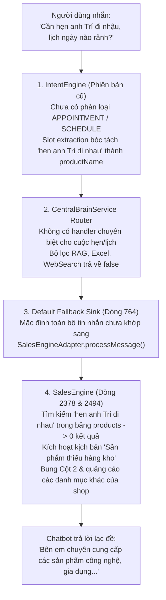

# PHÂN TÍCH NGUYÊN NHÂN GỐC RỄ LỖI HIỂU SAI Ý ĐỊNH
## TÀI LIỆU 03 – BOTCHAT BRAIN 2.1 AUDIT & ARCHITECTURE DESIGN

> **Dự án:** BOTCHAT  
> **Tình huống kiểm thử thực tế:**  
> **Người dùng:** *"Cần hẹn anh Trí đi nhậu, lịch ngày nào rảnh?"*  
> **Chatbot phản hồi sai:** *"Bên em chuyên cung cấp các sản phẩm công nghệ, gia dụng, trà, cà phê và thiết bị văn phòng..."*  
> **Mức độ nghiêm trọng:** P0 (Blunder Defect – Hệ thống định tuyến sai nghiệp vụ, gây phản cảm cho người dùng).

---

## 1. NGUYÊN NHÂN GỐC RỄ TỔNG THỂ (ROOT CAUSE SYNTHESIS)

Sự cố trên không đơn thuần là thiếu một từ khóa "đi nhậu", mà xuất phát từ **3 lỗi kiến trúc mang tính hệ thống**:



---

## 2. TRẢ LỜI CHI TIẾT 10 CÂU HỎI KIỂM ĐỊNH (THEO MỤC IV PROMPT)

### 2.1. IntentEngine phân loại câu trên như thế nào?
- **Trước khi nâng cấp:** Trong [server/services/intelligence/intentEngine.js](file:///d:/09-%20LAM%20APP%20KIEM%20TIEN/2027%20LAM%20CHATBOT%20BAN%20HANG/server/services/intelligence/intentEngine.js), hàm `analyzeIntent` chỉ chứa các nhóm ý định thương mại: `PRODUCT_CONSULTATION`, `PRICE_INQUIRY`, `TECH_SPECS`, `ORDER_REQUEST`, `STAFF_HANDOFF`, `INTERNAL_DOCUMENT_RAG`, `EXCEL_CALCULATION`.
- Do không có định nghĩa `APPOINTMENT` hoặc `SCHEDULE_QUERY`, hệ thống rơi vào fallback cuối cùng của IntentEngine và trả về:
  `primaryIntent = 'PRODUCT_CONSULTATION'` (Độ tin cậy: `confidence = 0.5`).
- Hàm `extractSlots` tại [server/services/intelligence/intentEngine.js#L583](file:///d:/09-%20LAM%20APP%20KIEM%20TIEN/2027%20LAM%20CHATBOT%20BAN%20HANG/server/services/intelligence/intentEngine.js#L583) loại bỏ các đại từ xưng hô và giữ lại cụm từ còn lại:
  `slots.productName = "hẹn anh Trí đi nhậu lịch ngày nào rảnh"`.

### 2.2. Có nhận diện được APPOINTMENT hay không?
- **Hoàn toàn KHÔNG.**
- Trước Brain 2.1, mã nguồn không có bất kỳ logic nào kiểm tra ý định đặt lịch, hẹn ăn trưa, cà phê, đi nhậu hay gặp gỡ công việc.

### 2.3. Có nhận diện nhầm thành PRODUCT_INQUIRY hoặc SALES không?
- **CÓ.**
- Cả `IntentEngine` và `CentralBrainService` đều gán cờ `isSales: true` theo mặc định khi không tìm thấy từ khóa tài liệu nội bộ hay Excel.

### 2.4. Có mặc định mọi câu hỏi là hội thoại bán hàng không?
- **CÓ.**
- Đây là lỗi triết lý kiến trúc lớn nhất: Mã nguồn được phát triển kế thừa từ một bot bán hàng e-commerce thuần túy.
- Bằng chứng tại [server/services/centralBrainService.js#L764-L775](file:///d:/09-%20LAM%20APP%20KIEM%20TIEN/2027%20LAM%20CHATBOT%20BAN%20HANG/server/services/centralBrainService.js#L764-L775):
  ```javascript
  // 4. BÁN HÀNG & TƯ VẤN SẢN PHẨM & CHAT SHOP (CORE DEFAULT CHO TOÀN BỘ CÂU HỎI CÒN LẠI)
  // TUYỆT ĐỐI KHÔNG LÔI KÉO TÀI LIỆU NỘI BỘ, QUY CHẾ VÀO BÁN HÀNG!
  toolsUsed.push('consult_sales_engine');
  const salesResult = await SalesEngineAdapter.processMessage({ ... });
  ```
  Bất kỳ câu hỏi nào người dùng đặt ra mà không phải RAG tài liệu hay Excel đều bị đẩy thẳng vào `consult_sales_engine`.

### 2.5. CentralBrainService có ghi đè ý định của IntentEngine không?
- **CÓ.**
- Tại dòng 367: `const primaryIntent = intentResult?.primaryIntent || 'PRODUCT_CONSULTATION'`.
- Khi `primaryIntent` không khớp với danh sách hardcode: `isExcelQuery`, `isDocExplicitQuery`, `isWebSearch`, `isLiveWebSearch`, `isQuotationRequest`, CentralBrainService tự động bỏ qua toàn bộ kết quả phân loại khác và chuyển tiếp cho `SalesEngineAdapter`.

### 2.6. ReasoningEngine có lựa chọn sai kế hoạch không?
- **CÓ.**
- Tại [server/services/intelligence/reasoningEngine.js](file:///d:/09-%20LAM%20APP%20KIEM%20TIEN/2027%20LAM%20CHATBOT%20BAN%20HANG/server/services/intelligence/reasoningEngine.js), hàm `planExecution` nhận `primaryIntent = 'PRODUCT_CONSULTATION'` và lập kế hoạch:
  `suggestedTools: ['consult_sales_engine']`, mục tiêu là "Tư vấn sản phẩm và tìm kiếm trong kho hàng".

### 2.7. ToolOrchestrator có gọi sai Sales Engine không?
- **CÓ.**
- Khi chạy nhánh OpenAI (`runOpenAiCentralBrain`), mô hình LLM nhận danh sách công cụ trong đó `consult_sales_engine` có mô tả: *"Tư vấn sản phẩm, tồn kho, kiểm tra danh mục và chốt đơn mua hàng"*. LLM không có công cụ đặt lịch hẹn nên buộc phải chọn `consult_sales_engine`.

### 2.8. ResponseEngine có sử dụng sai ngữ cảnh hoặc prompt không?
- **CÓ.**
- ResponseEngine tiếp nhận câu trả lời phát sinh từ `SalesEngine.js` vốn bị bao bọc bởi system prompt tại [server/salesEngine.js#L2519-L2524](file:///d:/09-%20LAM%20APP%20KIEM%20TIEN/2027%20LAM%20CHATBOT%20BAN%20HANG/server/salesEngine.js#L2519-L2524):
  *"Bạn là TRÍ AI SALES ROBOT, trợ lý bán hàng thông minh... NHIỆM VỤ TƯ VẤN BÁN HÀNG VÀ CHỐT KHÁCH"*.
- Do đó, câu trả lời sinh ra luôn mang định hướng mời chào thương mại.

### 2.9. Conversation History có được truyền đầy đủ không?
- **KHÔNG ĐẦY ĐỦ.**
- Tại [server/services/centralBrainService.js#L842-L845](file:///d:/09-%20LAM%20APP%20KIEM%20TIEN/2027%20LAM%20CHATBOT%20BAN%20HANG/server/services/centralBrainService.js#L842-L845):
  ```javascript
  const messages = [
    { role: 'system', content: systemPrompt },
    { role: 'user', content: message }
  ];
  ```
  Nhánh OpenAI Tool Calling chỉ gửi tin nhắn hiện tại kèm system prompt, **hoàn toàn bỏ qua lịch sử hội thoại các lượt trước** từ database.
- Ở nhánh `SalesEngine.js`, lịch sử được đọc thủ công từ bảng `messages` nhưng chỉ phục vụ trích xuất tên khách và ngữ cảnh danh mục (`conversationContextField`), không có cấu trúc ngữ cảnh đa lượt đầy đủ (Task Context, Entity Context).

### 2.10. Có xung đột giữa các luật nhận diện từ khóa không?
- **CÓ, XUNG ĐỘT RẤT NGHIÊM TRỌNG:**
  1. *Lỗi ranh giới từ `\b` với tiếng Việt có dấu:* Trong JavaScript RegExp, `\b` coi các ký tự có dấu (như `ó`, `đ`, `ế`) là phi-từ, dẫn đến regex `/(?:đặt\s+ngày\s+đó)\b/` bị khớp sai hoặc trượt ranh giới.
  2. *Lỗi Regex `\d+` tham lam làm hỏng mã sản phẩm:* Regex `.replace(/\d+/g, ' ')` dùng để xóa số lượng mua hàng đã vô tình xóa sạch chữ số trong các model máy (ví dụ: `HL-L6210DW` bị cắt thành `HL-L DW`, `ThinkPad L14` bị cắt thành `ThinkPad L`). Phải sửa thành `\b\d+\b`.
  3. *Lỗi gán nhãn sản phẩm thiếu cho từ ngữ thông thường:* Mọi cụm từ không có trong DB đều bị coi là tên sản phẩm thiếu và đưa vào luồng `isMissing`, dẫn đến việc chào bán danh mục khác.

---

## 3. BẰNG CHỨNG MÃ NGUỒN CỤ THỂ

| File | Dòng Code | Hành vi sai lệch |
| :--- | :--- | :--- |
| `server/services/centralBrainService.js` | L764-L775 | Mặc định chuyển toàn bộ câu hỏi không thuộc RAG/Excel sang `SalesEngineAdapter.processMessage`. |
| `server/services/centralBrainService.js` | L842-L845 | Gửi mảng `messages` chỉ có 1 lượt duy nhất lên OpenAI API, làm mất hoàn toàn lịch sử chat. |
| `server/salesEngine.js` | L2485-L2508 | Kịch bản 3 bước thiếu hàng kho ép buộc bot phải xin SĐT và quảng cáo Cột 2 khi không tìm thấy chuỗi trong bảng `products`. |
| `server/salesEngine.js` | L2519-L2524 | System prompt của SalesEngine chỉ định bot là "trợ lý bán hàng thông minh, nhiệm vụ chốt khách". |
| `server/services/intelligence/intentEngine.js` | L583-L586 | Regex bóc tách danh từ tham lam không có danh sách loại trừ (blacklist) từ ngữ cuộc hẹn và giao tiếp xã hội. |
