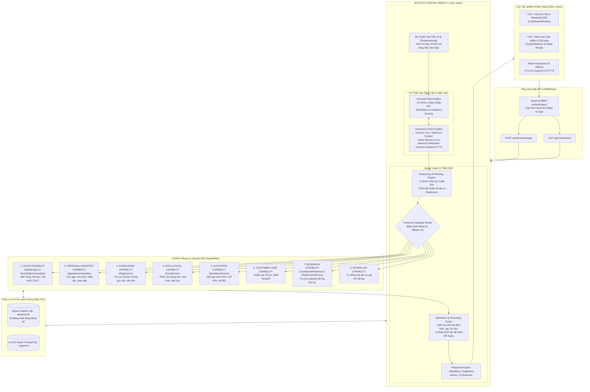

# THIẾT KẾ KIẾN TRÚC MỤC TIÊU: BOTCHAT BRAIN 2.1
## UNIVERSAL INTENT & CONTEXT ENGINE
## TÀI LIỆU 04 – BOTCHAT BRAIN 2.1 AUDIT & ARCHITECTURE DESIGN

> **Dự án:** BOTCHAT  
> **Nguyên tắc vàng:** ONE BRAIN – MANY CAPABILITIES – ONE BOTCHAT  
> **Cam kết:** Giữ nguyên tên BOTCHAT, giữ nguyên giao diện hai cột, giữ nguyên toàn bộ dữ liệu & nghiệp vụ bán hàng hiện hữu. Không tạo chatbot riêng rẽ.

---

## 1. NGUYÊN TẮC THIẾT KẾ KIẾN TRÚC MỤC TIÊU

BOTCHAT chuyển mình từ một bot tư vấn bán hàng đơn thuần thành **Nhân viên AI Đa năng (Universal AI Employee)** cho doanh nghiệp theo các trụ cột kiến trúc:

1. **Bộ não Trung tâm Thống nhất (Single Unified Central Brain):**
   - Chỉ một điểm điều phối trí tuệ duy nhất: `CentralBrainService`.
   - Toàn bộ các phân hệ: Sales, RAG tài liệu, Báo giá, Lịch hẹn, Xử lý Excel, Nghiên cứu Web đều là các **Năng lực (Capabilities)** được cắm vào Central Brain thông qua **Capability Router**.
2. **Phi tập trung hóa Sales Engine (Decoupled Sales Engine):**
   - `SalesEngine` không còn là "thùng rác hứng mặc định" (Default Sink) cho mọi câu hỏi không xác định.
   - `SalesEngine` chỉ được kích hoạt khi và chỉ khi `IntentEngine` xác nhận có ý định thương mại thực tế (`PRODUCT_INQUIRY`, `PRICE_INQUIRY`, `ORDER_REQUEST`,...).
3. **Động cơ Ngữ cảnh Hợp nhất (Universal Context Engine):**
   - Lưu trữ và duy trì ngữ cảnh xuyên suốt các lượt hội thoại (Multi-turn Context).
   - Giải quyết các tham chiếu đại từ ("ngày đó", "sản phẩm này", "người ấy", "buổi chiều nhé").
4. **Cơ chế Bảo vệ & Xác thực Hai Lớp (Grounding & Action Gates):**
   - Các hành động có tác động thực tế (đặt lịch hẹn, gửi email, chốt đơn hàng, xóa bộ nhớ) bắt buộc phải có cơ chế xác nhận (`requiresConfirmation: true`) và kiểm soát phân quyền (RBAC/Tenant).

---

## 2. SƠ ĐỒ THÀNH PHẦN KIẾN TRÚC MỤC TIÊU (TARGET COMPONENT TOPOLOGY)

---

## 3. LUỒNG THỰC THI 11 BƯỚC THỐNG NHẤT (END-TO-END UNIFIED PIPELINE)

Mọi tương tác từ người dùng đều trải qua quy trình 11 bước nghiêm ngặt:

| Bước | Tên Giai Đoạn | Thành phần Xử lý | Hành vi Cụ thể |
| :---: | :--- | :--- | :--- |
| **1** | Nhận yêu cầu | `API Gateway` | Tiếp nhận message, clientDevice, customerInfo từ phiên xác thực an toàn. |
| **2** | Tiền xử lý & Chuẩn hóa | `Preprocessing` | Tách dấu, khử từ lóng, bóc tách thực thể số/người/thời gian mà không làm hỏng mã model. |
| **3** | Nhận diện ý định | `Universal Intent Engine` | Phân loại vào 24 nhóm intent, xác định `primaryIntent`, `secondaryIntents`, `confidence`. |
| **4** | Lấy & Giải quyết Ngữ cảnh | `Universal Context Engine` | Truy xuất lịch sử đa lượt, giải quyết tham chiếu ("ngày đó", "loại này"), đồng bộ profile. |
| **5** | Xác định mục tiêu người dùng | `Reasoning Engine` | Phân biệt rõ: Người dùng muốn *Hỏi*, muốn *Biết*, hay muốn *Thực hiện hành động*. |
| **6** | Kiểm tra dữ liệu còn thiếu | `Data Sufficiency Check` | Nếu thiếu tham số cốt lõi (ví dụ hẹn gặp thiếu thời gian), ưu tiên đặt **01 câu hỏi làm rõ duy nhất**. |
| **7** | Lập kế hoạch thực hiện | `Reasoning Engine` | Tạo chuỗi bước thực thi nội bộ (Internal Plan), KHÔNG hiển thị chuỗi suy nghĩ CoT cho khách. |
| **8** | Kiểm tra quyền & Phân quyền | `Security & Tenant Gate` | Kiểm tra quyền tenant (`orgId`), quyền người dùng; kích hoạt cờ `requiresConfirmation` nếu có tác động thực tế. |
| **9** | Chọn năng lực & Công cụ | `Capability Router` | Định tuyến chính xác đến 1 trong 8 Capabilities. Tuyệt đối không gọi Sales cho câu hỏi phi bán hàng. |
| **10** | Kiểm chứng kết quả | `Verification Engine` | Kiểm tra Link liveness (HTTP 200), kiểm tra căn cứ dữ liệu (Grounding), kích hoạt `guardOffTopic`. |
| **11** | Phản hồi & Điều khiển UI | `Response Engine` | Đóng gói JSON kèm Markdown, Citations, Suggested Action Chips, và chỉ thị đóng/mở Cột 2 (`revealCatalog`). |

---

## 4. BẢO TỒN VÀ KẾ THỪA TOÀN BỘ NGHIỆP VỤ BÁN HÀNG

- Toàn bộ mã nguồn `SalesEngine.js` được giữ nguyên vẹn 100%.
- Khi `Capability Router` nhận diện các ý định mua sắm (`PRODUCT_INQUIRY`, `PRICE_INQUIRY`, `ORDER_REQUEST`), `SalesEngineAdapter` sẽ được kích hoạt với đầy đủ năng lực:
  - Báo giá niêm yết chính xác từ Database.
  - Phân loại bảo hành theo tính chất: Điện máy có bảo hành 12-36 tháng; Đồ ăn/uống (trà) cam kết 100% chính hãng, Date mới, 1 đổi 1 trong 7 ngày.
  - Quy trình 7 bước đặt hàng mượt mà, tự động thu gọn Cột 2 khi khách cung cấp thông tin.
  - Ghi nhận Lead chuẩn xác vào bảng `leads` và `lead_activities`.
