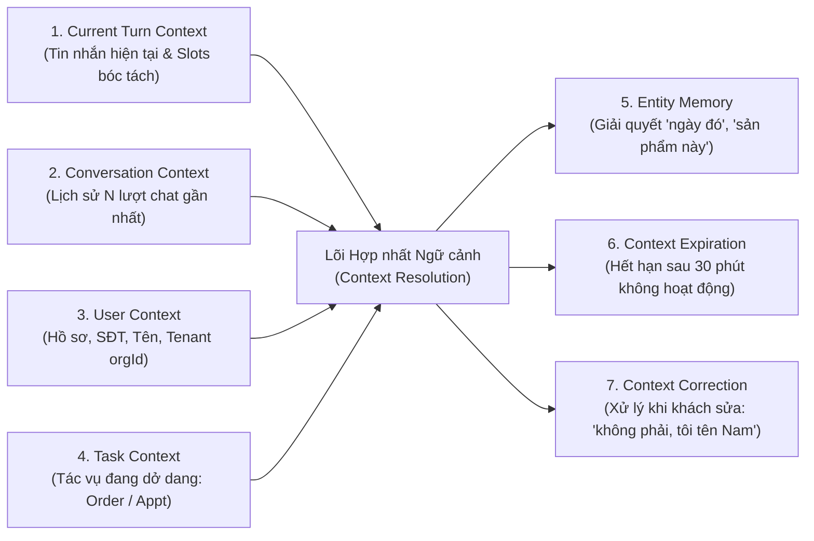

# ĐẶC TẢ UNIVERSAL INTENT & CONTEXT ENGINE
## TÀI LIỆU 05 – BOTCHAT BRAIN 2.1 AUDIT & ARCHITECTURE DESIGN

> **Dự án:** BOTCHAT  
> **Phiên bản thiết kế:** 2.1-Universal  
> **Nhiệm vụ:** Chuẩn hóa 24 nhóm ý định, cấu trúc dữ liệu phân loại thống nhất và mô hình quản lý ngữ cảnh đa lượt.

---

## 1. DANH MỤC 24 NHÓM Ý ĐỊNH CHUẨN HÓA (CANONICAL INTENT TAXONOMY)

Toàn bộ các tương tác của người dùng với BOTCHAT được ánh xạ vào 24 nhóm ý định độc lập:

| STT | Mã Ý Định (Intent Code) | Tên Ý Định | Định nghĩa & Phạm vi xử lý | Capability Phụ trách |
| :---: | :--- | :--- | :--- | :--- |
| 1 | `GENERAL_CHAT` | Trò chuyện thông thường | Giao tiếp xã hội, tán gẫu, hỏi thăm, tâm sự, đùa vui. | `PERSONAL_ASSISTANT` |
| 2 | `GREETING` | Chào hỏi mở đầu | "Xin chào", "Hi", "Hello", chào buổi sáng/tối. | `PERSONAL_ASSISTANT` |
| 3 | `IDENTITY` | Hỏi về BOTCHAT | "Bạn là ai?", "Em tên gì?", "Do ai tạo ra?", tính năng của bot. | `PERSONAL_ASSISTANT` |
| 4 | `PRODUCT_INQUIRY` | Hỏi thông tin sản phẩm | Hỏi giá, tính năng, thông số, so sánh thông số kỹ thuật. | `SALES` |
| 5 | `SALES` | Tư vấn giải pháp mua hàng | Tư vấn theo nhu cầu, theo ngân sách, chọn mẫu phù hợp. | `SALES` |
| 6 | `QUOTATION` | Lập báo giá chính thức | Yêu cầu bảng báo giá, tính toán số lượng lớn, chiết khấu, VAT. | `QUOTATION` |
| 7 | `ORDER` | Đặt mua hàng | "Lấy cho tôi cái này", chốt số lượng, cung cấp thông tin giao nhận. | `SALES` |
| 8 | `CUSTOMER_SUPPORT` | Hỗ trợ sau bán hàng | Chính sách bảo hành, hướng dẫn sử dụng, địa chỉ trung tâm bảo hành. | `CUSTOMER_CARE` |
| 9 | `COMPLAINT` | Tiếp nhận khiếu nại | Phản ánh sản phẩm lỗi, dịch vụ chậm trễ, yêu cầu đổi trả. | `CUSTOMER_CARE` |
| 10 | `KNOWLEDGE_QUERY` | Tra cứu kiến thức chung | Hỏi khái niệm, kiến thức ngành, câu hỏi bách khoa. | `KNOWLEDGE` |
| 11 | `DOCUMENT_TASK` | Tra cứu tài liệu nội bộ | Tìm kiếm quy chế, quyết định, công văn, sổ tay quy trình công ty. | `KNOWLEDGE` |
| 12 | `EXCEL_ANALYSIS` | Phân tích bảng tính | Tính tổng, lọc số liệu doanh thu, đọc dữ liệu từ file Excel tải lên. | `DATA` |
| 13 | `DATA_ANALYSIS` | Phân tích dữ liệu & KPI | Thống kê số lượng, so sánh tỷ trọng, trích xuất biểu đồ số liệu. | `DATA` |
| 14 | `WEB_RESEARCH` | Nghiên cứu Internet | Tìm kiếm tin tức bên ngoài, tra cứu giá thị trường, thời tiết. | `RESEARCH` |
| 15 | `OFFICE_TASK` | Công việc hành chính | Soạn thảo biên bản, tóm tắt nội dung cuộc họp, lập form mẫu. | `OFFICE` |
| 16 | `EMAIL_TASK` | Xử lý & Soạn email | Soạn thư gửi đối tác, phản hồi email khách hàng, lập dự thảo thư. | `OFFICE` |
| 17 | `APPOINTMENT` | Hẹn gặp & Đặt lịch | Hẹn gặp anh Trí, hẹn ăn trưa, cà phê, đi nhậu, bàn công việc. | `PERSONAL_ASSISTANT` |
| 18 | `SCHEDULE_QUERY` | Tra cứu lịch trình | "Anh Trí ngày nào rảnh?", "Chiều mai có trống giờ không?". | `PERSONAL_ASSISTANT` |
| 19 | `REMINDER` | Nhắc việc & Thông báo | "Nhắc tôi 9h sáng mai họp", "Ghi nhớ giúp tôi lịch gọi lại". | `PERSONAL_ASSISTANT` |
| 20 | `TASK_MANAGEMENT` | Quản lý tiến độ tác vụ | Tạo todo list, kiểm tra trạng thái nhiệm vụ, phân công việc. | `WORKFLOW` |
| 21 | `WORKFLOW_EXECUTION` | Chạy quy trình tự động | Kích hoạt webhook, xuất file báo cáo, đồng bộ dữ liệu CRM. | `WORKFLOW` |
| 22 | `MEMORY_COMMAND` | Quản lý trí nhớ cá nhân | "Quên thông tin của tôi đi", "Nhớ số điện thoại của tôi". | `PERSONAL_ASSISTANT` |
| 23 | `STAFF_HANDOFF` | Chuyển gặp chuyên viên | "Cho tôi gặp nhân viên thật", "Gọi người hỗ trợ trực tiếp". | `CUSTOMER_CARE` |
| 24 | `UNKNOWN` | Chưa rõ ý định | Câu hỏi mơ hồ, câu quá ngắn không đủ dữ kiện để phân loại. | `REASONING` |

---

## 2. BẢNG ÁNH XẠ INTENT CŨ SANG INTENT MỚI (MIGRATION MAP)

Để bảo đảm 100% không làm gãy các kịch bản đang hoạt động:

| Intent Cũ trong Source | Ánh xạ sang 24 Intent Mới | Ghi chú tương thích |
| :--- | :--- | :--- |
| `PRODUCT_CONSULTATION` | `PRODUCT_INQUIRY` / `SALES` | Duy trì gọi `SalesEngineAdapter` |
| `PRICE_INQUIRY` | `PRODUCT_INQUIRY` (Sub: Price) | Duy trì tính năng báo giá niêm yết DB |
| `TECH_SPECS` | `PRODUCT_INQUIRY` (Sub: Specs) | Duy trì tính năng tra cứu cấu hình chi tiết |
| `PRODUCT_COMPARISON` | `PRODUCT_INQUIRY` (Sub: Compare) | Duy trì tính năng so sánh sản phẩm |
| `ORDER_REQUEST` | `ORDER` | Duy trì luồng đặt hàng 7 bước |
| `FORMAL_QUOTATION` | `QUOTATION` | Duy trì tạo bảng báo giá VAT 10% |
| `INTERNAL_DOCUMENT_RAG` | `DOCUMENT_TASK` | Duy trì tìm kiếm văn bản nội bộ |
| `EXCEL_CALCULATION` | `EXCEL_ANALYSIS` | Duy trì tra cứu dữ liệu sheet Excel |
| `INTERNET_SEARCH` | `WEB_RESEARCH` | Duy trì WebSearchService (loại trừ DuckDuckGo) |
| `POLICY_INQUIRY` | `CUSTOMER_SUPPORT` (Sub: Policy) | Duy trì phân biệt bảo hành thực phẩm vs điện máy |
| `STAFF_HANDOFF` | `STAFF_HANDOFF` | Duy trì xin SĐT tạo Lead nóng |
| `MEMORY_COMMAND` | `MEMORY_COMMAND` | Duy trì lệnh `forgetCustomer` |
| `APPOINTMENT` | `APPOINTMENT` | Mới chuẩn hóa trong Brain 2.1 |
| `SCHEDULE_QUERY` | `SCHEDULE_QUERY` | Mới chuẩn hóa trong Brain 2.1 |
| `REMINDER` | `REMINDER` | Mới chuẩn hóa trong Brain 2.1 |
| `GENERAL_CHAT` | `GENERAL_CHAT` | Mới chuẩn hóa trong Brain 2.1 |

---

## 3. CẤU TRÚC DỮ LIỆU PHÂN LOẠI THỐNG NHẤT (UNIFIED INTENT DATA SCHEMA)

Mọi lượt phân loại từ `IntentEngine` đều trả về cấu trúc JSON chuẩn hóa:

```json
{
  "primaryIntent": "APPOINTMENT",
  "secondaryIntents": [
    { "intent": "SCHEDULE_QUERY", "confidence": 0.82 }
  ],
  "confidence": 0.95,
  "entities": {
    "targetPerson": "Quang Nhựt Trí",
    "activity": "đi nhậu",
    "timeSpec": "ngày mai",
    "phone": "0982441446",
    "productName": null,
    "modelCode": null,
    "quantity": null,
    "budget": null
  },
  "slots": {
    "productName": null,
    "modelCode": null,
    "targetPerson": "anh Trí",
    "appointmentActivity": "đi nhậu",
    "timeSpec": "ngày mai",
    "phone": "0982441446"
  },
  "conversationContext": {
    "previousIntent": "GREETING",
    "activeTopic": "APPOINTMENT_SCHEDULING",
    "turnIndex": 2,
    "referenceSubject": "anh Trí"
  },
  "requiredInformation": ["targetPerson", "activity", "timeSpec", "phone"],
  "missingInformation": ["timeSpec"],
  "suggestedAction": "CLARIFY_TIME",
  "selectedCapability": "PERSONAL_ASSISTANT",
  "riskLevel": "LOW",
  "requiresConfirmation": false
}
```

---

## 4. ĐẶC TẢ CONTEXT ENGINE (MULTI-TURN ARCHITECTURE)

Hệ thống quản lý ngữ cảnh đa lượt gồm 8 thành phần:



### 4.1. Giải quyết Tham chiếu Đại từ (Co-reference Resolution)
Khi khách hàng nhắn câu ngắn hoặc đại từ thay thế:
- *"Thứ Sáu được không?"* $\rightarrow$ Context Engine đối chiếu `activeTopic === 'APPOINTMENT'` và điền `timeSpec = "Thứ Sáu"` vào cuộc hẹn với anh Trí.
- *"Vậy đặt ngày đó nhé"* $\rightarrow$ Context Engine giải quyết `"ngày đó"` thành giá trị `timeSpec` vừa ghi nhận ở lượt trước (`Thứ Sáu`).
- *"Máy này bao nhiêu tiền?"* $\rightarrow$ Context Engine lấy `selectedProduct` hoặc sản phẩm đang hiển thị ở đầu danh sách Cột 2.

### 4.2. Thời hạn Ngữ cảnh (Context TTL & Expiration)
- **Active Window:** 30 phút kể từ tin nhắn cuối cùng.
- Nếu người dùng quay lại sau 2 giờ: Ngữ cảnh tác vụ tạm thời (`taskContext`) sẽ được làm mới, nhưng thông tin hồ sơ người dùng (`userContext` gồm tên, SĐT) vẫn được giữ lại từ bảng `ai_customer_memory`.

### 4.3. Cơ chế Khách hàng Đính chính (Context Correction)
- Khi khách hàng nhắn câu phủ định ngữ cảnh: *"Không phải, tôi hỏi laptop chứ không phải máy in"* hoặc *"Tôi tên Nam chứ không phải tên Trí"*.
- Context Engine lập tức hủy bỏ đối tượng tham chiếu cũ (`entityMemory`), cập nhật lại thông tin mới và điều chỉnh luồng định tuyến ngay lập tức.
