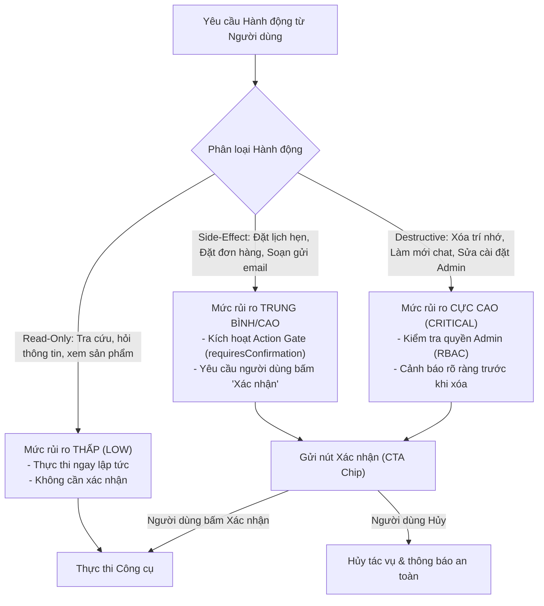

# MA TRẬN ĐIỀU HƯỚNG NĂNG LỰC & PHÂN QUYỀN (CAPABILITY ROUTING & ACCESS GATES)
## TÀI LIỆU 06 – BOTCHAT BRAIN 2.1 AUDIT & ARCHITECTURE DESIGN

> **Dự án:** BOTCHAT  
> **Nguyên tắc cốt lõi:**  
> 1. Chỉ gọi Sales khi thực sự có nhu cầu mua hàng / hỏi sản phẩm.  
> 2. Tuyệt đối không gọi Sales Engine cho `GENERAL_CHAT` hay câu hỏi cuộc hẹn.  
> 3. Không dùng RAG tràn lan nếu không hỏi văn bản nội bộ.  
> 4. Không gọi Internet nếu dữ liệu nội bộ đã đáp ứng.  
> 5. Mọi hành động có tác động thực tế phải có xác nhận (`requiresConfirmation`).

---

## 1. MA TRẬN ĐỊNH TUYẾN 8 NHÓM NĂNG LỰC (CAPABILITY ROUTING MATRIX)

| Mã Nhóm | Năng lực (Capability) | Các Intent Kích hoạt | Công cụ Thực thi (Tools) | Nguồn Dữ liệu Truy vấn | Điều kiện Kích hoạt Bắt buộc |
| :---: | :--- | :--- | :--- | :--- | :--- |
| **A** | **SALES** | `PRODUCT_INQUIRY`, `SALES`, `ORDER` | `consult_sales_engine`, `smart_sales_consultant`, `smart_order_flow` | Bảng `products`, `product_prices`, `product_attributes` | Tin nhắn có tên sản phẩm, mã model, ngân sách, hoặc ý định mua sắm rõ ràng. |
| **B** | **KNOWLEDGE** | `KNOWLEDGE_QUERY`, `DOCUMENT_TASK` | `search_knowledge_base`, `rag_service` | Bảng `knowledge_documents`, `knowledge_chunks` | Người dùng hỏi rõ về quy chế, quy trình, công văn, văn bản nội bộ của doanh nghiệp. |
| **C** | **OFFICE** | `OFFICE_TASK`, `EMAIL_TASK` | `draft_office_document`, `compose_email_template` | Template văn bản, ngữ cảnh hội thoại | Người dùng yêu cầu soạn thảo văn bản, viết email đối tác, lập biên bản. |
| **D** | **DATA** | `EXCEL_ANALYSIS`, `DATA_ANALYSIS` | `query_excel_data`, `excel_parser` | Bảng `document_sheets`, `document_rows`, file `.xlsx` | Câu hỏi liên quan đến bảng tính Excel, tính tổng doanh thu, lọc số liệu. |
| **E** | **CUSTOMER CARE** | `CUSTOMER_SUPPORT`, `COMPLAINT`, `STAFF_HANDOFF` | `smart_policy_inquiry`, `smart_staff_handoff` | Bảng `faq_items`, `leads`, `lead_activities` | Khách yêu cầu bảo hành, khiếu nại dịch vụ, hoặc đòi gặp nhân viên trực tiếp. |
| **F** | **PERSONAL ASSISTANT** | `APPOINTMENT`, `SCHEDULE_QUERY`, `REMINDER`, `GENERAL_CHAT`, `GREETING`, `IDENTITY` | `appointment_handler`, `reminder_service`, `memory_engine` | Bảng `ai_customer_memory`, `bot_settings` | Giao tiếp thông thường, hẹn gặp anh Trí, hỏi lịch rảnh, nhờ nhắc việc. |
| **G** | **RESEARCH** | `WEB_RESEARCH` | `live_website_retrieval`, `search_web_internet` | Bảng `crawled_products`, `live_website_cache`, Google/Brave API | Người dùng yêu cầu rõ tra cứu ngoài Internet hoặc kiểm tra website nhà cung cấp. |
| **H** | **WORKFLOW** | `QUOTATION`, `TASK_MANAGEMENT`, `WORKFLOW_EXECUTION` | `generate_formal_quotation`, `workflow_engine` | Bảng `quotations`, `quotation_items`, API bên thứ 3 | Yêu cầu lập báo giá chính thức, đồng bộ CRM, kích hoạt webhook tự động. |

---

## 2. MA TRẬN PHÂN QUYỀN & CỔNG XÁC NHẬN (SECURITY & CONFIRMATION GATES)

Mọi hành động đều được phân loại theo mức độ rủi ro (Risk Level):

### Bảng Quy chuẩn Cổng Xác nhận Cụ thể:

| Hành vi Thực hiện | Cấp Quyền Yêu cầu | Cờ Xác nhận (`requiresConfirmation`) | Mô tả Hành vi Giao diện |
| :--- | :---: | :---: | :--- |
| **Tra cứu giá, thông số sản phẩm** | Anonymous / User | `false` | Trả lời trực tiếp, mở Cột 2 tự động. |
| **Tra cứu tài liệu quy chế nội bộ** | User thuộc Tenant | `false` | Trích dẫn nguồn tài liệu `[Nguồn: ...]`. |
| **Lập bảng báo giá tạm tính** | Anonymous / User | `false` | Xuất bảng Markdown chi tiết kèm VAT 10%. |
| **Xác nhận Đặt hàng (Tạo đơn)** | User (Cần Tên + SĐT) | **`true`** | Hiển thị tóm tắt đơn hàng & nút "Xác nhận Đặt Mua". |
| **Đặt lịch hẹn với anh Trí** | User (Cần SĐT + Ngày) | **`true`** | Thông báo chưa đồng bộ Calendar, hỏi xác nhận thông tin gửi anh Trí. |
| **Gửi Email / Gọi Webhook** | User có quyền | **`true`** | Hiển thị bản xem trước Email/Payload trước khi gửi. |
| **Xóa toàn bộ lịch sử chat (Reset)** | Anonymous / User | **`true`** | Hiển thị modal / nút "Xác nhận Làm mới cuộc trò chuyện". |
| **Xóa Trí nhớ Cá nhân (Forget)** | User sở hữu thông tin | `false` | Thực thi ngay lập tức để bảo vệ quyền riêng tư tuyệt đối. |
| **Thay đổi Cài đặt Hệ thống** | Admin (`requireAdmin`) | **`true`** | Yêu cầu xác thực JWT / Session Admin hợp lệ. |

---

## 3. NGUYÊN TẮC CÔ LẬP DOANH NGHIỆP (TENANT ISOLATION POLICIES)

1. **Không tin cậy `orgId` từ Client Payload:**
   - Client không được tự ý gửi chuỗi `orgId` tùy ý để truy vấn tài liệu.
   - `orgId` bắt buộc phải được giải mã từ phiên xác thực (JWT Token hoặc Signed Session Cookie) tại tầng middleware [server/middleware/authMiddleware.js](file:///d:/09-%20LAM%20APP%20KIEM%20TIEN/2027%20LAM%20CHATBOT%20BAN%20HANG/server/middleware/authMiddleware.js).
2. **Scoping bắt buộc trên mọi câu lệnh SQL:**
   - Mọi câu lệnh SELECT/INSERT/UPDATE trên các bảng `knowledge_documents`, `knowledge_chunks`, `leads`, `ai_customer_memory`, `orders` bắt buộc phải kèm mệnh đề:
     `WHERE org_id = ?`
3. **Chống rò rỉ chéo dữ liệu giữa các tổ chức:**
   - Nghiêm cấm tuyệt đối một khách hàng của Tenant A tra cứu được tài liệu nội bộ hoặc thông tin khách hàng của Tenant B.
