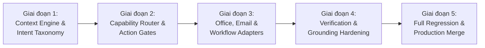

# KẾ HOẠCH TRIỂN KHAI VÀ LỘ TRÌNH NÂNG CẤP (IMPLEMENTATION ROADMAP)
## TÀI LIỆU 09 – BOTCHAT BRAIN 2.1 AUDIT & ARCHITECTURE DESIGN

> **Dự án:** BOTCHAT  
> **Giai đoạn tiếp theo (Sau khi phê duyệt thiết kế):** TRIỂN KHAI NÂNG CẤP MÃ NGUỒN  
> **Nguyên tắc triển khai:** Không commit trực tiếp lên `main`; thực hiện từng phase tuần tự, kiểm thử 100% trước khi chuyển phase.

---

## 1. LỘ TRÌNH 5 GIAI ĐOẠN TRIỂN KHAI (5-PHASE ROADMAP)



### Chi tiết các Giai đoạn:

### Giai đoạn 1: Xây dựng Context Engine & Chuẩn hóa 24 Nhóm Intent (Dự kiến: 2 ngày)
- **Mục tiêu:** Tách rời hoàn toàn việc bóc tách danh từ tham lam; tạo module quản lý ngữ cảnh đa lượt chuyên biệt.
- **Tập tin tác động:**
  - `server/services/intelligence/intentEngine.js` (Bổ sung 24 nhóm Intent, sửa regex `\b\d+\b` và ranh giới tiếng Việt).
  - `server/services/intelligence/contextEngine.js` (Tạo mới: Quản lý Current Turn, Conversation Context, User Profile, Task State, Co-reference Resolution).
- **Kiểm thử nghiệm thu Phase 1:** Chạy test case nhóm 1 (Trò chuyện) và nhóm 7 (Hội thoại đa lượt).

### Giai đoạn 2: Tái cấu trúc Capability Router & Cổng Xác nhận Hành động (Dự kiến: 2 ngày)
- **Mục tiêu:** Xóa bỏ cơ chế "mặc định rơi vào SalesEngine"; phân luồng 8 Capabilities rõ ràng.
- **Tập tin tác động:**
  - `server/services/centralBrainService.js` (Refactor luồng điều phối router, truyền đầy đủ conversation history vào LLM call).
  - `server/services/intelligence/reasoningEngine.js` (Cập nhật kế hoạch 11 bước).
  - `server/services/intelligence/responseEngine.js` (Hỗ trợ cờ `requiresConfirmation` và Action Chips).
- **Kiểm thử nghiệm thu Phase 2:** Chạy test case nhóm 3 (Đặt hàng & Báo giá) và nhóm 4 (Hẹn gặp & Lịch trình).

### Giai đoạn 3: Phát triển Adapters Hành chính & Soạn thảo (Dự kiến: 2 ngày)
- **Mục tiêu:** Mở rộng năng lực AI Employee: Soạn thảo biên bản, email phản hồi, tóm tắt báo cáo.
- **Tập tin tác động:**
  - `server/services/intelligence/officeAdapter.js` (Tạo mới: Xử lý template văn bản, email).
  - `server/services/intelligence/toolOrchestrator.js` (Đăng ký tools: `draft_office_document`, `compose_email_template`).
- **Kiểm thử nghiệm thu Phase 3:** Chạy test case nhóm 6 (Excel & Soạn thảo văn bản).

### Giai đoạn 4: Gia cố Kiểm chứng & Chống Trả lời Lạc đề (Dự kiến: 1.5 ngày)
- **Mục tiêu:** Tối ưu hóa Verification Engine: Kiểm tra grounding, loại trừ link rác, ngăn chặn triệt để rò rỉ giọng điệu bán hàng vào các câu hỏi nghiệp vụ khác.
- **Tập tin tác động:**
  - `server/services/intelligence/verificationEngine.js` (Mở rộng hàm `guardOffTopic`, kiểm tra căn cứ dữ liệu).
- **Kiểm thử nghiệm thu Phase 4:** Chạy test case nhóm 8 (Dữ liệu thiếu/mơ hồ) và nhóm 9 (Prompt Injection).

### Giai đoạn 5: Chạy Benchmark 100 Kịch bản & Sáp nhập Production (Dự kiến: 1.5 ngày)
- **Mục tiêu:** Thực thi toàn bộ bộ kiểm thử `tests/test_100_scenarios_benchmark.js`, đối chiếu độ trễ và tỷ lệ đạt $\ge 95\%$.
- **Tác vụ:**
  - Tạo PR từ nhánh `feature/botchat-brain-2.1-intent` vào `main`.
  - Phê duyệt và merge.

---

## 2. CÂY PHỤ THUỘC TẬP TIN (FILE DEPENDENCY TREE)

```
server/services/centralBrainService.js
  ├── server/services/intelligence/intentEngine.js
  │     └── server/services/intelligence/contextEngine.js (MỚI)
  ├── server/services/intelligence/reasoningEngine.js
  ├── server/services/intelligence/appointmentHandler.js
  ├── server/services/intelligence/officeAdapter.js (MỚI)
  ├── server/services/intelligence/smartSalesConsultant.js
  │     └── server/salesEngine.js (GIỮ NGUYÊN)
  ├── server/services/intelligence/toolOrchestrator.js
  │     ├── server/services/ragService.js
  │     ├── server/services/quotationService.js
  │     ├── server/services/parsers/excelParser.js
  │     └── server/services/webSearchService.js
  ├── server/services/intelligence/verificationEngine.js
  └── server/services/intelligence/responseEngine.js
```

---

## 3. KẾ HOẠCH DỰ PHÒNG & KHÔI PHỤC (ROLLBACK PLAN)

Trong trường hợp có bất kỳ lỗi hồi quy nghiêm trọng nào phát sinh trong quá trình thử nghiệm:
1. **Cô lập theo Git Branch:** Toàn bộ công việc thực hiện trên nhánh `feature/botchat-brain-2.1-intent`. Nhánh `main` trên production hoàn toàn không bị ảnh hưởng.
2. **Kế hoạch Rollback tức thì (Instant Rollback):**
   - Lệnh khôi phục: `git checkout main && git branch -D feature/botchat-brain-2.1-intent`.
   - Cơ sở dữ liệu SQLite `data/triai.db` được sao lưu bản backup: `data/triai.db.backup_before_brain2_1` trước khi thực hiện bất kỳ migration nào.
3. **Chuyển mạch mềm (Soft Feature Flag):**
   - Bổ sung biến môi trường `ENABLE_BRAIN_2_1=true/false` trong `.env`. Khi đặt `false`, hệ thống tự động quay về quy trình điều phối cũ của Brain 2.0 mà không cần restart máy chủ.
