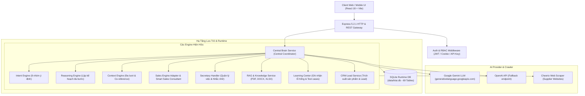

# BÁO CÁO KHẢO SÁT HIỆN TRẠNG KIẾN TRÚC BOTCHAT
**Mã tài liệu:** `ARCH-DOC-01`  
**Dự án:** BOTCHAT  
**Mục tiêu nâng cấp:** TRÍ AI – HUMAN BRAIN  
**Ngày thực hiện:** 24/11/2026  
**Đơn vị thực hiện:** Nhóm Kỹ sư Trí tuệ Nhân tạo & Kiến trúc sư Hệ thống  

---

## 1. TỔNG QUAN HỆ THỐNG HIỆN HỮU

BOTCHAT là hệ thống AI bán hàng & trợ lý doanh nghiệp đa năng (AI Sales & AI Secretary) đang hoạt động ổn định trên môi trường Node.js Backend và React Frontend, kết nối cơ sở dữ liệu SQLite cục bộ tại `data/triai.db`.

---

## 2. BẢNG KIỂM KÊ CÔNG NGHỆ VÀ MODULE HIỆN CÓ

| Thành phần | Công nghệ / Thư viện | Hiện trạng thực tế trong Source | Đánh giá năng lực |
|---|---|---|---|
| **Frontend Framework** | React 18.3.1 + Vite 5.2.0 | Cột 1 (Avatar 3D), Cột 2 (Product Selector), Cột 3 (Chat stream), Owner Dashboard | Hoạt động mượt mà, build production sạch (32s). |
| **Styling & Icons** | Tailwind CSS 3.4.3 + Lucide React | Giao diện Dark Cyberpunk Cyber-Valkyrie, Responsive | Đồng bộ, hiện đại. |
| **Backend Framework** | Node.js (ES Module) + Express 5.2.1 | `server/index.js` (930+ lines), RESTful APIs | Ổn định, có SSRF Protection, CORS whitelist. |
| **Cơ sở dữ liệu** | SQLite3 (`sqlite3` 6.0.1) | `data/triai.db` gồm **69 bảng dữ liệu**, WAL mode | Gọn nhẹ, toàn vẹn dữ liệu, giao dịch ACID an toàn. |
| **AI LLM Provider** | Google Gemini API (v1beta) | `server/geminiService.js` (Gemini Flash/Pro) | Cơ chế tự động thử model kế tiếp khi 404/503. |
| **LLM Fallback** | OpenAI API Compatible | `callOpenAI` trong `server/salesEngine.js` | Sẵn sàng fallback khi Gemini nghẽn mạng. |
| **File Parsers** | `pdf-parse`, `mammoth`, `xlsx` | `server/services/parsers/` | Hỗ trợ nạp tài liệu PDF, Word, Excel vào tri thức. |
| **Bán hàng & CRM** | `SalesEngine` & `CrmLeadService` | 46 leads, 67 báo giá, 14 sản phẩm nội bộ, 8 crawled | Bóc tách chính xác sản phẩm, brand, model, đơn hàng. |
| **Ý định & Ngữ cảnh** | `IntentEngine` & `ContextEngine` | 8 nhóm ý định, phân tích đa lượt, bảo toàn chủ thể | Không nhầm lẫn câu hỏi phi thương mại sang bán hàng. |
| **Trí nhớ hiện tại** | `ai_customer_memory` | Chỉ là bảng Key-Value đơn giản (69 records) | **CHƯA ĐẠT**: Chưa có trí nhớ sự kiện, tương lai, kỹ năng. |

---

## 3. CƠ SỞ DỮ LIỆU RUNTIME HIỆN HỮU (`data/triai.db`)

Cơ sở dữ liệu thực tế tại `data/triai.db` gồm **69 bảng**. Các bảng nghiệp vụ cốt lõi:

1. **Người dùng & Phân quyền:**
   - `users`: 60 dòng (`id, email, password_hash, full_name, role, plan, is_active, created_at, updated_at`).
   - `roles`: 2 dòng (`owner`, `customer`, `staff`).
   - `user_roles`: Ánh xạ người dùng - vai trò.

2. **Hội thoại & Lịch sử chat:**
   - `conversations`: 967 phiên (`id, user_id, agent_id, skill_id, title, is_archived, last_message_at, created_at, updated_at`).
   - `messages`: 1,234 tin nhắn (`id, conversation_id, sender_type, sender_id, content, metadata_json, created_at`).

3. **Bán hàng & CRM:**
   - `leads`: 46 khách hàng tiềm năng (`id, customer_name, phone, email, product_id, product_name, quantity, customer_requirement, conversation_id, website_source, widget_id, consent_to_contact, created_time, lead_status, notes, updated_at, brand, model, products_json, conversation_summary`).
   - `lead_activities`: Lịch sử tương tác Lead.
   - `products`: 14 sản phẩm nội bộ đã phê duyệt.
   - `crawled_products`: 8 sản phẩm thu thập từ website nhà cung cấp.
   - `quotations`: 67 bảng báo giá chính thức kèm `quotation_items`.

4. **Trí nhớ & Bảo mật hiện tại:**
   - `ai_customer_memory`: 69 bản ghi (`id, user_id, org_id, memory_type, key, value, confidence, is_approved, created_at, updated_at, expires_at`).
   - `owner_tasks`: 25 công việc của Chủ nhân (`id, user_id, title, description, time_spec, priority, status, created_at, updated_at`).
   - `secretary_notes`: Ghi chú & bản thảo email của thư ký.
   - `ai_security_audit_logs`: 22 nhật ký ngăn chặn giả mạo Owner / vi phạm phân quyền.
   - `ai_tool_telemetry`: 95 log theo dõi chi phí và thời gian chạy công cụ.

5. **Tri thức & Học hỏi (RAG):**
   - `knowledge_documents` (15 files) & `knowledge_chunks` (243 chunks).
   - `unanswered_questions`: 53 câu hỏi chưa trả lời được ghi nhận tự động.
   - `ai_test_cases`: 9 ca kiểm thử tự động.

---

## 4. ĐÁNH GIÁ ĐIỂM MẠNH VÀ NHỮNG KHOẢNG TRỐNG CẦN NÂNG CẤP

### 4.1. Điểm mạnh cần bảo toàn nguyên vẹn
1. **Sales Engine hoàn chỉnh:** Quy trình tư vấn, xem sản phẩm Cột 2, giỏ hàng, đặt hàng từng bước, lưu CRM chuẩn xác.
2. **Hạ tầng RAG & Tri thức sẵn sàng:** Đã có hệ thống băm tài liệu, vector/hybrid keyword search, quản lý website crawler.
3. **Intent & Context Engine 2.1:** Đã phân định rõ ranh giới giữa Bán hàng, Thư ký, Trò chuyện và Nghiên cứu dữ liệu.
4. **Cơ sở dữ liệu ổn định:** Dữ liệu thực của Chủ nhân và khách hàng được lưu trữ an toàn trong SQLite, có cơ chế migration tuần tự không phá hủy.

### 4.2. Những khoảng trống kiến trúc đối chiếu với TRÍ AI – HUMAN BRAIN
1. **Trí nhớ còn phân mảnh (Fragmented Memory):**
   - Hiện tại mới chỉ có bảng `ai_customer_memory` lưu Key-Value đơn giản (ví dụ: `favorite_brand=Glory`).
   - Thiếu cấu trúc **5 tầng trí nhớ người**:
     - *Working Memory* (chưa có bộ đệm mục tiêu phiên).
     - *Episodic Memory* (chưa có lưu vết sự kiện thời gian thực kèm ngữ cảnh, địa điểm, quyết định).
     - *Semantic Memory* (chưa có đồ thị liên kết thực thể con người - tổ chức - sản phẩm).
     - *Procedural Memory* (chưa lưu quy trình xử lý và kinh nghiệm đã được chứng minh).
     - *Prospective Memory* (mới có `owner_tasks` đơn giản, chưa liên kết cam kết trong chat với bộ đếm thời hạn).
2. **Thiếu cơ chế củng cố trí nhớ (Memory Consolidation) & Quên thông minh:**
   - Chưa có thuật toán đánh giá độ tin cậy của thông tin trước khi ghi nhớ.
   - Chưa có cơ chế phát hiện mâu thuẫn (Contradiction Detection) khi người dùng đưa thông tin mới khác thông tin cũ.
   - Chưa có phân cấp độ nhạy cảm dữ liệu (Data Sensitivity: Public, Internal, Confidential, Restricted).
3. **Giao diện Quản trị Trí nhớ chưa có:**
   - `OwnerDashboard.jsx` hiện mới có các tab: `leads`, `products`, `settings`, `knowledge`, `supplier_websites`, `brain_management`, `learning_center`.
   - Chưa có khu vực trực quan hóa trí nhớ: **Memory Center**, **Memory Timeline**, **Entity Graph**, **Reasoning Monitor**, **Task & Planning**.

---

## 5. KẾT LUẬN GIAI ĐOẠN KHẢO SÁT
Hệ thống BOTCHAT hiện tại có nền tảng vững chắc và rất phù hợp để nâng cấp tiến hóa thành **TRÍ AI – HUMAN BRAIN**. Việc nâng cấp sẽ tuân thủ nguyên tắc: **Một Central Brain – Tích hợp 5 Tầng Trí Nhớ – Bảo toàn 100% Sales Engine và Dữ liệu hiện có**.
