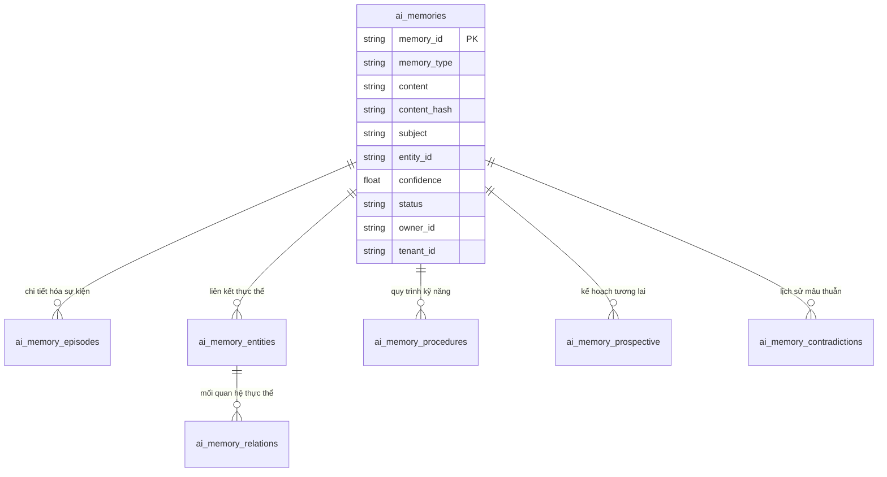

# THIẾT KẾ CƠ SỞ DỮ LIỆU & HỆ THỐNG TRÍ NHỚ 5 TẦNG
**Mã tài liệu:** `ARCH-DOC-04`  
**Dự án:** BOTCHAT -> TRÍ AI HUMAN BRAIN  
**Mục tiêu:** Xây dựng cấu trúc dữ liệu lưu trữ bền vững, tối ưu truy xuất, không trùng lặp và tương thích 100% với SQLite hiện hữu (`data/triai.db`).  

---

## 1. NGUYÊN TẮC THIẾT KẾ DỮ LIỆU BỘ NÃO

1. **Chuẩn hóa trường dữ liệu theo quy định:** Mỗi bản ghi ký ức bắt buộc có đầy đủ 16 trường chuẩn để định danh, xác minh nguồn gốc và phân loại độ nhạy cảm.
2. **Chống trùng lặp vô hạn (Deduplication via Content Hash):** Tạo giá trị băm SHA-256 cho nội dung cốt lõi của ký ức kết hợp thực thể; trước khi chèn mới, kiểm tra trùng lặp để chỉ tăng điểm củng cố (reinforcement count) thay vì chèn rác.
3. **Phát hiện mâu thuẫn (Contradiction Detection & History):** Khi người dùng cung cấp thông tin mới đối nghịch thông tin cũ (ví dụ: đổi ngân sách từ 10 triệu lên 20 triệu, đổi ngày hẹn), hệ thống ghi nhận trạng thái `SUPERSEDED` hoặc `CONFLICTING`, lưu lịch sử thay đổi vào bảng mâu thuẫn, tuyệt đối không âm thầm ghi đè.
4. **Không lưu trữ bí mật và thông tin nhạy cảm (Security by Design):** Bộ lọc tự động loại trừ mật khẩu, token, private key và mã thẻ ngân hàng khỏi việc ghi nhớ.
5. **Độc lập và không phá vỡ schema cũ:** Tất cả bảng mới sử dụng tiền tố `ai_memory_*`, không sửa đổi cấu trúc các bảng bán hàng hiện hữu (`products`, `quotations`, `leads`).

---

## 2. CẤU TRÚC BẢNG DỮ LIỆU CỐT LÕI (CORE MEMORY TABLE)

Bảng tổng hợp quản lý toàn bộ các bản ghi ký ức: `ai_memories`.

```sql
CREATE TABLE IF NOT EXISTS ai_memories (
  memory_id TEXT PRIMARY KEY,                       -- Định danh duy nhất (UUID)
  memory_type TEXT NOT NULL,                        -- WORKING, EPISODIC, SEMANTIC, PROCEDURAL, PROSPECTIVE
  content TEXT NOT NULL,                            -- Nội dung thông tin được ghi nhớ
  content_hash TEXT NOT NULL,                       -- Mã băm SHA-256 chống trùng lặp
  subject TEXT NOT NULL,                            -- Chủ đề chính (Sản phẩm, Khách hàng, Lịch hẹn,...)
  entity_id TEXT,                                   -- Mã thực thể liên kết nếu có (user_id, product_id, lead_id)
  source TEXT NOT NULL,                             -- USER_CHAT, DOCUMENT, AI_INFERENCE, SYSTEM_ACTION
  source_reference TEXT,                            -- ID tin nhắn, file tài liệu hoặc nguồn gốc chứng thực
  confidence REAL NOT NULL DEFAULT 1.0,             -- Độ tin cậy (0.0 - 1.0)
  status TEXT NOT NULL DEFAULT 'ACTIVE',            -- ACTIVE, CONSOLIDATED, CONFLICTING, SUPERSEDED, EXPIRED
  event_time TEXT,                                  -- Thời điểm sự kiện thực tế diễn ra (ISO 8601)
  created_at TEXT NOT NULL,                         -- Thời điểm AI ghi nhận ký ức
  updated_at TEXT NOT NULL,                         -- Thời điểm cập nhật ký ức
  owner_id TEXT NOT NULL DEFAULT 'owner_tri',       -- Người sở hữu hoặc phụ trách ký ức
  tenant_id TEXT NOT NULL DEFAULT 'org_default',    -- Mã tổ chức / doanh nghiệp (cô lập dữ liệu)
  sensitivity TEXT NOT NULL DEFAULT 'INTERNAL',     -- PUBLIC, INTERNAL, CONFIDENTIAL, RESTRICTED
  expiration_at TEXT,                               -- Thời điểm ký ức hết hạn (nếu có)
  reinforcement_count INTEGER DEFAULT 1,            -- Số lần ký ức được củng cố lặp lại
  last_accessed_at TEXT                             -- Thời điểm ký ức được truy xuất gần nhất
);

CREATE INDEX IF NOT EXISTS idx_ai_mem_type ON ai_memories(memory_type);
CREATE INDEX IF NOT EXISTS idx_ai_mem_entity ON ai_memories(entity_id);
CREATE INDEX IF NOT EXISTS idx_ai_mem_subject ON ai_memories(subject);
CREATE INDEX IF NOT EXISTS idx_ai_mem_tenant_owner ON ai_memories(tenant_id, owner_id);
CREATE INDEX IF NOT EXISTS idx_ai_mem_status ON ai_memories(status);
CREATE INDEX IF NOT EXISTS idx_ai_mem_hash ON ai_memories(content_hash);
CREATE INDEX IF NOT EXISTS idx_ai_mem_event_time ON ai_memories(event_time);
```

---

## 3. CÁC BẢNG CHUYÊN BIỆT CHO 5 TẦNG TRÍ NHỚ



### 3.1. Episodic Memory (Trí nhớ sự kiện): `ai_memory_episodes`
Lưu trữ các sự kiện cụ thể đã diễn ra trong quá khứ gắn với mốc thời gian, nhân vật và quyết định:
```sql
CREATE TABLE IF NOT EXISTS ai_memory_episodes (
  episode_id TEXT PRIMARY KEY,
  memory_id TEXT NOT NULL,
  conversation_id TEXT,
  participants_json TEXT NOT NULL,                  -- Danh sách người tham gia: ["Khách 0982441446", "TRÍ AI"]
  event_category TEXT NOT NULL,                     -- CONSULTATION, PRICE_QUOTATION, MEETING, COMPLAINT, ORDER
  summary TEXT NOT NULL,                            -- Tóm tắt sự việc
  outcome TEXT,                                     -- Kết quả đạt được (Chốt đơn, Chờ xem xét, Từ chối)
  location TEXT,                                    -- Địa điểm (Showroom, Online Chat, Zalo)
  created_at TEXT NOT NULL,
  FOREIGN KEY (memory_id) REFERENCES ai_memories(memory_id) ON DELETE CASCADE
);
CREATE INDEX IF NOT EXISTS idx_episodes_category ON ai_memory_episodes(event_category);
CREATE INDEX IF NOT EXISTS idx_episodes_conv ON ai_memory_episodes(conversation_id);
```

### 3.2. Semantic Memory (Trí nhớ kiến thức & Đồ thị thực thể): `ai_memory_entities` & `ai_memory_relations`
Lưu trữ các thực thể (Con người, Doanh nghiệp, Dòng máy) và mạng lưới liên kết giữa chúng:
```sql
CREATE TABLE IF NOT EXISTS ai_memory_entities (
  entity_id TEXT PRIMARY KEY,
  entity_name TEXT NOT NULL,                        -- Ví dụ: "Quang Nhựt Trí", "Nam Á Bank", "Brother HL-L6210DW"
  entity_type TEXT NOT NULL,                        -- PERSON, ORGANIZATION, PRODUCT, BRAND, TOPIC
  description TEXT,
  attributes_json TEXT,                             -- Các thuộc tính đặc trưng dạng JSON
  tenant_id TEXT NOT NULL DEFAULT 'org_default',
  created_at TEXT NOT NULL,
  updated_at TEXT NOT NULL
);
CREATE INDEX IF NOT EXISTS idx_entities_type_name ON ai_memory_entities(entity_type, entity_name);

CREATE TABLE IF NOT EXISTS ai_memory_relations (
  relation_id TEXT PRIMARY KEY,
  from_entity_id TEXT NOT NULL,                     -- Thực thể gốc
  relation_type TEXT NOT NULL,                      -- IS_OWNER_OF, WORKS_AT, INTERESTED_IN, SUPPLIES, REQUIRES
  to_entity_id TEXT NOT NULL,                       -- Thực thể đích
  strength REAL NOT NULL DEFAULT 1.0,               -- Độ gắn kết quan hệ
  confidence REAL NOT NULL DEFAULT 1.0,
  context TEXT,                                     -- Ngữ cảnh phát sinh quan hệ
  created_at TEXT NOT NULL,
  FOREIGN KEY (from_entity_id) REFERENCES ai_memory_entities(entity_id) ON DELETE CASCADE,
  FOREIGN KEY (to_entity_id) REFERENCES ai_memory_entities(entity_id) ON DELETE CASCADE
);
CREATE INDEX IF NOT EXISTS idx_rel_from ON ai_memory_relations(from_entity_id);
CREATE INDEX IF NOT EXISTS idx_rel_to ON ai_memory_relations(to_entity_id);
```

### 3.3. Procedural Memory (Trí nhớ kỹ năng & Quy trình): `ai_memory_procedures`
Lưu trữ phương pháp thực hiện công việc và kinh nghiệm tư vấn thành công:
```sql
CREATE TABLE IF NOT EXISTS ai_memory_procedures (
  procedure_id TEXT PRIMARY KEY,
  memory_id TEXT NOT NULL,
  procedure_name TEXT NOT NULL,                     -- "Quy trình tư vấn máy in văn phòng ngân hàng"
  trigger_condition TEXT NOT NULL,                  -- Khi khách hỏi máy in có bảo mật và in 2 mặt
  steps_json TEXT NOT NULL,                         -- Mảng JSON các bước hành động cụ thể
  success_rate REAL DEFAULT 1.0,                    -- Tỷ lệ thành công dựa trên phản hồi khách hàng
  usage_count INTEGER DEFAULT 1,                    -- Số lần đã áp dụng thành công
  is_verified INTEGER DEFAULT 1,                    -- Được Owner phê duyệt hay AI tự đúc kết
  created_at TEXT NOT NULL,
  updated_at TEXT NOT NULL,
  FOREIGN KEY (memory_id) REFERENCES ai_memories(memory_id) ON DELETE CASCADE
);
```

### 3.4. Prospective Memory (Trí nhớ tương lai & Cam kết): `ai_memory_prospective`
Ghi nhớ các cam kết, việc cần làm trong tương lai kèm thời hạn và điều kiện kích hoạt:
```sql
CREATE TABLE IF NOT EXISTS ai_memory_prospective (
  prospective_id TEXT PRIMARY KEY,
  memory_id TEXT NOT NULL,
  task_title TEXT NOT NULL,                         -- "Gọi lại cho anh Hoàng xác nhận số lượng máy đếm tiền"
  target_user_id TEXT NOT NULL,                     -- Người nhận việc (Owner / Staff)
  trigger_time TEXT NOT NULL,                       -- Thời điểm kích hoạt (ISO 8601)
  trigger_condition TEXT,                           -- Điều kiện phụ (sau khi có giá nhập mới,...)
  status TEXT NOT NULL DEFAULT 'PENDING',           -- PENDING, TRIGGERED, COMPLETED, CANCELLED
  priority TEXT NOT NULL DEFAULT 'NORMAL',          -- LOW, NORMAL, HIGH, URGENT
  notification_channel TEXT DEFAULT 'DASHBOARD',    -- DASHBOARD, EMAIL, ZALO
  created_at TEXT NOT NULL,
  completed_at TEXT,
  FOREIGN KEY (memory_id) REFERENCES ai_memories(memory_id) ON DELETE CASCADE
);
CREATE INDEX IF NOT EXISTS idx_prosp_trigger ON ai_memory_prospective(trigger_time, status);
```

### 3.5. Bảng Quản lý Mâu thuẫn (Contradiction Log): `ai_memory_contradictions`
Theo dõi khi thông tin mới đối nghịch thông tin cũ:
```sql
CREATE TABLE IF NOT EXISTS ai_memory_contradictions (
  contradiction_id TEXT PRIMARY KEY,
  entity_id TEXT,
  subject TEXT NOT NULL,
  old_memory_id TEXT NOT NULL,
  old_value TEXT NOT NULL,
  new_value TEXT NOT NULL,
  detection_reason TEXT NOT NULL,                   -- "Khách đổi số điện thoại từ 098... sang 091..."
  resolution_status TEXT NOT NULL DEFAULT 'RESOLVED_UPDATE', -- RESOLVED_UPDATE, PENDING_CONFIRMATION, REJECTED
  resolved_by TEXT NOT NULL DEFAULT 'AI_LOGIC',
  created_at TEXT NOT NULL,
  FOREIGN KEY (old_memory_id) REFERENCES ai_memories(memory_id)
);
```

---

## 4. QUY TRÌNH THỰC THI MIGRATION TĂNG TIẾN AN TOÀN

Khi Giai đoạn 2 được kích hoạt, file migration `server/migrations/schema_phase_human_brain_memory.js` sẽ:
1. Tạo các bảng trên bằng `CREATE TABLE IF NOT EXISTS`.
2. Tạo các index tối ưu hóa tìm kiếm.
3. Chạy script backfill an toàn chuyển các bản ghi cũ từ `ai_customer_memory` sang cấu trúc mới `ai_memories` với `memory_type = 'SEMANTIC'`.
4. Không xóa bảng cũ `ai_customer_memory`, giữ vai trò backup song song.
5. Có hàm `rollbackHumanBrainMemory(db)` sẵn sàng khi cần khôi phục.
