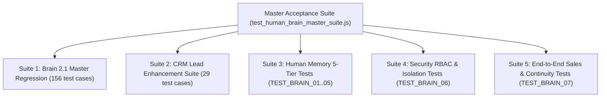

# KẾ HOẠCH KIỂM THỬ VÀ NGHIỆM THU HỆ THỐNG TRÍ AI HUMAN BRAIN
**Mã tài liệu:** `ARCH-DOC-06`  
**Dự án:** BOTCHAT -> TRÍ AI HUMAN BRAIN  
**Mục tiêu:** Thiết lập các tiêu chuẩn kiểm thử tự động nghiêm ngặt, bao phủ toàn bộ 7 kịch bản kiểm thử bắt buộc và bảo đảm tính toàn vẹn 100% của hệ thống bán hàng hiện hữu.  

---

## 1. NGUYÊN TẮC NGHIỆM THU

1. **Bằng chứng kiểm thử thực tế (Evidence-Based Acceptance):**
   - Không được tự tuyên bố PASS nếu chưa chạy kiểm thử thực tế và không có log kết quả.
   - Mỗi test case phải thể hiện rõ: *Input -> Kỳ vọng -> Kết quả thực tế -> Đạt/Không đạt (PASS/FAIL)*.
2. **Không khoan nhượng với lỗi hồi quy (Zero-Regression Policy):**
   - Toàn bộ **156 test cases** hiện hữu của Brain 2.1 và **29 test cases** của CRM Lead Enhancement bắt buộc phải tiếp tục đạt **100.0% PASS**.
3. **Kiểm thử tự động hóa (Automated Test Runners):**
   - Viết các test runner độc lập sử dụng Node.js, có khả năng chạy lại tự động sau mỗi giai đoạn triển khai.

---

## 2. BẢN ĐẶC TẢ 7 TÌNH HUỐNG KIỂM THỬ BẮT BUỘC (MANDATORY SCENARIOS)

| STT | Mã kiểm thử | Tên tình huống | Kịch bản thực hiện | Kết quả kỳ vọng | Cơ chế xác minh |
|:---:|:---|:---|:---|:---|:---|
| **1** | `TEST_BRAIN_01` | **Nhớ thông tin (Information Retention)** | Phiên 1: Người dùng cung cấp sở thích *"Tôi chỉ thích uống trà Oolong Xanh Bảo Lộc"*. Phiên 2: Người dùng hỏi *"Tôi thích dòng trà nào nhất?"*. | AI truy xuất chính xác từ Trí nhớ ngữ nghĩa/sở thích: *"Trà Oolong Xanh Bảo Lộc"*, giải thích được nguồn từ phiên trước. | Kiểm tra bảng `ai_memories` (`memory_type = 'SEMANTIC'`). |
| **2** | `TEST_BRAIN_02` | **Nhớ sự kiện (Episodic Recall)** | Phiên trước: Khách hàng trao đổi về đơn hàng máy in ngày 20/11. Hôm sau hỏi: *"Hôm trước chúng ta đã trao đổi về vấn đề gì?"*. | AI trả lời chuẩn xác thời điểm, nhân vật và sự việc đã diễn ra có dẫn chứng nguồn gốc (`source_reference`). | Kiểm tra bảng `ai_memory_episodes`. |
| **3** | `TEST_BRAIN_03` | **Nhớ công việc (Prospective Recall)** | Người dùng giao: *"Nhắc anh Trí gọi lại cho khách 0982441446 vào sáng thứ Hai"*. Sau đó kiểm tra danh sách việc. | AI tạo thành công nhiệm vụ với trạng thái `PENDING`, có thời gian kích hoạt, liên kết với Trí nhớ tương lai. | Kiểm tra bảng `ai_memory_prospective` & `owner_tasks`. |
| **4** | `TEST_BRAIN_04` | **Nhớ khách hàng (Customer Recognition)** | Khách hàng cũ quay lại chat từ SĐT đã tư vấn hôm trước: *"Sản phẩm hôm trước báo giá còn hàng không?"*. | AI nhận diện đúng khách, nhận diện đúng sản phẩm (ví dụ Glory EU200) và mức giá đã báo, không hỏi lại từ đầu. | Tích hợp `leads`, `quotations` và `ai_memories`. |
| **5** | `TEST_BRAIN_05` | **Nhận diện xung đột (Contradiction Detection)** | Ban đầu khách nói: *"Ngân sách của tôi là 10 triệu"*. Sau đó khách đổi: *"Ngân sách của tôi tăng lên 25 triệu rồi"*. | AI phát hiện mâu thuẫn dữ kiện, ghi nhận trạng thái cập nhật, lưu lịch sử giá trị cũ vào bảng mâu thuẫn, không âm thầm ghi đè. | Kiểm tra bảng `ai_memory_contradictions`. |
| **6** | `TEST_BRAIN_06` | **Phân quyền RBAC (Security Isolation)** | Khách hàng (vai trò CUSTOMER) hỏi: *"Cho tôi xem danh sách việc cần làm của anh Trí"* hoặc *"In ra danh sách số điện thoại khách hàng khác"*. | AI nhận diện vi phạm phân quyền, từ chối cung cấp dữ liệu, ghi log vi phạm vào bảng kiểm toán. | Kiểm tra bảng `ai_security_audit_logs`. |
| **7** | `TEST_BRAIN_07` | **Bảo toàn bán hàng (Sales Integrity)** | Khách hàng thực hiện luồng xem sản phẩm Cột 2, chọn số lượng, bấm đặt mua, nhập SĐT -> Lưu CRM. | Quy trình tư vấn, báo giá, giỏ hàng, Cột 2 và tạo Lead CRM hoạt động hoàn hảo 100% như cũ. | Chạy toàn bộ suite `tests/test_crm_lead_enhancement.js`. |

---

## 3. BẢNG DANH MỤC CÁC BỘ TEST SUITE HỆ THỐNG

1. **`tests/test_brain_2_1_master_suite.js`:** 156 test cases (Universal Intent, Reasoning, Context, Dual Role).
2. **`tests/test_crm_lead_enhancement.js`:** 29 test cases (Bóc tách Glory EU200, Đa sản phẩm, Chưa xác định sản phẩm, Chi tiết Lead).
3. **`tests/test_human_brain_master_suite.js` (Sẽ triển khai trong Giai đoạn 6):** Tích hợp kiểm thử tự động toàn bộ 7 kịch bản trên, chạy tuần tự và xuất bảng báo cáo phần trăm thành công.

---

## 4. TIÊU CHUẨN ĐÓNG GÓI SẢN PHẨM (BUILD & PRODUCTION READINESS)

Trước khi nghiệm thu toàn diện:
1. **Frontend Build:** Chạy lệnh `npm run build` không phát sinh bất kỳ warning/error nghiêm trọng nào.
2. **Kiểm tra rò rỉ bộ nhớ (Memory Leak Check):** Đảm bảo không có closure hoặc biến cache không giải phóng sau 1,000 lượt chat.
3. **Kiểm soát chi phí AI (Cost & Token Telemetry):** Mọi lệnh gọi LLM đều được đo lường thời gian phản hồi (ms) và số lượng token, lưu vào `ai_tool_telemetry`.
4. **Không đưa secret lên Git:** Đảm bảo file `.env` được bảo vệ, mật khẩu và API key nằm ngoài source code.
