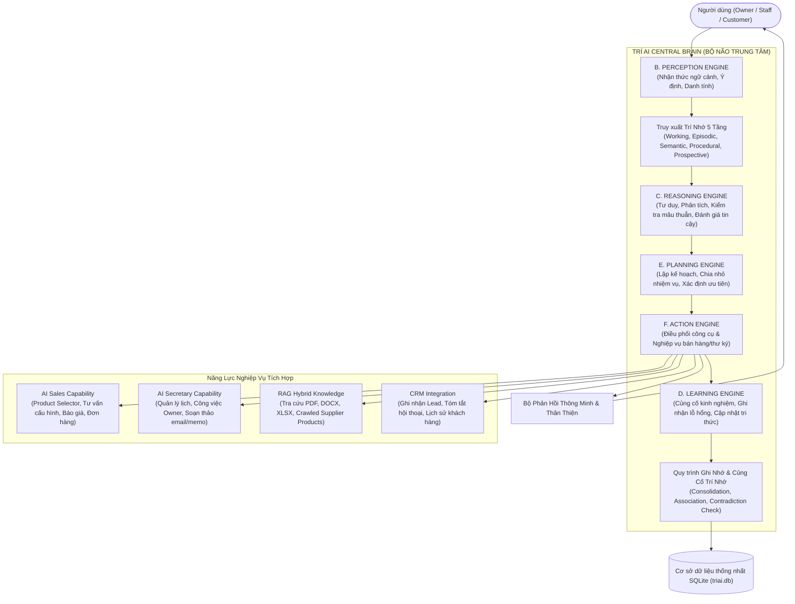
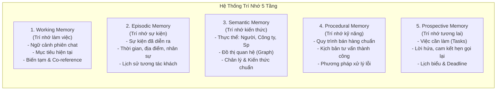
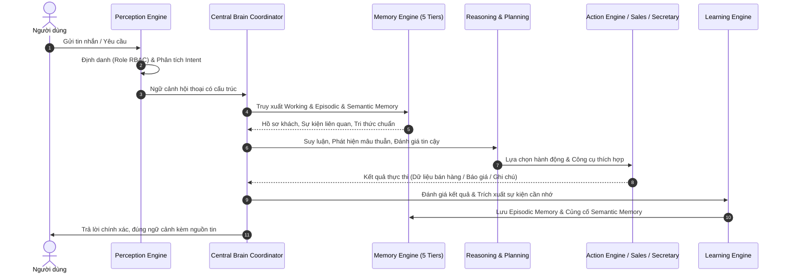

# THIẾT KẾ KIẾN TRÚC TỔNG THỂ: TRÍ AI – HUMAN BRAIN
**Mã tài liệu:** `ARCH-DOC-02`  
**Dự án:** BOTCHAT  
**Mục tiêu nâng cấp:** TRÍ AI – HUMAN BRAIN (Bộ não nhân tạo hoàn chỉnh)  
**Nguyên tắc tối thượng:** ONE BRAIN – MANY CAPABILITIES – ONE TRÍ AI  

---

## 1. TẦM NHÌN VÀ NGUYÊN TẮC KIẾN TRÚC

TRÍ AI – HUMAN BRAIN không phải là một chatbot thông thường chỉ biết sinh văn bản theo câu nhắc. Đây là một **Hệ Thống Trí Tuệ Nhân Tạo Có Nhận Thức và Trí Nhớ Bền Vững**, mô phỏng các vùng chức năng não bộ người:

1. **Ghi nhớ (Remembering):** Nhớ ngữ cảnh tức thời, nhớ sự kiện quá khứ, nhớ tri thức khái niệm, nhớ kỹ năng thực thi và nhớ các cam kết tương lai.
2. **Nhận thức (Perceiving):** Thấu hiểu ý định thật sự, ngữ cảnh nhiều phiên và danh tính người đối thoại.
3. **Tư duy (Reasoning):** Suy luận logic, kiểm tra mâu thuẫn dữ kiện, đánh giá độ tin cậy và lập kế hoạch hành động.
4. **Học hỏi (Learning):** Tiếp thu tri thức mới từ tài liệu, rút kinh nghiệm từ lỗi sai và củng cố ký ức thành công.
5. **Hành động (Acting):** Thực thi công việc được cấp quyền (Tư vấn bán hàng, Báo giá, Quản lý công việc, Soạn thảo văn bản) có kiểm soát an toàn.

---

## 2. SÁU CỖ MÁY CỐT LÕI CỦA TRÍ AI HUMAN BRAIN

### 2.1. CỖ MÁY 1: MEMORY ENGINE – HỆ THỐNG TRÍ NHỚ 5 TẦNG
Mô phỏng cấu trúc phân vùng trí nhớ của não bộ con người:

| Tầng trí nhớ | Tương đương sinh học | Chức năng trong TRÍ AI | Bảng dữ liệu phụ trách |
|---|---|---|---|
| **Working Memory** | Vỏ não trước trán (Prefrontal Cortex) | Lưu trữ mục tiêu phiên hiện hành, biến hội thoại ngắn hạn, danh tính tạm thời, theo dõi chủ thể ngữ cảnh. | `conversations`, `messages`, Session Cache |
| **Episodic Memory** | Hồi hải mã (Hippocampus) | Ghi lại các mốc sự kiện thực tế: "Khách gọi ngày 20/11 hỏi máy đếm tiền", "Cuộc họp sáng nay đã quyết định chốt báo giá". | `ai_memory_episodes`, `lead_activities` |
| **Semantic Memory** | Vỏ não thái dương (Temporal Cortex) | Lưu thực thể và quan hệ: Con người (Anh Trí là Owner), Tổ chức (Ngân hàng Nam Á), Sản phẩm (Brother HL-L6210DW là máy in 2 mặt). | `ai_memory_entities`, `ai_memory_relations`, `knowledge_chunks` |
| **Procedural Memory** | Hạch nền & Tiểu não (Basal Ganglia & Cerebellum) | Quy trình thao tác nghiệp vụ: Các bước tạo đơn hàng, quy trình xử lý khiếu nại, cách tư vấn khi khách chê giá đắt. | `ai_memory_procedures`, `sales_scenarios` |
| **Prospective Memory** | Mạng lưới hồi ức tương lai | Ghi nhớ việc cần làm trong tương lai: "Sáng mai 9h gọi lại cho khách 0982441446", "Nhắc anh Trí gửi báo giá thứ Sáu". | `owner_tasks`, `ai_memory_prospective` |

---

### 2.2. CỖ MÁY 2: PERCEPTION ENGINE – HỆ THỐNG NHẬN THỨC
Nhiệm vụ: Chuyển đổi dữ liệu thô từ người dùng thành biểu diễn nhận thức có cấu trúc:
- **Định danh người đối thoại:** Xác thực xem người dùng là `OWNER`, `STAFF` hay `CUSTOMER`.
- **Nhận thức ý định đa chiều (Universal Intent Classification):** Không phân loại đơn mục tiêu; nhận diện được các câu hỏi đa ý định (ví dụ: vừa chào hỏi, vừa hỏi máy đếm tiền, vừa hẹn lịch gặp).
- **Trích xuất thực thể & Tham chiếu ngữ cảnh (Co-reference Resolution):** Nhận biết "nó", "sản phẩm đó", "con máy vừa rồi" đang trỏ tới thực thể nào trong Working Memory.

---

### 2.3. CỖ MÁY 3: REASONING ENGINE – HỆ THỐNG TƯ DUY & SUY LUẬN
Mô phỏng tư duy logic cấp cao:
- **Kiểm tra tính nhất quán & Phát hiện mâu thuẫn (Contradiction Detection):** So sánh thông tin người dùng vừa nói với dữ kiện đã lưu trong trí nhớ. Nếu khách đổi số điện thoại hoặc đổi nhu cầu, ghi nhận sự thay đổi kèm lịch sử, không âm thầm ghi đè.
- **Xác minh nguồn tin & Độ tin cậy (Confidence & Provenance):** Phân biệt rõ thông tin từ văn bản nội bộ có trích dẫn (Độ tin cậy 1.0) với thông tin do AI phỏng đoán (Độ tin cậy < 0.7).
- **Biết hỏi lại khi thiếu dữ kiện (Active Listening):** Khi người dùng hỏi quá chung chung hoặc thiếu tham số cần thiết để hành động, AI chủ động đặt 1 câu hỏi làm rõ thay vì bịa đặt câu trả lời.

---

### 2.4. CỖ MÁY 4: LEARNING ENGINE – HỆ THỐNG HỌC HỎI & RÚT KINH NGHIỆM
- **Học từ tài liệu nạp vào:** Tự động phân tích cấu trúc văn bản PDF, Word, Excel, băm chunk và tạo chỉ mục tìm kiếm thông minh.
- **Học từ phản hồi người dùng:** Khi người dùng khen, chê hoặc đính chính thông tin, AI lưu vào `ai_memory_feedbacks` và `unanswered_questions`.
- **Cơ chế lão hóa & Hết hạn tri thức (Knowledge Expiration):** Kiến thức về bảng giá cũ hoặc chương trình khuyến mãi đã hết hạn sẽ tự động chuyển trạng thái `DEPRECATED` hoặc `EXPIRED`.

---

### 2.5. CỖ MÁY 5: PLANNING ENGINE – HỆ THỐNG LẬP KẾ HOẠCH
- **Phân rã mục tiêu (Goal Decomposition):** Nhận mục tiêu lớn của Chủ nhân (ví dụ: "Lập kế hoạch mua sắm thiết bị văn phòng cho chi nhánh mới") -> Tự động chia nhỏ thành các nhiệm vụ cụ thể: Khảo sát danh mục -> Tìm nhà cung cấp -> So sánh giá -> Tổng hợp báo giá -> Trình duyệt.
- **Theo dõi tiến độ & Nhắc việc:** Theo dõi trạng thái từng bước (`PENDING`, `IN_PROGRESS`, `COMPLETED`), tích hợp với Trí nhớ tương lai (Prospective Memory).

---

### 2.6. CỖ MÁY 6: ACTION ENGINE – HỆ THỐNG HÀNH ĐỘNG CÓ PHÂN QUYỀN
Hệ thống hành động kết nối các công cụ nghiệp vụ:
- **Nghiệp vụ Bán hàng (AI Sales):** Tìm kiếm danh mục, báo giá thời gian thực, quản lý giỏ hàng, đặt hàng từng bước, lưu Lead CRM.
- **Nghiệp vụ Thư ký (AI Secretary):** Tạo nhiệm vụ của Chủ nhân, soạn bản thảo email, ghi chú cuộc họp, tra cứu tài liệu mật.
- **Cơ chế Hàng rào Bảo vệ (Action Guardrail):** Các hành động làm thay đổi dữ liệu nhạy cảm hoặc gửi email ra bên ngoài bắt buộc phải có bước xác nhận từ Chủ nhân.

---

## 3. CHU TRÌNH NHẬN THỨC VÀ GHI NHỚ GIỐNG CON NGƯỜI

Chu trình xử lý một thông điệp trong TRÍ AI:

---

## 4. BẢO TOÀN VÀ TÍCH HỢP HỆ THỐNG BÁN HÀNG HIỆN HỮU

Kiến trúc TRÍ AI – HUMAN BRAIN kế thừa và nâng tầm toàn bộ chức năng bán hàng hiện hữu:
1. **Không can thiệp bảng `products` và `quotations` hiện tại:** Central Brain truy xuất trực tiếp các sản phẩm và bảng giá đã duyệt.
2. **Nâng cấp bảng `leads`:** Giữ nguyên các cột hiện tại, bổ sung liên kết thông minh với `Episodic Memory` để khi khách hàng quay lại sau nhiều ngày, AI lập tức nhớ được:
   - Khách tên gì, số điện thoại nào.
   - Lần trước đã hỏi máy in hay máy đếm tiền nào.
   - Đã được gửi báo giá bao nhiêu tiền.
   - Đang ở giai đoạn nào trong phễu bán hàng.
3. **Độc lập và an toàn:** Toàn bộ dữ liệu bộ não nhân tạo được tích hợp trong cơ sở dữ liệu `data/triai.db` hiện có thông qua các bảng mới với tiền tố rõ ràng `ai_memory_*`, không gây xung đột với bất kỳ module cũ nào.
