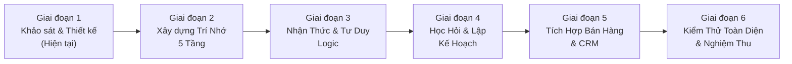

# LỘ TRÌNH TRIỂN KHAI NÂNG CẤP TỪNG GIAI ĐOẠN (UPGRADE ROADMAP)
**Mã tài liệu:** `ARCH-DOC-03`  
**Dự án:** BOTCHAT -> TRÍ AI HUMAN BRAIN  
**Chiến lược triển khai:** Tăng tiến, có kiểm soát, cô lập rủi ro, không phá vỡ tính năng hiện hữu  

---

## 1. NGUYÊN TẮC THỰC THI

1. **Kiểm soát từng giai đoạn (Staged Execution):** Chỉ chuyển sang giai đoạn tiếp theo khi giai đoạn trước đã được kiểm thử đạt 100% tiêu chí.
2. **Không sửa đổi database production trực tiếp:** Toàn bộ bảng mới và cột mới được tạo bằng migration tăng tiến an toàn (`CREATE TABLE IF NOT EXISTS`, `ALTER TABLE ... ADD COLUMN`).
3. **Bảo toàn chức năng bán hàng:** Mọi thay đổi đối với Central Brain phải có lớp kiểm thử hồi quy (Regression Test) đảm bảo luồng bán hàng Cột 2, giỏ hàng và CRM hoạt động bình thường.
4. **Kế hoạch Rollback rõ ràng cho từng bước:** Nếu có sự cố, hệ thống có thể quay trở về trạng thái ổn định trước đó ngay lập tức mà không làm mất dữ liệu.

---

## 2. LỘ TRÌNH 6 GIAI ĐOẠN CHI TIẾT

---

### GIAI ĐOẠN 1: KHẢO SÁT & THIẾT KẾ KIẾN TRÚC (ĐANG THỰC HIỆN)
- **Mục tiêu:**
  - Khảo sát mã nguồn, cơ sở dữ liệu thực tế, các engine hiện hữu.
  - Thiết lập bộ 6 tài liệu kiến trúc chuẩn mực.
  - Phân tích rủi ro và xác định phương án bảo toàn dữ liệu.
- **Sản phẩm bàn giao:**
  - `BOTCHAT_CURRENT_ARCHITECTURE.md`
  - `TRI_AI_HUMAN_BRAIN_ARCHITECTURE.md`
  - `UPGRADE_ROADMAP.md`
  - `DATABASE_MEMORY_DESIGN.md`
  - `SECURITY_AND_DATA_ISOLATION.md`
  - `TESTING_AND_ACCEPTANCE_PLAN.md`
- **Tác động mã nguồn:** **0% (Chưa can thiệp code, chỉ khảo sát và lập tài liệu)**.
- **Tiêu chí nghiệm thu:** Chủ dự án phê duyệt toàn bộ thiết kế kiến trúc trước khi code.

---

### GIAI ĐOẠN 2: XÂY DỰNG HỆ THỐNG TRÍ NHỚ 5 TẦNG (MEMORY ENGINE)
- **Mục tiêu:**
  - Phát triển cấu trúc dữ liệu và logic cho 5 tầng trí nhớ: Working, Episodic, Semantic, Procedural, Prospective.
  - Xây dựng cơ chế trích xuất và củng cố trí nhớ (Memory Consolidation).
  - Xây dựng cơ chế phát hiện mâu thuẫn (Contradiction Detection) và chống trùng lặp dữ liệu.
  - Xây dựng giao diện quản trị Memory Center và Memory Timeline trong `OwnerDashboard.jsx`.
- **Các file dự kiến tạo/sửa đổi:**
  - `server/migrations/schema_phase_human_brain_memory.js` (Tạo bảng trí nhớ 5 tầng).
  - `server/services/intelligence/humanMemoryEngine.js` (Module trí nhớ mới thay thế bản key-value cũ).
  - `server/services/intelligence/memoryConsolidationEngine.js` (Bộ lọc, củng cố và đánh giá độ tin cậy).
  - `server/routes/memoryRoutes.js` (API quản lý trí nhớ cho Admin).
  - `src/components/admin/MemoryCenter.jsx` & `MemoryTimeline.jsx` (Giao diện trực quan hóa ký ức).
- **Phương án Rollback:** Tắt cờ kích hoạt module trong `server/db.js`, hệ thống tự động quay lại `ai_customer_memory` cũ.

---

### GIAI ĐOẠN 3: NÂNG CẤP NHẬN THỨC VÀ TƯ DUY (PERCEPTION & REASONING)
- **Mục tiêu:**
  - Nâng cấp `ContextEngine` và `IntentEngine` hỗ trợ nhận thức ngữ cảnh hội thoại nhiều phiên.
  - Tích hợp `ReasoningEngine` với trí nhớ: Trước khi trả lời, AI truy xuất Working -> Episodic -> Semantic -> Procedural -> Prospective Memory.
  - Xây dựng cơ chế phát hiện thông tin thiếu và đặt câu hỏi làm rõ (Active Listening).
- **Các file dự kiến sửa đổi:**
  - `server/services/intelligence/contextEngine.js`
  - `server/services/intelligence/reasoningEngine.js`
  - `server/services/intelligence/verificationEngine.js`
- **Phương án Rollback:** Giữ nguyên các hàm adapter cũ, đảm bảo backward compatibility.

---

### GIAI ĐOẠN 4: HỌC HỎI VÀ LẬP KẾ HOẠCH (LEARNING & PLANNING)
- **Mục tiêu:**
  - Phát triển `PlanningEngine`: Khả năng nhận mục tiêu lớn từ Chủ nhân và phân rã thành các bước có thời hạn.
  - Liên kết nhiệm vụ (`owner_tasks`) với Trí nhớ tương lai (Prospective Memory) và nhắc việc tự động.
  - Tích hợp `ProceduralMemory`: Ghi nhớ kịch bản và phương pháp tư vấn đã kiểm chứng thành công.
- **Các file dự kiến tạo/sửa đổi:**
  - `server/services/intelligence/planningEngine.js`
  - `server/services/intelligence/proceduralMemoryEngine.js`
  - `src/components/admin/TaskPlanningCenter.jsx`

---

### GIAI ĐOẠN 5: TÍCH HỢP TOÀN DIỆN VỚI HỆ THỐNG BÁN HÀNG VÀ CRM
- **Mục tiêu:**
  - Kết nối Trí nhớ sự kiện (Episodic Memory) với hồ sơ khách hàng CRM và Sales Engine.
  - Khi khách hàng cũ quay lại, AI nhận biết ngay lịch sử: sản phẩm đã quan tâm, mức giá đã báo, các trao đổi gần nhất.
  - AI tiếp tục cuộc tư vấn mượt mà mà không bắt khách nhắc lại từ đầu.
  - Bảo toàn 100% dữ liệu sản phẩm, giá bán, giỏ hàng, báo giá và đơn hàng hiện hữu.
- **Các file dự kiến sửa đổi:**
  - `server/services/centralBrainService.js`
  - `server/salesEngine.js`
  - `server/services/crmLeadService.js`
  - `server/services/intelligence/smartSalesConsultant.js`

---

### GIAI ĐOẠN 6: KIỂM THỬ TOÀN DIỆN, ĐÓNG GÓI & NGHIỆM THU
- **Mục tiêu:**
  - Chạy toàn bộ 7 kịch bản kiểm thử bắt buộc (Nhớ thông tin, Nhớ sự kiện, Nhớ công việc, Nhớ khách hàng, Nhận diện xung đột, Phân quyền RBAC, Bảo toàn bán hàng).
  - Chạy bộ hồi quy kiểm tra rò rỉ bộ nhớ (Memory Leak Check) và chi phí token.
  - Build hoàn thiện giao diện frontend (`npm run build`).
  - Lập báo cáo nghiệm thu hoàn chỉnh trình Chủ dự án.
- **Các file kiểm thử:**
  - `tests/test_human_brain_master_suite.js` (Bộ test tổng hợp mới).
  - `tests/test_brain_2_1_master_suite.js` (156 test cũ vẫn phải đạt 100% PASS).
  - `tests/test_crm_lead_enhancement.js` (29 test CRM vẫn phải đạt 100% PASS).

---

## 3. BẢNG TỔNG HỢP TIẾN ĐỘ VÀ PHÂN BỔ TRÁCH NHIỆM

| Giai đoạn | Trách nhiệm chính | Sản phẩm đầu ra | Trạng thái |
|---|---|---|:---:|
| **Giai đoạn 1: Khảo sát & Thiết kế** | AI System Architect & Tech Lead | Bộ 6 tài liệu kiến trúc & Báo cáo khảo sát | ⏳ **ĐANG THỰC HIỆN** |
| **Giai đoạn 2: Hệ thống Trí nhớ 5 Tầng** | Memory Engineer & Database Engineer | Schema, Engine Trí nhớ, Memory Center UI | 📋 Chờ phê duyệt G1 |
| **Giai đoạn 3: Nhận thức & Tư duy** | AI Engineer & Backend Engineer | Reasoning Engine tích hợp Trí nhớ | 📋 Chờ phê duyệt G2 |
| **Giai đoạn 4: Học hỏi & Lập kế hoạch** | AI Engineer & Backend Engineer | Planning Engine & Prospective Memory | 📋 Chờ phê duyệt G3 |
| **Giai đoạn 5: Tích hợp Bán hàng & CRM** | Fullstack Engineer & Sales Engine Lead | Kết nối trí nhớ khách hàng với Sales/CRM | 📋 Chờ phê duyệt G4 |
| **Giai đoạn 6: Kiểm thử & Nghiệm thu** | QA Engineer & Security Engineer | Báo cáo kiểm thử 7 Test Cases & Build sạch | 📋 Chờ phê duyệt G5 |
